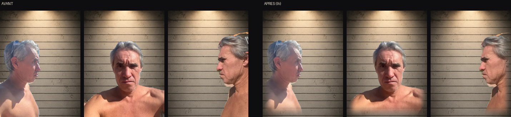

# PROGRESS — Bad Boys & Bad Girls

> À lire en premier à chaque session. Mis à jour à chaque étape significative.

## Phase en cours

**Phases 6 à 9 en production** (2026-11-04, par le conseiller) :
- **base** : 22 migrations appliquées sur `bad-boys-prod` (`hmmobtyherwuhrhymfbk`), texte exact des fichiers, historique aux versions des fichiers ; 201 fonctions et 27 politiques identiques à la preview ; détourage en lot désactivé (`photo_batch_allowed = false`) ;
- **code** : `phase-9` fusionnée dans `main` en avance rapide (`ef970c0`, le code de la CI n° 98) ;
- **déploiement** : Vercel de production prêt, sans erreur ;
- les scripts `supabase/scripts/prod-apply/` ont servi et sont devenus inutiles (voir leur README) ;
- reste ouverte : la décision 9-43 (bouton « ⋯ » des messages sur un vrai téléphone, test du porteur).

**Site en ligne** (2026-11-06, par le conseiller) : domaine `bad-boys8bad-girls.fr`, inscriptions ouvertes ; voir la section « Lancement ». Reste à faire : passer le cron d'e-mails de l'app de Brevo à Resend (sous-phase dédiée).

**Phase 10 close** (porteur, 2026-11-24) : **10a à 10h en production** (`main` = `7d3bd43`), toutes les décisions de la phase validées (10-1 à 10-55 ; 10-18 sans objet). Reste ouverte la **question 10-22** (changer d'e-mail et de mot de passe depuis Ma fiche : non codé).

**10i (fiche membre complète dans l'admin, 2026-11-24)** : faite sur `phase-10`, migration appliquée à la preview, décisions 10-56 à 10-63 à valider ; voir la section 10i. En attente de validation.

*Historique de cette section avant le 2026-11-04 :*

**Phase 5 terminée et en production** (2026-10-19) : fusionnée dans `main` (PR #12, `b00a8f7`) et déployée par le conseiller après vérification de la prod (36 migrations identiques aux fichiers, fonctions identiques à la preview, 0 table sans RLS, coffre vide hors poivre). Super admin de prod accordé au compte du porteur. **Phase 6 (Parloir sans horaire et Cavale) : validée par le conseiller** (2026-10-20 : cause réelle corrigée, CI n° 27 verte deux fois), décisions 6-1 à 6-14 validées ; en attente de la fusion (rien sur `main` ni sur la prod). **Phase 7 (modération, pilotage, tâches planifiées, RGPD, e-mails) : validée par le conseiller** (2026-10-20, décisions 7-1 à 7-43, trois réserves notées) ; preview à jour sauf le script 5 (indentation, à lancer avec psql). Rien sur `main` ni sur la prod. **Phase 8 (audit final) validée par le conseiller** (2026-10-22). **Phase 9 (éléments [P1]) terminée, en attente de la validation du conseiller** (2026-10-22, CI n° 55 verte : 70 tests e2e sur Pixel 7 et iPhone 14, aucun instable ; rapport dans la section Phase 9, décisions 9-1 à 9-4). Branche `phase-9`. **Phase 9e (photos sur le mur gradué, détourage obligatoire, décision finale du porteur du 2026-10-23)** : faite, décisions 9-5 à 9-13 à valider. **9f (vérification du conseiller sur la 9e)** : CI corrigée à la cause (limite gardée à 15 min, CI n° 66 verte deux fois, 0 instable), Fiche = planche de la référence, test anti-mesure tierce ; suppression des 3 branches `vercel/*` à faire par le porteur (refusée à la session) ; en attente de la vérification du conseiller. **9g (Fiche pancarte, décision du porteur du 2026-10-23)** : faite, décisions 9-14 à 9-19 à valider ; CI n° 69 verte deux fois ; en attente de la vérification du conseiller. **9h (Fiche v7, décision du porteur du 2026-10-24)** : faite sur `phase-9`, décisions 9-20 à 9-27 vérifiées par le conseiller (toutes validées sauf 9-24, refusée puis corrigée : le bouton suit la couleur de la personne connectée) ; CI n° 75 verte ; correctif 9-24 : CI n° 77 verte. **9i (pancarte plus basse, détourage MODNet chez le membre, redétourage de la preview)** : faite, décisions 9-23 (mise à jour) et 9-28 à 9-34 à valider ; CI n° 81 verte. **9k (valider au Greffe une photo non détourée, tirage agrafé sur la Fiche)** : faite, décisions 9-35 à 9-41 à valider ; CI n° 90 verte, sans test instable. **9l (Parloir, améliorations immédiates)** : faite, décisions 9-42 à 9-47 à valider ; CI n° 94 verte, sans test instable. **9l-ter (carte Cavale repliable)** : faite, décisions 9-48 à 9-50 à valider ; CI n° 96 verte. **9l-bis (vérification du conseiller)** : canal « … écrit » non contournable en public (test ajouté), canaux publics autorisés sur la preview ; voir la section 9l-bis. Rappel : le passage en prod des phases 6 à 9 se fera en une fois, après contrôle du conseiller. Phase 8 : (2026-10-20, CI n° 51 verte : 68 tests e2e sur Pixel 7 et iPhone 14, aucun instable) : rapport de fin de phase dans la section Phase 8, décisions 8-1 à 8-7 à valider, deux actions du porteur sur la preview (scripts 5 puis 6 avec psql ; mot de passe de 12 caractères dans Supabase Auth). Branche `phase-8`.

## Correctif : connexion et inscription plus claires (branche `hotfix/auth-ux`, depuis `main` après la fusion de `hotfix/captcha`, 2026-11-07)

Demande du conseiller, suite du correctif anti-robot.
- **Redirection 308 vers le domaine (point 1)** : déjà faite dans `hotfix/captcha` (commit `d18cce4`, voir sa section). Elle couvre tout hôte de production autre que `bad-boys8bad-girls.fr` et `www`, dont `bad-boys-bad-girls.vercel.app`, `bad-boys-bad-girls-riuk.vercel.app` et `bad-boys-bad-girls-git-main-riuk.vercel.app` ; testée (`tests/unit/canonical-host.test.ts`). Rien de plus ici.
- **Mot de passe incorrect** : « E-mail ou mot de passe incorrect. » (texte existant), puis **juste dessous** un lien bien visible « Mot de passe oublié ? » (or, gras, plus grand). C'est alors le seul lien de ce nom dans le formulaire ; sans erreur, il reste à sa place habituelle, discret.
- **Inscription avec une adresse déjà inscrite** : même réponse qu'une adresse nouvelle (aucune énumération : Supabase Auth répond pareil, et l'app aussi). Le panneau « Vérifie ta boîte mail » de l'inscription ajoute : « Si tu as déjà un compte avec cette adresse, connecte-toi ou réinitialise ton mot de passe. » (« connecte-toi » mène à `/connexion`, « réinitialise ton mot de passe » à `/mot-de-passe-oublie`). Le texte s'affiche pour toute inscription : il ne dit rien sur l'adresse.
- **Tests** : e2e `signup.spec.ts` (Pixel 7 et iPhone 14) :
  - adresse déjà inscrite : même panneau, la phrase et ses deux liens ;
  - mauvais mot de passe : le message, un seul lien « Mot de passe oublié ? », placé juste après le message et qui mène à la bonne page.
  - Local : Pixel 7 complet vert (46 réussis, 5 ignorés : les 3 tests du captcha, réservés à la CI) ; `signup.spec.ts` vert aussi sur iPhone 14 (WebKit) ; Vitest 269.
- **Repris de `hotfix/captcha`** : `main` a été fusionné à `dc53486`, avant le dernier correctif de test de cette branche (`settled()` attend le titre de la page avant axe ; cause : CI n° 118, « document-title » sur `/admin/vue` après une navigation côté client). Il est repris ici, à l'identique, pour que la CI de cette branche n'y retombe pas.
- **CI** : en cours.

## Correctif urgent : anti-robot (branche `hotfix/captcha`, depuis `main`, 2026-11-06)

Diagnostic du conseiller (journal Supabase Auth de la prod) : 6 inscriptions refusées « captcha protection: request disallowed (no captcha_token found) », 2 réussies. Le formulaire partait sans jeton quand on cliquait avant que Turnstile en ait donné un (ou quand le widget n'avait pas pu se charger).
- **Formulaires** (inscription, connexion par mot de passe et par lien magique, mot de passe oublié) : le bouton d'envoi reste **désactivé tant que Turnstile n'a pas donné de jeton** (callback), avec « Vérification anti-robot en cours… ». Jeton expiré : le bouton se redésactive, Turnstile le renouvelle seul (`refresh-expired: auto`). Erreur du widget, ou script absent au bout de 10 s : « La vérification anti-robot n'a pas pu se charger. Désactive le bloqueur de publicités ou le bouclier du navigateur pour ce site, puis recharge la page. » et un bouton « Réessayer » qui relance le widget (avec un script neuf si l'ancien ne répond pas). Après chaque envoi, le widget repart (un jeton ne sert qu'une fois).
  - Logique pure dans `lib/auth/captcha.ts` (états, bouton, lecture du jeton côté serveur), composant `components/auth/turnstile.tsx` (`useCaptcha`, `Turnstile`).
  - **Sans `NEXT_PUBLIC_TURNSTILE_SITE_KEY`** (local, preview) : rien ne change, le bouton n'attend rien.
  - Le formulaire « nouveau mot de passe » n'a pas de widget : `updateUser` n'est pas protégé par le captcha.
- **Bug RGPD corrigé** : la suppression de compte vérifiait le mot de passe par `signInWithPassword` **sans jeton** : avec le captcha actif, elle échouait toujours (et le message disait « Mot de passe incorrect »). Le formulaire porte maintenant le widget, son bouton attend le jeton, l'action le transmet (`captchaToken`), et un refus du captcha s'affiche comme tel. La vérification du mot de passe reste la même.
  - **Écart avec la demande** : l'**export des données n'était pas cassé**. `/api/me/export` lit la session (`getClaims`) et n'appelle aucun endpoint protégé par le captcha ; il est tout de même testé avec le captcha actif.
- **Autres appels vérifiés** : `signUp`, `signInWithOtp`, `signInWithPassword` et `resetPasswordForEmail` de `app/[locale]/(auth)/actions.ts` transmettaient déjà le jeton (le défaut venait du bouton). Aucun appel à `resend` dans l'app. Côté Supabase Auth, le captcha protège `/signup`, `/token`, `/otp`, `/magiclink`, `/recover` et `/resend`, pas `/verify` : le lien de confirmation par e-mail n'en a pas besoin (code source de Supabase Auth, `internal/api/api.go`, lu le 2026-11-06).
- **Tests** :
  - **CI avec le captcha actif** : les jobs e2e ajoutent `[auth.captcha]` (Turnstile, clé secrète de test de Cloudflare `1x0000000000000000000000000000000AA`, qui ne valide que le jeton factice) à leur copie de `supabase/config.toml`, et l'application est construite avec la clé de site de test `1x00000000000000000000AA` (toujours valide). Tous les parcours e2e passent donc par le vrai widget et par la vérification de Supabase Auth ; les appels directs à l'API Auth des tests envoient le jeton factice (`tests/e2e/helpers/captcha.ts`). En local, rien ne change (pas de captcha).
  - Playwright `captcha.spec.ts` (CI) : bouton désactivé et message pendant que le script est retenu, actif une fois le jeton reçu ; script bloqué : message et « Réessayer » ; script qui ne répond jamais : message au bout de 10 s, puis « Réessayer ». `moderation-rgpd.spec.ts` : suppression de compte (mauvais mot de passe, puis le bon) et export, avec le captcha actif en CI.
  - Vitest `captcha.test.ts` : états du bouton (sans clé, attente, jeton, jeton vide, expiration, erreur, délai dépassé, relance, jeton consommé) et lecture du jeton.
  - Vérifié en local que la pile avec ce bloc de configuration refuse une inscription sans jeton avec exactement l'erreur de la prod (`captcha_failed … no captcha_token found`). La validation du jeton factice demande d'appeler Cloudflare, ce que les conteneurs de ce poste ne peuvent pas : c'est la CI qui la prouve.
  - Local (Pixel 7, sans captcha) : suite complète verte (44 réussis, 5 ignorés dont les 3 tests du captcha) ; Vitest 262.
- **Redirection vers le domaine** (ajout du conseiller, 2026-11-07) : en production (`VERCEL_ENV=production`), toute page demandée sur un autre hôte que `bad-boys8bad-girls.fr` ou `www` (`bad-boys-bad-girls.vercel.app`, `*-riuk.vercel.app` de production) reçoit une **308** vers `https://bad-boys8bad-girls.fr`, avec le même chemin et les mêmes paramètres : Turnstile n'y est autorisé que sur ces deux noms. Les previews et le local ne changent pas. `lib/canonical-host.ts` (hôte lu dans `x-forwarded-host`, puis `host`), appelé en premier par `proxy.ts` ; Vitest `canonical-host.test.ts` (fonction et proxy).
  - **Limite** : le proxy ne voit pas `/api/*`, `/_next/*` ni les fichiers statiques (son `matcher`). Les routes de cron restent donc servies sur l'hôte appelé : une redirection casserait leur appel par la base (`pg_net` ne suit pas les redirections). Turnstile ne concerne que les pages.
- **CI n° 116 (`2f9dde2`)** : Pixel 7 vert ; iPhone 14 annulé par la limite de 15 min, après l'échec du « 9 ter » et la relance de tout le parcours :
  - **cause** : sur `/ma-fiche/donnees`, le Tab entre dans l'iframe du widget Turnstile (dans une racine d'ombre fermée). WebKit ne donne alors aucun `focusin` à la page et fait défiler la page pour l'iframe : le widget restait sous la barre d'onglets ;
  - **reproduit en local** sous WebKit (installé sur ce poste, le widget chargé par le proxy de sortie, clé de site de test) : les 3 mêmes lignes « div », avec l'ancien code ;
  - **correctif** (`components/app/tab-bar-links.tsx`) : l'élément focalisé est vérifié à chaque image pendant 600 ms (au lieu de corriger aux seuls événements de défilement), et la perte du focus par la fenêtre déclenche la même vérification quand le focus est entré dans une iframe ou dans le widget anti-robot ;
  - **essai écarté** : appliquer cette vérification à toute perte du focus de la fenêtre. Cela cassait 2 fois sur 3 l'étape 6 du parcours, où le test passe d'une fenêtre à l'autre (message du Parloir jamais affiché chez le Visiteur). C'est pourquoi la vérification est limitée aux iframes ;
  - le « 9 ter » attend le jeton du widget avant de parcourir une page qui l'affiche (`data-captcha-widget`), pour que le Tab traverse toujours le widget comme le ferait une personne ;
  - **résultat local** : parcours complet sur iPhone 14 (WebKit, widget de test chargé) vert 3 fois de suite, 14 sur 14 ; Pixel 7 complet vert (44 réussis, 5 ignorés : les 3 tests du captcha, réservés à la CI) ; Vitest 269.
- **Observé en local, hors de ce correctif** : quand le temps réel manque l'insertion d'un message, le Parloir ne le relit qu'au bout de 15 s (relecture de sécurité), autant que l'attente du test. Jamais vu en CI ; à traiter à part si le conseiller le souhaite.
- **CI n° 117 (`05c047b`)** : vérifications et Pixel 7 verts ; iPhone 14 « vert » pour GitHub mais avec **1 test instable** (le « 9 ter » échoue, puis passe à la relance), donc **pas vert**. `/ma-fiche/donnees` n'apparaît plus (correctif ci-dessus) ; reste `/mon-casier`, le textarea du Casier, une fois sur deux.
  - **Cause, reproduite en local** (2 fois sur 8, pages aux scripts retardés de 1,5 s comme sur une machine lente) : quand le Tab atteint le textarea **avant que React ait hydraté la page**, rien ne remonte encore le champ. WebKit fait défiler juste assez pour amener le curseur au bas de l'écran, sous la barre, sans tenir compte ni de `scroll-padding` ni de `scroll-margin` (relevé image par image : bas du champ à 681 px, haut de la barre à 607 px). La correction n'arrivait qu'après l'hydratation, trop tard pour le contrôle.
  - **Correctif** : la remontée au-dessus de la barre est un petit script statique, `public/focus-lift.js`, chargé par la mise en page racine avec le nonce de la CSP (pas de code inline, pas de `dangerouslySetInnerHTML`). Il est donc actif dès le premier instant de chaque page, avant l'hydratation, et le reste lors des navigations côté client. Même logique qu'avant (vérification à chaque image pendant 600 ms, cas de l'iframe du widget) ; l'ancien code React de `tab-bar-links.tsx` est retiré.
  - **Défense en plus** (demande du conseiller) : `scroll-margin-bottom` à la hauteur de la barre (et de la zone sûre) sur le widget anti-robot et sur les textarea des pages à barre d'onglets, et marge basse plus grande sous le formulaire de `/ma-fiche/donnees`. WebKit ne s'en sert pas pour le curseur d'un textarea, d'où le script.
  - **Le widget** : nos conteneurs n'ont aucun `tabindex` ; la zone porte le libellé « Vérification anti-robot » (`role="group"`). Le « div «  » » du contrôle n'est pas l'un des nôtres : c'est l'hôte que Cloudflare crée dans notre conteneur, que le navigateur présente comme élément actif quand le focus est dans l'iframe du widget.
  - **Test** : rien d'assoupli, iPhone et ces pages restent contrôlés. Le « 9 ter » ajoute un contrôle plus strict : `/mon-casier` et `/ma-fiche/donnees` repassés au clavier avec les scripts de la page retardés de 1,5 s.
  - **Résultat local** : parcours complet sur iPhone 14 (WebKit, widget de test chargé), 14 sur 14, 3 fois de suite, sans relance.
- **CI** : en cours.

## Lancement (2026-11-06, par le conseiller)

- **Domaine** : `bad-boys8bad-girls.fr` (OVH, DNS OVH) : `A @ → 216.198.79.1`, `CNAME www → Vercel` ; branché sur la production Vercel, `www` redirigé vers le domaine nu.
- **E-mails d'authentification** : Resend (région `eu-west-1`), domaine vérifié (`resend._domainkey`, `rsend`, `send`), en SMTP dans Supabase Auth de `bad-boys-prod` ; expéditeur `ne-pas-repondre@bad-boys8bad-girls.fr`.
  - Brevo abandonné (compte SMTP jamais activé). Ses enregistrements DNS restent chez OVH mais ne servent pas.
  - **À faire, sous-phase dédiée** : le cron d'e-mails de l'app (`/api/cron/email`) appelle encore l'API Brevo (`BREVO_API_KEY`, `BREVO_API_URL`). Le vérifier puis le passer sur Resend, **sans rien envoyer avant**.
- **Textes légaux** : mentions légales, CGU et confidentialité complétées (éditeur particulier non professionnel, LCEN art. 6 III 2 ; contact `bad-boys-web@proton.me` ; adresses de Vercel et de Supabase Pte. Ltd. vérifiées). Commits `dc9a957`, `185fd79` et `21ccae2` sur `main` (`21ccae2`, l'adresse du site dans les mentions légales, n'est pas encore dans `phase-10`).
- **Turnstile** : `NEXT_PUBLIC_TURNSTILE_SITE_KEY` sur Vercel Production ; clé secrète dans Supabase Auth de la prod (captcha actif).
- **Inscriptions** : `SIGNUPS_OPEN=true` en production. Quartiers Toulon et Nice en liste d'attente.

## Bases Supabase : preview et production (2026-10-17)

- **Historique de la preview complété (2026-10-19)** : la ligne `20261003223804 concept_v2_recreate` manquait ; ajoutée avec le SQL du fichier dans `statements` (MD5 identique), **rien réappliqué**. Historique de la preview = les 36 fichiers de `main` (empreinte identique, comme la prod).

- **Preview** : `bad-boys-preview` (`chvnmzmvcjvhxlnfmlvv`, eu-west-1) — l'ancienne base « dev », branches et previews Vercel ; c'est là que vont les migrations des phases en cours.
- **Production** : `bad-boys-prod` (`hmmobtyherwuhrhymfbk`, eu-west-3, Postgres 17). Réglée par le porteur : inscriptions coupées, URL du site, TOTP ; `SUPABASE_SECRET_KEY` posée en Production sur Vercel.
- **Mise en place (2026-10-17, par Claude via le connecteur)** : uniquement les **25 migrations de `main`** (`20261002192027_extensions` → `20261006112943_phase4_promenade_tiers`), contenu exact des fichiers.
  - 23 passées par le connecteur : le SQL enregistré par Supabase est identique octet pour octet aux fichiers (MD5 comparés ; seul le dernier saut de ligne diffère).
  - 2 avec `DROP` (`20261003223804_concept_v2_recreate`, `20261005045519_phase3_qcm_casier`) : le connecteur les annule avant toute demande de confirmation → exécutées par le porteur dans le SQL Editor. L'éditeur a ré-indenté le corps de 5 fonctions (`zone_progress`, `importance_weight`, `answers_before_write`, `casier_charges_after_write`, `common_points`) : même logique, texte différent → redéfinies par Claude avec le texte exact des fichiers (`create or replace`, droits inchangés).
  - Ordre : `moderation_keywords` (n° 10) appliquée par erreur avant `phase3_poses_greffe` (n° 9) ; sans effet (aucune dépendance entre les deux, état final identique, vérifié).
  - Historique `supabase_migrations.schema_migrations` remis aux versions et noms exacts des fichiers (25 lignes) ; les deux migrations du SQL Editor y sont sans texte enregistré (`statements` vide).
  - Communes 83/06 chargées (`supabase/fixtures/places-83-06.sql`, 316 communes). Aucun quartier (la migration Toulon / Nice n'est pas sur `main`).
- **Vérifié** contre une base de référence locale construite avec ces 25 migrations et les communes (empreinte MD5) : fonctions (79, texte et droits), colonnes, contraintes, index, politiques RLS (public et storage), déclencheurs, types, droits des tables, tâches pg_cron (2), buckets (2), extensions, données (questions, options, signes, mots-clés, communes) : **identiques**. Écarts attendus seulement : dates de création (`app_settings.updated_at`, `questions.created_at`) et droits par défaut de schémas propres à la plateforme (`supabase_functions` en local).
- **Sécurité** : 24 tables, **0 sans RLS**, aucun droit de table ni de fonction pour `anon`. Audit Supabase : rien de plus qu'en preview (10 tables sans politique et 26 fonctions membres, toutes aussi en preview ; « Leaked password protection » désactivée, comme en preview).
- **À savoir** : la migration `core_schema` crée elle-même dans le coffre de la prod le poivre `ban_email_pepper` (généré dans la base, jamais affiché) : 1 secret dans le coffre, rien d'autre n'y a été touché. `auth.users` contient 1 compte (créé hors de cette mise en place), aucun profil.
- **Migrations de `phase-5` (2026-10-18, avant la fusion dans `main`, par Claude via le connecteur)** : 10 des 11 migrations absentes de `main`, dans l'ordre, contenu exact (MD5 du SQL enregistré = MD5 des fichiers, les 10) : `phase5a_web_push`, `phase5a_push_vault_reads`, `phase5a_push_secret_names`, `launch_zones_toulon_nice`, `phase5a_ter_super_admin`, `phase5b_visiting_hours`, `phase5b_complements`, `phase5c_parloir`, `phase5c_absence_close`, `phase5_promenade_open_mode`. Historique remis aux versions et noms exacts.
  - `20261006190000_phase5a_drop_push_route_config` (un `DROP`) : lancée par le porteur dans le SQL Editor le 2026-10-19 ; `push_route_config()` absente (vérifié) ; ligne d'historique ajoutée par Claude avec le texte exact du fichier (MD5 identique). **Historique de la prod = les 36 fichiers de `phase-5`** (versions et noms, empreinte identique).
  - **Vérifié** contre la base locale construite avec les 36 migrations de `phase-5` (empreinte MD5 par catégorie, `push_route_config` exclue) : fonctions (122), colonnes (290), politiques (25), déclencheurs (34), types énumérés (23), droits des tables (230) et des fonctions (181), RLS (31 tables), tâches pg_cron (5), publication Realtime : **identiques**. **0 table sans RLS.** Audit Supabase identique à la preview (16 tables sans politique, 46 fonctions membres, « Leaked password protection » désactivée).
  - Prod : `launch_mode = 'zones'`, Toulon et Nice en liste d'attente, 0 super admin, **coffre inchangé** (1 secret : `ban_email_pepper`), aucune variable Vercel touchée. Sans `push_endpoint_url` ni `push_cron_secret`, `push_dispatch` ne fait rien (vérifié dans le code).
- **Reste** : super admin ; clés de notification propres à la prod au lancement (checklist) ; retrait des droits d'écriture du connecteur d'IA sur la prod (checklist).

## Phase 10 (branche `phase-10`) — close le 2026-11-24, en production

**Clôture** (porteur, 2026-11-24) : 10a à 10h en production, `main` = `7d3bd43`. Toutes les décisions validées. Question 10-22 toujours ouverte (non codée).

**Branche** : `phase-10`, créée le 2026-11-04 à partir de `main` (`ef970c0`). `main` a avancé depuis (textes légaux remplis, `dc9a957` et `185fd79`) : fusionné dans `phase-10` le 2026-11-06 (commit de fusion, historique non réécrit). Rien sur `main` ni sur la prod.

### 10a — Vue « Greffe » du site (demande du porteur, 2026-11-06)
Une migration (`20261106120000_greffe_view.sql`), appliquée à la preview par le connecteur (historique remis à la version du fichier) ; types régénérés depuis la preview (seuls les ajouts de la 10a).
- **Accès** : menu de l'admin, « Voir comme un Visiteur » (`/admin/vue`). La mise en page de l'admin exige déjà un admin avec double authentification ; chaque fonction le revérifie (`is_admin()`). L'admin n'a besoin d'aucun profil de membre.
- **Découverte** (`/admin/vue`) : tous les Bads visibles, sans filtre de critères ni de quartier, du plus récent au plus ancien, par pages de 48 (`admin_view_discover`). « Visible » = la règle `is_bad_visible` sans sa condition de quartier ouvert : actif, pas en pause, vu dans les 90 jours, 3 poses validées, un Casier.
- **Promenade du jour par quartier** (`/admin/vue/promenade`, choix du quartier) : la Promenade est tirée pour chaque Visiteur. La vue montre les Bads tirés aujourd'hui (jour de Paris) dans le quartier, une fois chacun, avec leur meilleur rang et le nombre de Visiteurs qui les ont tirés, **jamais qui sont ces Visiteurs** (`admin_view_promenade`).
- **Fiche complète** (`/admin/vue/fiche/[id]`) : les 3 poses, la pancarte recto/verso, le Casier en liste (l'affichage « Voir ma Fiche ») ; ni pari, ni bouton de demande, ni Signaler/Bloquer, ni complicité, distance ou points communs (rien qui dépende d'un spectateur) (`admin_view_fiche`).
- **Lecture seule stricte** : les trois fonctions sont `security definer`, réservées à `is_admin()`. Elles n'écrivent rien chez les Bads : aucune demande, aucun pari, aucun `mark_promenade_seen`, aucune notification, aucun `last_seen_at`. La page n'appelle aucune autre fonction.
- **Journal** : chaque ouverture de Fiche écrit une ligne dans `greffe_fiche_views` (quel admin, quelle Fiche, quand). La table a la RLS, aucun droit pour `anon` ni `authenticated` (personne ne la lit par l'API), une ligne ne peut pas être modifiée (déclencheur), et elle est supprimée avec le compte du Bad. Les liens de la vue ne sont pas préchargés (`prefetch={false}`) : une Fiche n'est journalisée que si elle est vraiment ouverte.
- **Règle 14** : le vrai chef d'accusation n'est jamais renvoyé, même à l'admin (`true_index` n'est pas dans les données) ; le verso montre les 3 chefs d'accusation sans marque.
- **Bandeau permanent** « Vue Greffe : lecture seule » (collé en haut, `role="note"`) sur toutes les pages de la vue, avec son explication ; rappel aussi dans le pied de la Fiche.
- **i18n** fr/en (espace `GreffeView`, entrée de menu `Admin.nav.vue`). **Contraste** : bandeau noir sur crème (≈ 15,9:1) ; axe sans violation sur les trois pages.
- **Tests** :
  - pgTAP `phase10a_greffe_view` (27 vérifications) : un Visiteur, un Bad, un anonyme et un admin sans double authentification sont refusés sur les trois fonctions, et rien n'est journalisé pour un refus ; la Découverte liste un Bad d'un quartier fermé mais pas un Bad en pause ; la Promenade regroupe par Bad (meilleur rang, nombre de Visiteurs) ; la Fiche contient le Casier dans l'ordre et jamais `true_index`, rien qui dépende d'un spectateur, et refuse un Bad masqué ; aucune trace chez les Bads (demandes, « vu » de la Promenade, notifications, conversations, blocages, signalements, `last_seen_at`) ; la consultation est journalisée ; le journal ne se modifie pas et ne se lit ni par un membre ni par un admin via l'API. `phase8a` et `phase4` (garde du N° d'écrou) mis à jour pour les nouvelles fonctions.
  - e2e (`relations.spec.ts`, Pixel 7 et iPhone 14) : l'admin (double authentification) ouvre « Voir comme un Visiteur », la Découverte (sans les filtres du Visiteur), la Promenade du quartier (rang et nombre de Visiteurs, pas le pseudo du Visiteur), puis une Fiche (3 poses, pancarte, verso avec les 3 chefs d'accusation, sans radio ni demande) ; bandeau présent partout ; axe sans violation ; **aucune ligne écrite** chez le Bad (demandes, notifications, conversations, signalements, « vu », `last_seen_at`) ; une seule ligne au journal, à son nom.
  - Local (Pixel 7) : suite complète verte (44 réussis, 2 ignorés) ; pgTAP 160 ; Vitest 254.
- **CI** : n° 107 (`be83fe3`) rouge sur iPhone 14, deux causes trouvées et corrigées (pas de relance comptée comme verte) :
  - étape 4 (et le test Bad de `relations.spec.ts`) : le créneau libre proposé par défaut (« Choisir un autre jour ») n'est valable que jusqu'à la demi-heure suivante ; page affichée avant 16 h 30, envoyée après → `slot_too_soon`, refus correct de la base. Les tests choisissent désormais un jour à J+2.
  - « 9 ter » sur `/mon-casier` : WebKit fait apparaître le curseur d'un textarea après nos corrections, sans tenir compte de `scroll-padding`, et le remet sous la barre d'onglets. `components/app/tab-bar-links.tsx` corrige aussi tout défilement dans les 600 ms qui suivent la prise de focus. Les 3 pages de la vue Greffe sont ajoutées au balayage axe et clavier du « 9 ter ».
  - **Résultat : CI n° 109 (`7017ba0`) verte** : vérifications, Pixel 7 (44 réussis, 2 ignorés) et iPhone 14 (35 réussis, 11 ignorés : tests réservés à Chromium), 0 test instable.
- **Décisions (10a)**, vérifiées par le conseiller le 2026-11-06 (CI n° 109 verte, migration relue : fonctions réservées à `is_admin()`, rien d'écrit chez les Bads, `true_index` absent) : 10-1, 10-2 et 10-4 **validées** ; 10-3 **validée avec une conservation de 12 mois** (purge dans le nettoyage quotidien, faite en 10b ; durée à confirmer par l'avocat comme les autres).
  - **10-1** « Bad visible » = la règle de la Découverte sans la condition de quartier. Un Bad masqué, en pause, banni ou incomplet n'apparaît pas et sa Fiche répond « introuvable » dans cette vue (la fiche membre de l'admin existe déjà pour ces cas).
  - **10-2** Promenade « par quartier » = les Bads tirés aujourd'hui pour les Visiteurs du quartier, regroupés. On ne montre jamais quel Visiteur a tiré quel Bad.
  - **10-3** Seules les **ouvertures de Fiche** sont journalisées, pas l'affichage des listes. Le journal n'a pas encore d'écran (lisible en SQL par le propriétaire de la base) et pas de durée de conservation autre que la suppression du compte du Bad : faut-il une purge (par ex. 1 an) et un écran pour le super admin ?
  - **10-4** La Fiche du Greffe ne montre ni distance, ni complicité, ni points communs (ils dépendent d'un Visiteur réel).

### 10b — E-mails de l'app par Resend (2026-11-06)
Demande du conseiller : passer le cron d'e-mails (`/api/cron/email`) de l'API Brevo à Resend (domaine `bad-boys8bad-girls.fr` vérifié, région `eu-west-1`), sans rien envoyer avant que les tests passent.
- **Envoi** : `lib/email/resend.ts` remplace `lib/email/brevo.ts` (supprimé). Appel HTTP direct, sans SDK, à `https://api.resend.com/emails` : l'URL de l'API est la même pour toutes les régions, la région ne concerne que le domaine d'envoi.
  - Clé dans `RESEND_API_KEY` (serveur ; Vercel « Sensitive », posée par le porteur, jamais dans le dépôt ni dans le chat) ; expéditeur `EMAIL_FROM` = l'adresse seule, le nom « Bad Boys & Bad Girls » est ajouté (une forme « Nom <adresse> » est gardée telle quelle).
  - En-têtes `User-Agent` (exigé par Resend) et `Idempotency-Key` = `email-outbox-<id>` : si la route s'arrête après l'acceptation par Resend mais avant le compte rendu à la base, l'e-mail repris n'est pas envoyé deux fois (clé gardée 24 h par Resend).
  - Désinscription en un clic (`List-Unsubscribe`, `List-Unsubscribe-Post`) inchangée. Tout refus (401, 422, 429, 5xx) ou toute panne réseau = échec : l'e-mail retourne en file (3 tentatives) et rend sa place dans le quota.
  - Sans `RESEND_API_KEY` ou `EMAIL_FROM`, la route répond 503 `email_not_configured` et n'envoie rien : c'est l'état de la preview et de la production tant que la clé n'est pas posée.
- **Quota** (migration `20261107130000_email_resend_quota`) : l'offre gratuite de Resend permet **100 e-mails par jour pour tout le compte (e-mails d'Auth compris), par jour UTC**, et 3 000 par mois (documentation Resend, « Account quotas and limits », lue le 2026-11-06). L'ancien réglage (300 par jour, jour de Paris) venait de Brevo et aurait dépassé la limite. Désormais : quota de 100 dont **50 réservés aux e-mails d'Auth** (décision 10-5), compté par **jour UTC** (`private.email_quota_day()`). La date « pas avant » d'un e-mail reste un jour de Paris (règle produit). 100 par jour sur 30 jours = les 3 000 du mois.
- **Conservation du journal de la vue Greffe** (décision 10-3, migration `20261107120000_greffe_views_retention`) : `cleanup_rows()` efface les lignes de `greffe_fiche_views` de plus de 12 mois, chaque nuit (job `cleanup` existant).
- **Tests** :
  - pgTAP `phase10b_email_resend` (quota de 100 dont 50 pour l'Auth, jour UTC, les envois de la veille UTC ne comptent pas, jamais plus de 50 réclamés par jour, la route n'est plus appelée ensuite, droits) ; `phase10a_greffe_view` : conservation de 12 mois ; `phase7e_email` : jour UTC, et le compteur du jour remis à zéro en début de test (il dépendait de ce qu'un passage e2e avait laissé dans la base locale).
  - Vitest `resend.test.ts` : configuration, requête exacte (clé, expéditeur, destinataire, idempotence, désinscription), refus et panne réseau = échec.
  - e2e `email-route.spec.ts` contre un **faux service Resend** (127.0.0.1:3199, jamais Resend) : un e-mail mis en file par la base part par la route, neutre (pas de pseudo), avec la clé, l'expéditeur, l'idempotence ; statut `sent` ; désinscription en un clic.
  - Local (Pixel 7) : suite complète verte (44 réussis, 2 ignorés), pgTAP 28 fichiers, Vitest 258.
- **Documentation** : README (variables, limites de l'offre gratuite, checklist) et `.env.example` passés à Resend.
- **Preview** : les deux migrations ne sont **pas encore appliquées** : le connecteur Supabase a demandé une confirmation (la fonction de nettoyage contient des `DELETE`), restée sans réponse ; non contournée.
- **Décision (10b)**, validée (clôture de la phase 10, 2026-11-24) :
  - **10-5** Partage du quota Resend : 50 par jour pour l'Auth, 50 pour l'app. Au lancement, les confirmations d'inscription passent avant les e-mails de l'app ; ce qui dépasse attend le lendemain (rappels de visite abandonnés une fois la visite commencée, comme avant).
- **Pour le porteur** :
  - poser `RESEND_API_KEY` (Sensitive) et `EMAIL_FROM=ne-pas-repondre@bad-boys8bad-girls.fr` sur Vercel **Production** uniquement (en Preview, la route continuerait d'envoyer de vrais e-mails aux comptes de test) ; retirer `BREVO_API_KEY` et `BREVO_API_URL` s'ils existent ;
  - les migrations `20261107120000` et `20261107130000` devront aussi passer en production (le quota de 300 y est encore) avant de poser la clé.
- **CI** : **n° 113 (`883cf0d`) verte** (2e passage : le 1er a été annulé avant tout test par la relance de la CI n° 112 sur la même branche, pas un échec) : vérifications et pgTAP, Pixel 7 (44 réussis, 2 ignorés) et iPhone 14 (35 réussis, 11 ignorés : tests réservés à Chromium), 0 test instable.

### 10c — Navigation de /admin, tableau de bord, recherche de membre (2026-11-07)
Demande du porteur : refonte de la navigation de `/admin` sur le modèle du panel Admin de TeaseYou. Relu : SPEC §15. Branche `phase-10`, partie de `main` (`406cf19`). Aucune page existante ne change de contenu, seulement la navigation (et `/admin`, qui devient le tableau de bord).
- **Coquille** (`components/admin/admin-shell.tsx`, menu dans `lib/admin/nav.ts`, composants maison, `lucide-react`) :
  - à partir de `lg` : menu latéral fixe à gauche, en groupes avec intitulé. Tableau de bord ; Comptes (Membres, Historique) ; Modération (Greffe (photos), Textes signalés, Mots-clés) ; Signalements ; Contenu (Questions (Interrogatoire), Signes distinctifs, Quartiers) ; Outils (Voir comme un Visiteur, mis en évidence par un cadre et une icône ; Performance) ;
  - sur téléphone : bouton « Menu admin » en haut, qui ouvre le même menu en tiroir. `<dialog>` modal (page inerte, Échap ferme). Le focus tourne dans le tiroir (Tab et Maj+Tab : le `<dialog>` seul laissait le focus sortir vers les commandes du navigateur sous Chromium, relevé par le test). Le tiroir se ferme au choix d'une entrée ; le focus revient au bouton ;
  - entrée active : `aria-current="page"`, y compris sur les pages en dessous (`/admin/greffe/lot`, `/admin/membres/<id>`…) ; le tableau de bord n'est actif que sur `/admin` ;
  - l'ancienne barre d'onglets (`components/admin/admin-nav.tsx`) est supprimée ; les onglets propres à la vue Greffe (10a) restent.
- **Compteurs en direct** : photos en attente au Greffe, signalements ouverts, textes signalés en attente, sur leurs entrées. Une seule fonction, `admin_counts()` (`security definer`, `is_admin()` donc aal2, nombres seuls), lue au premier rendu puis toutes les 30 s, **seulement quand l'onglet est visible**, et au retour sur l'onglet. Compté exactement comme les pages qui les listent. Un compteur illisible ou refusé n'affiche rien (jamais un 0 inventé) ; 0 n'affiche pas de pastille ; au-delà de 99, « 99+ » ; texte pour les lecteurs d'écran (« 3 en attente »).
- **Tableau de bord** (`/admin`, qui ne redirige plus vers le Greffe) : `admin_dashboard()` (`security definer`, `is_admin()`). Cartes :
  - Bads : inscrits, Fiche terminée, visibles (la règle de la Découverte, `is_bad_visible`) ;
  - Visiteurs : inscrits, Permis terminé ;
  - photos en attente, signalements ouverts, textes signalés ;
  - quartiers ouverts et en liste d'attente ;
  - e-mails de l'app envoyés aujourd'hui (jour UTC du quota, 10b) et quota du jour de l'app (quota moins la réserve des e-mails d'Auth) ;
  - notifications en file.
  Profils de démonstration (`is_seed`) exclus. Une donnée absente ou mal formée s'affiche « — » (`lib/admin/dashboard.ts`). Puis « À traiter » : les 10 éléments en attente les plus anciens (photos, signalements, textes signalés), avec le pseudo, la pose, la catégorie ou la source, la date, et un lien vers la page dédiée.
- **Recherche de compte** : « Rechercher un membre » dans le menu latéral, bouton visible en haut sur téléphone, raccourci Ctrl/⌘K. `admin_search_members(q)` (`security definer`, `is_admin()`) : pseudo ou N° d'écrou **par partie**, e-mail **exact uniquement** (une requête avec « @ » ne cherche que l'e-mail entier, sans tenir compte de la casse ; aucune recherche partielle sur l'e-mail), de 2 à 254 caractères, 20 résultats au plus. Elle renvoie ce que la liste de la page Membres montre déjà (pseudo, rôle, état, date d'inscription) : **jamais le N° d'écrou**, l'e-mail ou `true_index`. Les libellés sont faits côté serveur ; un résultat ouvre `/admin/membres/<id>`.
- **En-tête** : le lien « Le Greffe » mène à `/admin` (tableau de bord).
- **Correctif trouvé en route** : après la double authentification, `admin-mfa.tsx` lançait deux navigations vers `/admin/greffe` (`router.replace` puis `router.refresh`). Un test qui ouvrait la page aussitôt était interrompu sous WebKit (« Navigation … interrupted by another navigation »). La mise en page admin, qui lit maintenant les compteurs, rendait ce chevauchement plus probable. Une seule navigation suffit : les pages admin sont dynamiques et se rendent à nouveau avec le niveau aal2.
- **Sécurité, tests** :
  - pgTAP `phase10c_admin_dashboard` : les 3 fonctions refusent un Visiteur, un Bad, un anonyme et un admin sans double authentification ; elles n'écrivent rien ; les compteurs suivent une photo, un signalement et un texte signalé ajoutés ; un profil de démonstration n'est pas compté ; « À traiter » est trié du plus ancien au plus récent, sans aucun e-mail ni `true_index`. Pour la recherche : partie de pseudo, partie de N° d'écrou, e-mail exact quelle que soit la casse ; une partie d'e-mail, le domaine seul ou la partie avant le « @ » ne trouvent rien ; les jokers sont pris comme du texte ; 20 au plus ; les colonnes de sortie ne contiennent ni écrou ni e-mail. `phase8a` : les 3 fonctions ajoutées à la liste revue. `phase4` (garde du N° d'écrou) : `admin_search_members` est désormais la seule fonction qui cherche par N° d'écrou, à la demande du porteur, sans le renvoyer.
  - Vitest `admin-nav.test.ts` (groupes, entrée active, compteurs, longueur de recherche, chiffres absents affichés « — », 10 éléments au plus) ; `admin-guard.test.ts` mis à jour (la coquille reçoit les compteurs).
  - e2e `relations.spec.ts` (Pixel 7 et iPhone 14) :
    - le lien de l'en-tête mène au tableau de bord ; le nombre de photos en attente est celui de la base ; axe sans violation ;
    - le tiroir : entrée active, axe sans violation tiroir ouvert, 20 Tab sans sortir, Échap ferme et rend le focus au bouton ; le choix d'une entrée ferme le tiroir, rend le focus et marque l'entrée active, avec son compteur ;
    - la recherche par Ctrl+K : focus dans le champ, une partie d'e-mail ne trouve rien, l'e-mail exact trouve, une partie du N° d'écrou trouve, le résultat ouvre la page du membre et ne montre ni écrou ni e-mail ; axe sans violation ;
    - en largeur `lg` : le menu latéral et ses groupes, sans bouton de tiroir, axe sans violation ;
    - le « 9 ter » (balayage clavier et axe) inclut `/admin` ; le test 10a passe par le menu (tiroir sur téléphone) ; `super-admin.spec.ts` attend désormais le tableau de bord après `/onboarding/1` (le super admin arrive sur `/admin`, qui ne redirige plus).
  - **Local** : pgTAP 29 fichiers ; Vitest 279 ; Pixel 7 complet vert (47 réussis, 5 ignorés : les 3 tests du captcha, réservés à la CI) ; iPhone 14 (WebKit) : parcours complet 14 sur 14, `relations`, `super-admin`, `password-recovery` et `moderation-rgpd` verts.
- **Preview et types** :
  - ~~migrations sur la preview~~ : **appliquées par le conseiller le 2026-11-07** (`20261107120000`, `20261107130000`, `20261107150000`, historique aux versions des fichiers ; vérifié avec la liste des migrations de la preview).
  - **types régénérés depuis la preview** (`supabase gen types`, projet `chvnmzmvcjvhxlnfmlvv`). Par rapport aux types de la preview déjà dans `main` (`406cf19`), le diff ne fait que **19 lignes ajoutées** : les trois fonctions de la 10c. Les fonctions de la 10b sont dans le schéma `private` et n'y figurent pas.
  - **Écart avec les types de la base locale, expliqué** : le schéma est identique, seule la version du générateur diffère. Vérifié par TypeScript, avec un contrôle d'égalité exacte table par table et fonction par fonction. Une fois les écritures du générateur local ramenées à celles de la preview, il ne reste que les points ci-dessous :
    - fonctions sans argument : `Args: never` (preview) ou `Args: Record<PropertyKey, never>` (CLI locale 2.119.0), 44 cas ;
    - colonnes JSON non nulles : `Json` ou `NonNullable<Json>`, 21 cas ;
    - `places.name_search`, colonne générée (`generated always … stored`) : `string | null` en insertion et mise à jour côté preview, `never` côté CLI locale (plus exact : on ne peut pas l'écrire) ;
    - la CLI locale ajoute à `profiles.Row` les « champs calculés » de PostgREST, c'est-à-dire les fonctions qui prennent une ligne `profiles` (`counts_for_zone`, `is_member_active`, `is_bad_visible`). C'est pour cela que ces fonctions et `criteria_match` / `distance_km` paraissaient différentes ;
    - en-tête : schéma `graphql_public` côté local, version de PostgREST (`14.18`) côté preview ; le reste est de la mise en forme.
- **Décisions (10c)**, validées par le porteur le 2026-11-07 (10c en production, `main` = `730efa2`) :
  - **10-6** (validée) « Visibles » = la règle de la Découverte (`is_bad_visible` : actif, pas en pause, vu dans les 90 jours, 3 poses validées, un Casier, quartier ouvert).
  - **10-7** (validée) « E-mails envoyés aujourd'hui / quota » = les e-mails de l'app, sur le jour UTC du quota de Resend, face à la part de l'app (quota moins la réserve des e-mails d'Auth). Les e-mails d'Auth ne sont pas comptés par l'app et n'y figurent pas. Sans envoi ce jour-là, le chiffre est « — » (pas de ligne).
  - **10-8** (validée) La recherche ne renvoie pas le N° d'écrou, même quand on cherche par lui : la page Membres ne l'affiche pas aujourd'hui.
  - **10-9** (validée) Après la double authentification, l'admin arrive sur le **tableau de bord** (`/admin`), plus sur le Greffe : fait, voir ci-dessous.
- **CI** : **n° 125 (`b350a56`) verte sur les 3 jobs, aucun test instable** : vérifications et pgTAP ; Pixel 7, 50 réussis, 2 ignorés ; iPhone 14, 41 réussis, 11 ignorés (tests réservés à Chromium). Le test 10c (tableau de bord, tiroir, compteurs, recherche, menu latéral) a tourné sur les deux appareils. Puis types régénérés depuis la preview : CI ci-dessous.
- **CI après les types de la preview** : **n° 127 (`730efa2`) verte sur les 3 jobs, aucun test instable** : vérifications et pgTAP ; Pixel 7, 50 réussis, 2 ignorés ; iPhone 14, 41 réussis, 11 ignorés (tests réservés à Chromium). 10c validée et en production.
- **Suite de la 10-9** (branche `phase-10`, partie de `main` `730efa2`) :
  - après la double authentification, `components/admin/admin-mfa.tsx` mène à `/admin` (une seule navigation, comme avant) ; `/acces-admin`, ouvert alors que la double authentification est déjà faite, renvoie aussi vers `/admin` ;
  - e2e : l'utilitaire `openGreffe` (`tests/e2e/helpers/admin.ts`) vérifie maintenant, à chaque connexion admin, l'arrivée exacte sur `/admin` avec le titre « Tableau de bord », puis ouvre le Greffe pour les tests qui en ont besoin. Le contrôle est plus strict, pas assoupli ; `super-admin.spec.ts` vérifie toujours que le super admin arrive sur `/admin` depuis `/onboarding/1` ;
  - le lien du courriel « photos en attente » mène toujours au Greffe (`/admin/greffe`), puisqu'il désigne cette file ;
  - local : Vitest 279 ; Pixel 7 complet vert (47 réussis, 5 ignorés : les 3 tests du captcha, réservés à la CI) ; iPhone 14 (WebKit) : `super-admin`, `relations`, `moderation-rgpd`, `onboarding-complete`, `photo-cutout` et le parcours complet verts (32 réussis) ;
  - CI : verte, run 130 (`df8d43f`) : checks, e2e Pixel 7 (50 réussis, 2 ignorés), e2e iPhone 14 (41 réussis, 11 ignorés), aucun test instable (flaky).

### 10i — Fiche membre complète dans l'admin (demande du porteur, 2026-11-24)

Branche `phase-10` depuis `main` (`7d3bd43`). Commits : `d7caca2` (base), `2d8e7c2` (heures de France), `2b9b6d6` (page et tests), `1e05bbb` (types de la preview). **Terminé, en attente de validation.** Rien sur `main` ni sur la prod.

**Fait**
- **Base** (`20261124120000_member_record_10i.sql`) :
  - `admin_member_extra(user)`, `security definer`, exige `members.detail` (aal2 compris, via `has_admin_permission`) : date de naissance exacte, N° d'écrou, rôle et date du dernier changement ; Interrogatoire (question, réponse, réponses acceptées, importance) ; activité (demandes envoyées et reçues par statut, les 20 dernières avec date, autre membre et statut, visites à venir / honorées / absences, Permis permanents en cours, Cavales proposées / acceptées, blocages faits / reçus, signalements faits / reçus / ouverts, historique des sanctions) ; réglages (pause et depuis quand, plafond, Parloir complet, fermeture manuelle, demandes en attente, préférences de notification sans le jeton de désinscription, appareils inscrits, code et nombre de parrainages). Le Casier reste celui de `admin_member_detail` : jamais `true_index`, super-admin compris.
  - Permission **`members.email`** (lecture) : cochée pour Admin, décochée pour Modérateur et Observateur ; le super-admin l'a toujours. `admin_member_email(user)` renvoie l'e-mail et journalise chaque affichage dans `greffe_fiche_views` (contexte `email`, contrainte élargie). Aucune liste ni recherche partielle ne le renvoie.
  - Les deux fonctions : exécution retirée à `public`, `anon`, `service_role`, accordée à `authenticated` (contrôle dans la fonction).
- **Page Membres › fiche** : sections repliables (`
`, ouvertes par défaut) dans l'ordre demandé : Identité, Recherche, Fiche (présentation / motif, signes, Casier), Interrogatoire, Photos, Activité, Réglages, Consentements, Historique. E-mail : bouton « Afficher l'e-mail » seulement avec `members.email`, sinon « Masqué ». Lien vers la file des signalements s'il y en a d'ouverts ; chaque demande récente mène à la fiche de l'autre membre.
- **3 bis — Genre** : libellé de la personne (« Homme », « Femme », « Non-binaire », « Autre »), plus le pluriel des critères.
- **3 bis — Fuseau** : `timeZone: "Europe/Paris"` dans la configuration next-intl côté serveur (`lib/time-zone.ts`, `i18n/request.ts`) et transmis au fournisseur client (`ClientIntl`) ; les trois `Intl.DateTimeFormat` écrits à la main (Ma fiche, Fiche, Mes demandes) passent aussi le fuseau. Toutes les dates de l'admin et des pages membres (Parloir, Tableau des visites, Courrier, Messagerie) en profitent. Le sélecteur des Heures de visite reste en UTC volontairement : il ne manipule que des dates de calendrier.
- **Tests** :
  - pgTAP `phase10i_member_record.test.sql` : chaque appel refusé à anon, à un membre, sans aal2, avec seulement `members.view` ; e-mail refusé sans `members.email` (Modérateur), accordé à Admin et au super-admin, refusé pour un compte sans profil, chaque affichage journalisé ; contenu (date, écrou, rôle, réponses, activité, sanctions, pause, parrainage) ; ni `true_index` ni jeton de désinscription, y compris pour le super-admin. Listes de revue mises à jour (`phase4`, `phase8a`, `phase10f` : 20 permissions, Admin 19).
  - e2e `admin-member-record.spec.ts` (Pixel 7 et iPhone 14, axe) : ordre des sections, « Femme », date exacte, écrou, compte créé à 06:20 UTC affiché **07:20** (jamais 06:20), Casier sans marque, e-mail absent de la page avant le clic puis affiché et journalisé une fois, repli d'une section ; Modérateur : « Masqué », pas de bouton ; page membre (Courrier du Greffe) en 07:20. **Vérifié : le test échoue sans le correctif du fuseau.**
  - i18n fr/en complets (test de vocabulaire vert).

**Résultats**
- Local : typecheck, lint, format OK ; Vitest 309 ; pgTAP 36 fichiers / 197 tests ; e2e complets Pixel 7 (65 passés, 5 ignorés) et iPhone 14 (56 passés, 14 ignorés), aucun instable ; `admin-member-record` 3/3 sur les deux appareils.
- Preview : migration appliquée par le connecteur (texte exact du fichier), historique ramené à la version du fichier `20261124120000` ; vérifié : 2 fonctions, `members.email` sur le rôle 1 seulement, contrainte de contexte avec `email`, anon sans droit d'exécution. Types régénérés depuis la preview (seul écart : les deux fonctions).
- CI sur `2b9b6d6` : verte sur `phase-10` (4 jobs, sans relance). Sur `ccr-7f52246f-59ami6`, le même commit a échoué **avant tout test** : le runner avait déjà le port 54322 occupé au démarrage de Supabase (« address already in use »). Pas une cause du code ; le commit suivant relance la CI sur les deux branches (résultat ci-dessous).
- CI sur `e5489f7` : 4 jobs verts sur les deux branches, mais **un test n'est passé qu'à la relance** (iPhone 14, `relations.spec.ts` : après « Reprendre », « Mettre en pause » absent). Donc pas vert. Non reproduit en local (80/80), cause trouvée dans le code : sur Ma fiche, le cadre Notifications (au-dessus de la pause) ne connaît l'état du navigateur qu'après la première peinture et grandissait alors d'un bouton ; la pause descendait de 76 px (iPhone 14) ou 56 px (Pixel 7). Un clic pris pendant ce décalage tombait à côté. Défaut réel pour les membres aussi (un doigt peut toucher autre chose).
- **Correctif `8b8de74`** : chaque état possible du navigateur est posé, caché (`invisible`, `aria-hidden`), dans la même cellule de grille dès la première peinture ; le cadre a d'emblée la hauteur de l'état le plus haut. Test ajouté dans le parcours : la place de la pause sans JavaScript (première peinture) égale sa place une fois l'état connu ; **il échoue sans le correctif** (5439 → 5515 px sur iPhone 14, 5434 → 5490 px sur Pixel 7). Local après correctif : lint, Vitest 309, e2e complets Pixel 7 (65 passés, 5 ignorés) et iPhone 14 (56 passés, 14 ignorés), aucun instable. CI de ce commit : voir ci-dessous.

**Décisions à valider**
- **10-56** Les nouveaux champs vivent dans une fonction voisine, `admin_member_extra`, appelée avec `admin_member_detail` ; pas de journal séparé (l'ouverture de la fiche l'est déjà).
- **10-57** Afficher l'e-mail est refusé pour un compte sans profil (le journal référence un profil) ; ces comptes n'ont donc ni bouton ni e-mail.
- **10-58** La recherche par e-mail **exact** existante est conservée : elle trouve le membre sans jamais renvoyer l'adresse. Aucune recherche partielle sur l'e-mail.
- **10-59** Sections ouvertes par défaut (rien de caché à l'arrivée ; on replie à la main).
- **10-60** `members.email` est une permission de lecture (affichée avec les lectures dans l'écran des rôles).
- **10-61** Genre : « Non-binaire » et « Autre » restent deux libellés distincts (deux valeurs en base).
- **10-62** Le formulaire de sanction garde sa place, juste avant Historique ; Historique regroupe l'historique d'identité, les actions de modération, les signalements reçus et les marquages.
- **10-63** Blocages comptés : seulement les blocages en cours (non levés).
- **10-64** Cadre Notifications de Ma fiche : hauteur fixe dès l'affichage (celle de l'état le plus haut). Conséquence visible : un peu d'espace vide sous le texte quand ce navigateur n'a pas de bouton (bloqué, non pris en charge).

### 10h — Pages qui ne finissent pas de charger sous WebKit (demande du conseiller, 2026-11-23)
Base : `main` = `c47c1d6` (10g en production). Types de la preview régénérés : **identiques** à ceux du dépôt (la migration `20261123120000` ne change aucune signature), donc rien à commiter.
- **Reproduction** :
  - test temporaire, non commité, sur iPhone 14 en local, 50 à 100 exécutions par série, chacune indépendante : connexion d'une Bad (arrivée sur Ma fiche par navigation côté client, comme le `login` de `moderation-rgpd:237`), puis `goto("/ma-fiche")`, « Mettre en pause », « Reprendre » (comme `relations:855`) ;
  - captures : trace Playwright, console, requêtes échouées ou encore en cours, et un script d'initialisation qui note chaque document, `pagehide` et la valeur de `data-cutout-engine`.
  - **Avant correction : 3 échecs sur 100**, toujours « page.goto: WebKit encountered an internal error ».
- **Cause 1, prouvée : la page se rechargeait d'elle-même.**
  - Une page photo (Ma fiche, onboarding, Greffe) atteinte par navigation côté client garde la politique de sécurité de la page précédente, sans WebAssembly.
  - Sous WebKit Linux, le worker n'a pas de WebGL : `usePreloadCutout` (`components/onboarding/cutout-choice.tsx`) concluait `none` et faisait `location.reload()` une fois. Trace : `engines=loading,none`, puis `pagehide`, puis un nouveau document.
  - La navigation suivante, celle du test ou celle d'un membre, arrivait pendant ce rechargement et échouait. Dans le cas de `moderation-rgpd:237` en CI, le document rechargé restait bloqué sur « loading ».
  - Ce rechargement n'était pas nécessaire. MODNet, le moteur principal, tourne dans le worker sous la politique du worker, et il se charge (vérifié : `ok: true`) même quand la page interdit WebAssembly, sous WebKit comme sous Chromium. Seul le secours MediaPipe a besoin de WebAssembly dans la page.
- **Cause 2, prouvée : une navigation pendant une rafale de requêtes GET.**
  - Après suppression du rechargement, il restait 1 échec sur 300, sans `pagehide`.
  - La trace montre, au moment du `goto`, les préchargements automatiques de Next encore en cours (`/ma-fiche/identite`, `/decouverte`, `/promenade`, `/quartier`, …) : chaque lien visible en lance un à l'affichage de la page.
  - Reproduit **sans le code de l'application** : depuis une page vide, des `fetch` GET en cours au moment d'un `page.goto` font échouer la navigation (2 sur 64), alors qu'une requête POST en cours (8 sur 8) ou le chargement du worker (50 sur 50) ne la font jamais échouer.
- **Cause 3 (aggravante) : le runtime de détourage téléchargé à chaque affichage de Ma fiche.**
  - Après les deux premières corrections, la chaîne `relations` faisait encore **2 échecs sur 150**, avec la même erreur, sur un `goto` juste après l'arrivée sur Ma fiche.
  - Seules requêtes en vol à cet instant dans les traces : le téléchargement par le worker du runtime de MODNet (`ort-wasm-simd-threaded.mjs` et `.wasm`, plusieurs Mo), lancé à chaque affichage de Ma fiche.
  - Isolé, ce téléchargement ne suffit pas à faire échouer une navigation (0 sur 200, comme sans worker, 0 sur 200). L'échec dépend donc de l'ensemble des chargements en cours ; je n'ai pas trouvé de déclencheur unique dans le moteur.
  - Ce téléchargement était de toute façon superflu sur Ma fiche, une page où l'on vient surtout pour autre chose.
- **Corrections** :
  1. `usePreloadCutout` ne recharge plus jamais la page. `none` signifie seulement « pas de secours MediaPipe dans ce document ». MODNet se précharge dans le worker dans tous les cas, et un échec du chargement du moteur donne `none` au lieu de rester « loading ».
  2. Plus aucun préchargement automatique des liens. `Link` (`i18n/navigation.tsx`) et `LocalizedLink` ont `prefetch={false}` par défaut, comme l'admin le faisait déjà. Toutes les pages sont dynamiques et sans `loading.tsx` : le préchargement n'apportait presque rien, et coûtait une requête serveur par lien visible et par page.
  3. Sur Ma fiche (`PosesEditor`, `PhotoManager`), le runtime de détourage se télécharge **à l'intention** : au toucher ou au focus d'un bouton photo (`warmCutout`), donc pendant que le membre choisit son fichier. Les étapes photo de l'onboarding et le Greffe le gardent à l'affichage.
- **Membres sur Safari iOS** :
  - **Cause 1 : oui**, sur les Safari dont le worker n'a pas WebGL (iOS 16 et antérieurs ; probablement le mode Isolement, à vérifier). Arrivée sur Ma fiche ou une page photo par un lien, notamment après la connexion : la page se rechargeait une fois, et un geste fait à cet instant (un tap, un envoi de formulaire) était perdu ou la navigation interrompue. Safari 17 et ultérieurs ont WebGL dans les workers : pas de rechargement.
  - **Cause 2 : probablement non.** L'échec vient de la pile réseau de WebKit sous Linux (libsoup), celle de Playwright ; Safari iOS utilise la pile réseau d'Apple. Je ne peux pas le vérifier ici : à tester sur un vrai iPhone si on veut une certitude. Supprimer les préchargements reste utile en soi, avec moins de requêtes et de calcul serveur.
- **Compromis accepté** : sur un navigateur sans WebGL dans le worker, arrivé sur une page photo par un lien, si MODNet échoue (appareil trop lent), le secours MediaPipe n'est plus disponible : la photo part au Greffe, qui la détoure, comme pour tout détourage impossible. Avant, la page se rechargeait pour offrir ce secours.
- **Preuves** (iPhone 14, WebKit, en local ; tests et délais inchangés, aucun test exclu) :

| Mesure | Avant | Après les 3 corrections |
|---|---|---|
| Reproduction ciblée | 3 échecs sur 100 | 100 sur 100 |
| `moderation-rgpd` 202 → 237 | 2 échecs sur 50 | **50 sur 50** (100 étapes) |
| `relations` 308 → 380 → 781, qui contient `:855` | 2 échecs sur 50 après les deux premières corrections | **50 sur 50** (150 étapes) |

  - CI **verte deux fois de suite, sans relance** sur `5d814e0` :
    - n° 173 (`phase-10`) et n° 174 (branche de session) ;
    - Pixel 7 : 65 réussis ; iPhone 14 : 32 + 24 réussis ;
    - aucun « flaky ».
  - Le n° 172 (`daeefb1`) avait échoué avant tout test : la pile Supabase locale n'a pas démarré en 8 minutes dans un job iPhone (incident de machine CI). Le n° 171, sur le même commit, était vert.
- **Incident de commit** : `e154809` ne contient que le renommage de `i18n/navigation.ts` en `.tsx`, sous un message qui décrit toute la correction. Mon `git add` avait échoué sur l'ancien chemin. Les modifications sont dans `daeefb1` ; je n'ai pas réécrit l'historique poussé.
- **Décisions (10h)**, validées (porteur, 2026-11-24) :
  - **10-53** Une page photo ne se recharge plus jamais d'elle-même. Prix : sans WebGL dans le worker et arrivé par un lien, si MODNet échoue, la photo part au Greffe au lieu du secours MediaPipe.
  - **10-54** Aucun lien n'est préchargé par défaut (`prefetch` à `false` dans `Link` et `LocalizedLink`). Un lien qui en aurait vraiment besoin peut le demander.
  - **10-55** Sur Ma fiche, le runtime de détourage (plusieurs Mo) se télécharge à l'intention du membre, plus à l'affichage. Risque : sur un réseau lent, un premier détourage peut dépasser son budget de chargement et partir au Greffe.

### 10g — corrections du conseiller (2026-11-23)
Revue du conseiller : décisions 10-37 à 10-49 et 10-51 **validées** ; 10-50 **refusée** ; 10-52 **à corriger**.
- **10-50 corrigée** (migration `20261123120000_photo_replacement`) :
  - Une nouvelle pose déposée, depuis Ma fiche comme depuis le Courrier, n'efface plus la photo validée de cette position. Une position peut porter **une photo validée et une autre** (en attente ou refusée), jamais deux de chaque : la contrainte `photos_owner_position` est remplacée par deux index uniques partiels.
  - La photo validée reste affichée et compte pour la visibilité (`has_three_poses`, `has_permit`, `public_photos` ne lisent que les validées) jusqu'à la décision du Greffe.
  - **Validée** : la nouvelle remplace l'ancienne (`admin_decide_photo` supprime l'ancienne ligne ; l'action du Greffe efface ses fichiers publics), sans nouveau « Fiche en ligne » ni nouveau Permis délivré.
  - **Refusée** : l'ancienne reste, et le motif s'affiche sous la pose.
  - Application :
    - l'envoi ne remplace plus que la photo en attente ou refusée de la position ;
    - Ma fiche, la Promenade, la Découverte et la Fiche montrent la photo validée ;
    - une pose validée qui a une remplaçante affiche « Validée · nouvelle pose en attente du Greffe (celle-ci reste en ligne) », ou le motif du refus.
  - La limite passe de 6 à 12 lignes, soit 6 positions × 2. Le test `phase2_security` « une 7e photo est refusée » vérifie désormais la règle « une seule photo en attente par position ».
  - Défaut résiduel accepté : si l'effacement des anciens fichiers publics échoue après la validation, ils restent orphelins dans le bucket public (noms aléatoires, plus référencés).
- **10-52 corrigée** :
  - une photo proposée ne crée aucune ligne avant « Accepter » (déjà le cas) ;
  - une fois acceptée, elle remplace sur place la photo validée de la pose, ou est **insérée directement validée** s'il n'y en a pas ;
  - l'alerte « photos en attente » ne part plus que pour un dépôt réellement en attente : déclencheur `photos_notify_admins` avec table de transition, lignes `pending` avec un fichier en attente ;
  - le déclencheur « Fiche en ligne » couvre aussi l'insertion validée.
- **Tests** :
  - pgTAP `phase10g_photo_replacement` (**21 vérifications**) :
    - une pose en attente à côté de la validée ; Bad toujours visible ; photo validée toujours affichée ;
    - refusée : l'ancienne reste ; validée : remplacement, une seule ligne, pas de nouveau « Fiche en ligne » ;
    - une seule photo en attente par position ;
    - Visiteur : Permis gardé pendant l'attente, pas redélivré ;
    - proposition : aucune ligne ni alerte avant et après l'acceptation, et un vrai dépôt alerte toujours.
  - e2e `messagerie.spec.ts`, nouveau test 4 (Pixel 7 et iPhone 14, axe) : Rose, Fiche en ligne, dépose un nouveau profil gauche depuis son Courrier. La vue Greffe « comme un Visiteur » affiche toujours sa Fiche avec l'ancien profil, et Ma fiche dit « nouvelle pose en attente ».
  - Accessibilité, défaut trouvé sur iPhone : la barre d'onglets fixe recouvrait au chargement les raccourcis « Mes critères » et « Mes données » de Ma fiche (mesuré : y 598 à 642 contre une barre à partir de y 607). Le contrôle axe de ce test mesure maintenant les tailles de cible avec la barre dans le flux, comme le balayage du parcours (9 ter).
- **Résultats locaux (2026-11-23)** :
  - pgTAP 35 fichiers, 194 tests ; Vitest 309 ; lint, typecheck, format, build ;
  - e2e Pixel 7 complet vert (62 réussis, 5 ignorés, aucun « flaky ») ;
  - e2e `messagerie` vert sur Pixel 7 et iPhone 14 (4/4) ;
  - iPhone 14 complet : 2 passages, un échec WebKit local à chaque fois, sur une page que la 10g ne touche pas, et pas au même endroit :
    - `journey` 7 : « WebKit encountered an internal error » sur `page.goto` ;
    - puis `journey` 6 : `page.goto("/visites")` sans fin avant la limite de 2 minutes ;
    - même famille que `journey` 12, `relations:853` et `onboarding:391` les 17 et 22 novembre. Cause non trouvée ; je ne les classe pas instables.
- **CI GitHub** (dépôt repassé public le 2026-11-23) :
  - n° 164 et 165, sur `04a3dbb` : les 3 jobs e2e sont verts, mais l'étape « Format » échoue. Cause : `app/api/cron/cleanup/route.ts` (modifié en 10g) n'était pas passé par prettier. Corrigé en `817c990`.
  - **n° 166 (`phase-10`, `817c990`) : verte, sans aucune relance** :
    - Pixel 7 : 65 réussis ;
    - iPhone 14 : 32 + 24 réussis.
  - n° 167 (branche de session, même commit) : verte, mais avec **un test réussi seulement à la relance**, donc pas « verte » au sens de nos règles. Il s'agit de `relations.spec.ts:855`, sur iPhone : après `goto("/ma-fiche")` et le clic « Reprendre », le bouton « Mettre en pause » n'apparaît pas en 5 s.
  - Le n° 165 avait déjà un test passé à la relance : `moderation-rgpd.spec.ts:237`. Son `login` attend le moteur de détourage de Ma fiche, qui est resté « loading » 20 s après le rechargement unique de la page, autrement dit un script de page qui ne s'est jamais exécuté.
  - Aucun de ces deux tests ne touche au code de la 10g. Ils appartiennent à la même famille que les navigations WebKit qui n'aboutissent pas, vues en local (17, 22 et 23 novembre) : pages qui restent sans script, ou `goto` qui ne finit pas.
  - Piste vérifiée et écartée : le rechargement unique de `cutout-choice.tsx` ne se produit pas sur Ma fiche chargée directement (WebAssembly y est autorisé).
  - Cause non trouvée. C'est un défaut préexistant, qui vit dans les pages membres et les tests, hors du périmètre de la 10g. **À traiter dans une sous-phase dédiée**, sans le classer instable.
- **Preview** : la migration `20261123120000_photo_replacement` **n'est pas appliquée**. Le connecteur a demandé une confirmation (`drop constraint`, `drop trigger`), restée sans réponse en 60 s ; vérifié : rien n'est passé. À lancer dans le SQL Editor (règle 11), puis historique à la version du fichier et vérification.

### 10g — Messagerie du Greffe (demande du porteur, 2026-11-22)
Branche `phase-10` repartie de `main` (`4ee8b28`, qui contenait déjà toute la 10f et la 10f-bis), en avance rapide sur l'ancienne `phase-10`. Relu : SPEC §7 quater, §10, §11, §15, §16 ; les briques du Parloir (temps réel corrigé en 10f, « … écrit »). Tables séparées de celles du Parloir. Découpage annoncé et suivi : 10g-1 base ; 10g-2 Messagerie (admin) ; 10g-3 Courrier du Greffe (membre) ; 10g-4 notifications, i18n, e2e, rapport.
- **Base** (`20261122120000_messagerie_enums`, `20261122120100_messagerie`) :
  - permission `members.message` (cochée Admin et Modérateur, pas Observateur) ;
  - tables `greffe_threads` (un fil par membre), `greffe_messages`, `greffe_attachments`, `greffe_photo_proposals`, `team_names`. RLS partout, lecture seule : le membre de son fil, l'équipe avec la permission et la double authentification. Toute écriture passe par des fonctions `security definer` ;
  - messages **ni modifiables ni supprimables**, par personne, clé secrète et propriétaire de la base compris (déclencheur). Seules exceptions : la cascade d'une suppression de compte et la rétention. Chaque message garde son auteur réel (`author_id`, jamais montré au membre) et une étiquette figée « Le Greffe · <nom d'équipe> » ;
  - membre suspendu ou banni : plus rien, sauf un message marqué « décision de modération » (case visible pour l'équipe dans ce cas seulement) ; push et e-mail suivent la même règle ;
  - images : bucket privé `greffe-mail`, fichiers sous le dossier du membre. Le serveur ne les dépose qu'après le feu vert de la base (`greffe_write_target`), et `greffe_send` vérifie que chaque fichier existe, est dans le bon dossier et n'a jamais servi. Lecture par des URL signées de 2 minutes, accordées par la politique du bucket aux seuls lecteurs du fil ;
  - temps réel : `greffe_messages` et `greffe_threads` publiés (nouveaux messages, « Lu »). L'abonnement attend le jeton et la confirmation de la base, comme le Parloir depuis la 10f. « … écrit » passe par un canal Broadcast privé `greffe-typing:<fil>` (`can_use_typing_channel` étendue) ;
  - photos aux normes. Le membre dépose une photo pour une pose depuis son Courrier : même envoi que Ma fiche, même file du Greffe, signalé dans le fil. L'équipe propose une photo retouchée ; seul le membre peut l'accepter (garde au niveau de la ligne, même contre une écriture directe). Ensuite seulement, le serveur la copie dans le bucket public et `greffe_apply_photo_proposal` (clé secrète seule, refusée sans acceptation) remplace la pose. Celle-ci est validée d'office par l'auteur de la proposition et journalisée (`moderation_actions.photo_proposal_accept`) ;
  - signalement d'un message de l'équipe par son destinataire : file Signalements du **super admin seul**, décidé sans sanction de membre (`admin_report_queue` et `admin_decide_report` réécrites) ;
  - rétention :
    - images effacées 30 jours après l'archivage, et à 12 mois au plus ;
    - photos proposées effacées dès la décision ;
    - textes effacés à 12 mois, une fois leurs fichiers partis ;
    - fil archivé et vide effacé à 12 mois ;
    - tâche quotidienne existante : `cleanup_rows`, `cleanup_dispatch` et la route `/api/cron/cleanup` ;
  - export RGPD : clé `courrier_du_greffe`. Suppression du compte : cascade, plus les fichiers du dossier du membre (`removeMemberFiles`).
- **Messagerie** (`/admin/messagerie`, dans le groupe Comptes du menu, avec son compteur de fils non lus) :
  - liste : non-lus en tête ; filtres Ouverts, En attente de réponse, Archivés ; recherche sur le pseudo ou le texte ; 30 fils par page ;
  - nouveau fil par pseudo exact ou N° d'écrou ; bouton « Écrire » sur la fiche Membres et sur chaque photo du Greffe ;
  - archiver et rouvrir ; « Ton nom d'équipe » ;
  - page d'un fil : messages en direct, « … écrit », « Lu », images, « Proposer une photo retouchée ».
- **Courrier du Greffe** (`/ma-fiche/courrier-du-greffe`) :
  - bandeau « Le Greffe t'a écrit » sur Ma fiche et sur l'entrée d'un dossier inachevé, et lien dans les raccourcis ;
  - réponse tant que le fil est ouvert ; le membre ne peut pas en ouvrir un ;
  - photo jointe : pose de face, profil gauche, profil droit ou « juste pour montrer » ;
  - Accepter / Refuser une photo proposée ; Signaler un message.
- **Notifications** :
  - push « Le Greffe t'a écrit », un par jour au plus ;
  - e-mail du même titre, neutre, sans contenu, un par jour au plus (index unique), dans le quota Resend existant ;
  - lien vers le Courrier du Greffe.
- **i18n** fr/en complète :
  - côté membre, « Courrier du Greffe » (en : « Registry mail ») ;
  - côté admin, « Messagerie » (en : « Messages ») ;
  - jamais « chat », « support » ni les termes interdits. Le test de vocabulaire a refusé un « like » anglais, remplacé.
- **Tests** :
  - pgTAP `phase10g_messagerie` (**82 vérifications**) :
    - accès : anonyme ; autre membre ; rôle sans la permission ; sans double authentification ;
    - le membre : ne peut ni ouvrir un fil ni écrire dans les tables ; répond seulement si le fil est ouvert ;
    - les messages : modification et suppression refusées, clé secrète comprise ; plafonds (2 000 caractères, 5 images, fichier inexistant ou d'un autre dossier, réutilisé) ; lecture du bucket ;
    - proposition de photo : refusée par l'équipe à la place du membre, par écriture directe, par un autre membre, sans acceptation ; acceptée puis appliquée une fois et journalisée ; refusée sans effet ;
    - suspendu ou banni ; signalement (file du super admin seule) ; rétention ; export ; cascade ;
    - `phase8a` (fonctions revues) et `phase10f` (19 permissions) mis à jour ;
  - Vitest `greffe-mail.test.ts` ; compteur du menu, permissions et textes du push mis à jour ;
  - e2e `messagerie.spec.ts` (Pixel 7 et iPhone 14, axe sur chaque écran, aucune souscription Realtime refusée) :
    - aller-retour complet en direct : bandeau, étiquette « Le Greffe · Sam », « Lu », « … écrit », la réponse ;
    - une image JPEG avec GPS envoyée : stockée en WebP **sans EXIF**, sans adresse publique ;
    - une pose retouchée proposée : rien ne change avant le clic, puis la pose est remplacée, validée par son auteur et journalisée.
  - Bug trouvé par l'e2e et corrigé : la relecture ne ramenait que les nouveaux messages, et le statut d'une proposition (porté par un message plus ancien) ne se mettait pas à jour.
- **Résultats locaux** : pgTAP 34 fichiers, 191 tests ; Vitest 309 ; lint, typecheck, format, build ; e2e Pixel 7 complet vert (61 réussis, 5 ignorés) ; `messagerie` vert sur iPhone 14. iPhone 14 complet en local : 2 échecs « WebKit encountered an internal error » sur un `page.goto` vers `/ma-fiche…` (`journey` 12, `relations:853`), le même symptôme local que le 2026-11-17, avant la 10g ; cause non trouvée, je ne les classe pas instables.
- **CI** : **non lancée par GitHub**. Les runs n° 160 (`phase-10`) et n° 161 (branche de session), sur `fc92804`, ont vu leurs 4 jobs refusés avant tout démarrage, avec l'annotation « The job was not started because recent account payments have failed or your spending limit needs to be increased. Please check the 'Billing & plans' section in your settings. » Le dépôt est bien public : c'est la facturation du compte GitHub qui bloque. **À faire par le porteur : Settings › Billing & plans (paiement, limite de dépenses).** Pas de relance : elle échouerait de la même façon. La 10g n'est donc **pas « CI verte »** ; seuls les résultats locaux ci-dessus en témoignent.
- **Preview** (2026-11-23) : migrations de la 10g **appliquées**, historique aux versions des fichiers (`20261122120000`, `20261122120100`).
  - `messagerie_enums` est passée par le connecteur.
  - `messagerie` a été lancée par le porteur dans le SQL Editor (règle 11) : par deux fois, la question de confirmation du connecteur était restée sans réponse en 60 s ; le premier lancement dans le SQL Editor n'avait rien appliqué, le second l'a fait.
  - Vérifié en base, en lecture seule : 5 tables avec RLS, 5 politiques, `members.message` sur les rôles 1 et 2, 32 fonctions (30 nouvelles et 2 anciennes), bucket privé, publication temps réel, les 6 fonctions réécrites, l'index d'e-mail élargi ; `anon` n'exécute pas `greffe_send`, `authenticated` n'exécute pas `greffe_apply_photo_proposal`.
  - Alertes de sécurité :
    - rien de neuf à corriger ;
    - `team_names` a la RLS sans politique, ce qui est voulu (accès par fonctions seulement, comme 27 autres tables) ;
    - les 17 fonctions 10g ouvertes aux membres connectés sont exactement la liste revue (`phase8a`).
  - Types régénérés depuis la preview : typecheck, lint et Vitest (309) verts.
- **Décisions (10g)**, validées par le conseiller le 2026-11-23 (10-50 et 10-52 après correction) :
  - **10-37** La clé demandée `members.message` a un verbe nouveau : la contrainte de format des clés l'accepte désormais (`…|manage|message`).
  - **10-38** Un seul fil par membre, pour toujours : l'archiver puis « Écrire » le rouvre, au lieu d'en créer un autre.
  - **10-39** Le nom d'équipe (2 à 30 caractères) est choisi par chaque membre de l'équipe pour lui-même, sur la page Messagerie ; sans nom, « Le Greffe » seul.
  - **10-40** Chaque ouverture d'un fil par **n'importe quel** membre de l'équipe est journalisée (`greffe_fiche_views`, contexte `messagerie`), pas seulement par le super admin.
  - **10-41** Les messages du membre sont eux aussi immuables : il ne peut ni modifier ni supprimer les siens.
  - **10-42** Un message de l'équipe signalé va dans la file du **super admin seul**, puisqu'il porte sur la conduite de l'équipe. Retenu, il ne sanctionne aucun membre.
  - **10-43** Une « décision de modération » est un message marqué par l'équipe (case visible seulement si le membre est suspendu ou banni).
  - **10-44** Le push du Courrier ne dépend d'aucune préférence (seulement d'un appareil inscrit). L'e-mail n'est pas désinscriptible, comme les décisions de modération : c'est un message de service, un par jour au plus.
  - **10-45** HEIC : décodé par le navigateur quand il le peut (Safari en pratique). Ailleurs, un message propose le JPEG. Le serveur ne reçoit que des images déjà compressées, puis les ré-encode lui-même.
  - **10-46** Une photo proposée non détourée pour une pose 0 à 2 est acceptée avec la dispense de détourage et le motif fixe « Photo retouchée par le Greffe, acceptée par le membre ». Le détourage reste l'affaire de l'équipe avant de proposer.
  - **10-47** Un Visiteur ne reçoit et ne dépose que la pose de face (règle d'une seule photo).
  - **10-48** Un membre peut écrire 30 messages par heure au plus.
  - **10-49** Images : au plus 1 600 px de côté et 900 Ko après ré-encodage serveur (450 Ko visés dans le navigateur).
  - **10-50** Une pose déposée depuis le Courrier remplace la photo de cette position comme dans Ma fiche. Une pose validée disparaît donc de la Fiche jusqu'à la validation de la nouvelle : c'est le comportement actuel du dépôt normal.
  - **10-51** Relecture de sécurité du fil : toutes les 15 s quand le temps réel est confirmé, toutes les 3 s sans, et immédiate à la (ré)ouverture et au retour sur l'onglet.
  - **10-52** Défaut connu, accepté faute de mieux simple : proposer une photo pour une pose que le membre n'a jamais déposée crée sa ligne de photo, ce qui envoie aux admins, ce jour-là, l'e-mail « photos en attente » sans photo réellement en attente.

### 10f — correctif : messages du Parloir manqués par le temps réel (demande du conseiller, 2026-11-17)
CI n° 151 (run 44102433042, relancée après le passage du dépôt en public) : vérifications et iPhone verts, **Pixel 7 rouge** : `journey.spec.ts` « 6. the visit », le message du Bad n'apparaît pas chez le Visiteur en 15 s, aussi à la relance. C'est le défaut noté le 2026-11-07.
- **Cause (prouvée sur la pile locale, trames WebSocket et `realtime.subscription`)** : le Parloir rejoignait son canal `postgres_changes` **avant que le jeton de session soit lu**. `subscribe()` compose la demande d'adhésion tout de suite, alors que le jeton est chargé de façon asynchrone. La demande partait donc **sans `access_token`**, et Realtime vérifiait la souscription en `anon`. Or `anon` ne peut pas lire `messages` : refus « Unable to subscribe to changes … invalid column for filter conversation_id » (message `system`, `status: error`). Le client signalait pourtant `SUBSCRIBED`, car realtime-js ne transforme pas ce refus en erreur. L'application se croyait donc à l'écoute et ne relisait qu'à 15 s. Mesure sur un parcours complet : **1 seule souscription acceptée sur toutes les adhésions**, aucune n'envoyant de jeton. Ce n'est **pas la 10f** : ni la RLS de `messages` (`can_read_conversation`) ni `is_member_active` ne sont en cause. Le défaut existait déjà ; il dépend de la vitesse de la machine, d'où une CI plus lente qui y tombe. Le canal « … écrit » (9l) attendait déjà `setAuth()` avant d'adhérer, et c'est pour cela qu'il marchait.
- **Correctif** (`components/parloir/chat.tsx`) :
  1. `await supabase.realtime.setAuth()` avant de rejoindre le canal : l'adhésion part avec le jeton du membre. La règle de sécurité ne bouge pas (`anon` ne lit toujours pas `messages`) ;
  2. la conversation n'est considérée « à l'écoute » qu'à la confirmation de la base (« Subscribed to PostgreSQL », `system` `status: ok`) ; un refus ou une fermeture la remet sur la relecture de secours de 3 s ;
  3. **relecture immédiate** à chaque (ré)ouverture de l'abonnement et au retour de l'onglet ; relecture de sécurité **toutes les 5 s pendant une visite en cours** (`liveVisit`, passé par `visit-room.tsx`), 15 s dans le Parloir sans horaire, 3 s sans temps réel.
- **Test** : délai inchangé. Nouvelle garde `tests/e2e/helpers/realtime.ts` : toute souscription Realtime refusée sur une page du parcours fait échouer l'étape (`afterEach` de `journey.spec.ts`). **Échec reproduit d'abord** : avec l'ancien `chat.tsx`, l'étape 6 échoue sur cette garde (4 refus relevés). Avec le correctif : 21 adhésions, toutes avec jeton, 0 refus, 18 confirmations (les autres sont des pages fermées avant la réponse).
- **Local (pile Supabase locale, build avec l'environnement local)** : Vitest 303, lint, typecheck, Pixel 7 complet vert (58 réussis, 5 ignorés).
  - **iPhone 14 (WebKit sous Linux), deux échecs différents sur deux passages**, hors Parloir : `relations.spec.ts:855` (« Mettre en pause » non visible, avant le correctif) puis `onboarding-complete.spec.ts:391` (« WebKit encountered an internal error » sur `page.goto("/ma-fiche")` juste après `/quartier`, après le correctif). Je ne les ai pas classés « instables » : cause non trouvée, à suivre si la CI les reproduit.
- **CI** : **verte deux fois, sans relance** sur `1148a5c` : n° 153 (`phase-10`, run 44143483180) et n° 154 (branche de session, run 44143488319). Les 3 jobs sont verts dans chacune : vérifications, Pixel 7 (61 réussis, 2 ignorés) et iPhone 14 (28 + 24 réussis, 4 + 7 ignorés). Aucun test « flaky » dans les six résumés, donc aucun test passé seulement à la relance.

### 10f-bis — « Voir comme un Bad » (demande du porteur, 2026-11-17)
Branche `phase-10`, après la 10f. Relu : SPEC §10, §15 et la carte Permis du Courrier (Phase 4).
- **Base** (`20261117140000_vue_bad`) :
  - nouvelle permission `vue_bad.view` (lecture), cochée pour Admin, Modérateur et Observateur ; jamais pour un rôle sans case (comme toutes les autres) ;
  - `admin_view_visitors(genre, âge min, âge max, quartier, page)`, `security definer`, exige `vue_bad.view` (donc aussi la double authentification) : les Visiteurs au **Permis délivré** (`has_permit` : Visiteur actif, pose de face validée), sans critère ni quartier imposés, les plus récents d'abord, 24 par page ;
  - colonnes rendues : pseudo, genre, âge, ville, quartier, photo publique, Motif de visite, signes distinctifs, Casier vierge, Visites honorées. **Aucun critère de recherche du Visiteur** (genres cherchés, âges, distance), ni distance, complicité ou points communs (ils n'existent que pour un Bad donné) ; un test pgTAP vérifie qu'aucune colonne d'entrée ou de sortie ne porte de critère ;
  - **journal** : chaque Permis affiché écrit une ligne dans `greffe_fiche_views` (contexte nouveau `vue_bad` ; la colonne `bad_id` porte alors l'id du Visiteur vu). Rien n'est écrit côté membre : pas de notification, pas de visite de profil, rien de visible pour le Visiteur (vérifié en e2e) ;
  - `admin_zone_names()` : les noms des quartiers pour les filtres des deux vues, avec `vue_visiteur.view`, `vue_bad.view` ou `zones.edit`.
- **Interface** : « Voir comme un Bad » dans le groupe Outils, à côté de « Voir comme un Visiteur » (`/admin/vue-bad`). Bandeau « Vue Greffe », filtres genre, âge min, âge max, quartier (formulaire GET, lien partageable), nombre de Permis, cartes, pagination. La carte est **le même composant** que le Courrier du Bad (`PermitLetterCard`, extrait de `courrier/[id]`) : un Bad et l'admin voient exactement la même chose. Sous chaque carte, en petit, le quartier du Visiteur (information de l'admin, hors carte).
- **Régression de la 10f corrigée** : la Promenade de « Voir comme un Visiteur » lisait les quartiers avec `admin_zones`, qui exige `zones.edit` depuis la 10f ; l'Observateur avait donc une page en erreur. Elle utilise maintenant `admin_zone_names` (testé en e2e : l'Observateur ouvre `/admin/vue/promenade`).
- **i18n** fr/en complets (`GreffeView.bad*`, `AdminShell.items.viewBad`, `Admin.permissions.vue_bad_view`). En anglais, « No Visitor fits these filters » (« matches » est interdit, le test de vocabulaire l'a refusé).
- **Tests** :
  - pgTAP `phase10f_bis_vue_bad` : refusée sans la case, sans double authentification, à un Bad et aux anonymes ; cochée pour les trois rôles de départ ; aucune colonne de critères ; seuls les Permis délivrés (pas de photo en attente, jamais un Bad, jamais un compte à rôle) ; filtres genre, âge, quartier ; une ligne de journal par Permis affiché. `phase10f_admin_roles` : 18 permissions ; son contrôle du journal d'équipe ne lit plus que les lignes écrites par le test (la base locale gardait celles des runs e2e, le journal étant inaltérable). `phase8a` : les deux fonctions ajoutées à la liste revue ;
  - Vitest `vue-bad.test.ts` (lecture des filtres, URL des pages, lecture des lignes) ;
  - e2e `admin-roles.spec.ts` (Pixel 7 et iPhone 14, axe) : l'Observateur voit « Voir comme un Bad » dans son menu, ouvre la page, voit la carte d'Iris (Visiteuse au Permis délivré) avec son Motif et sans critères, axe sans violation ; filtre Femme : Iris disparaît ; journal vérifié en base ; aucune notification pour Iris ; le rôle « Greffe seul » reçoit un 403.
  - Bug trouvé en route, **dans le test, pas dans l'application** : la fiche d'Iris n'était jamais terminée (la contrainte `profiles_completion_check` exige un lieu ; l'erreur de la mise à jour n'était pas lue), donc pas de Permis et une page vide. Le test crée maintenant un lieu et vérifie l'erreur.
- **Résultats locaux (2026-11-17)** : pgTAP 33 fichiers / 184 tests ; Vitest 303 ; lint, typecheck, format ; e2e `admin-roles` vert sur Pixel 7 ; Pixel 7 complet vert (58 réussis, 5 ignorés). iPhone 14 local : voir la section du correctif temps réel (deux échecs WebKit hors 10f-bis). **En CI** (n° 153 et 154, qui contiennent la 10f-bis) : tout vert, `admin-roles` compris, sur Pixel 7 et iPhone 14.
- **Blocages (inchangés depuis la 10f)** :
  1. ~~CI GitHub~~ : levé, le dépôt est public (CI n° 153 et 154 vertes).
  2. Connecteur Supabase sur un autre compte : **rien sur la preview**, comme demandé. Migrations à appliquer dans l'ordre, après celles de la 10f : `20261117140000_vue_bad` (ajoute une permission et ses cases, remplace la contrainte de contexte de `greffe_fiche_views` par une plus large, crée deux fonctions ; aucune donnée supprimée).
- **Décisions (10f-bis)**, validées (clôture de la phase 10, 2026-11-24) :
  - **10-32** Une ligne de journal par Permis **affiché** (24 au plus par page), à chaque ouverture ou changement de page ou de filtre, et non une ligne par ouverture de la page : on sait quel admin a vu quel Visiteur.
  - **10-33** Le journal réutilise `greffe_fiche_views` (contexte `vue_bad`, colonne `bad_id` = id du Visiteur) plutôt qu'une nouvelle table.
  - **10-34** Sans filtre d'âge : de 18 à 99 ans ; tri du plus récent au plus ancien ; 24 par page.
  - **10-35** Le quartier du Visiteur est affiché sous la carte (pas dessus) : utile à l'admin, absent de la carte d'un Bad.
  - **10-36** Les Visiteurs masqués, suspendus ou au compte à rôle n'apparaissent pas (`has_permit` exige un membre actif ; testé pour le compte à rôle et la photo non validée).

### 10f — Rôles d'administration paramétrables (demande du porteur, 2026-11-17)
Branche `phase-10` après la 10e (`main` = `8631004` ; 10e encore sur la branche). Relu : SPEC §10, §15. Découpage annoncé et suivi : 10f-1 base (permissions, rôles, réécriture des fonctions admin, profil membre d'un compte à rôle, équipe, journal) ; 10f-2 interface (menu, 403, page Équipe, Historique) ; 10f-3 tests et livraison.
- **Modèle** (`20261117120100_admin_roles`) :
  - `admin_permissions` : 17 permissions fixes, une par zone de l'admin, en lecture ou en action (`dashboard.view`, `members.view`, `members.detail`, `vue_visiteur.view`, `greffe.decide`, `reports.decide`, `flags.decide`, `texts.edit`, `keywords.edit`, `sanctions.apply`, `birthdate.decide`, `zones.edit`, `questions.edit`, `signs.edit`, `performance.view`, `history.view`, `team.manage`) ;
  - `admin_roles` (nom unique, description, modifiable) et `admin_role_permissions` (cases cochées) ; `admin_users.role_id` (obligatoire). Rôles de départ : **Admin** (tout sauf `team.manage`), **Modérateur** (tableau de bord, membres, vue Visiteur, Greffe, signalements, textes signalés et effacement, mots-clés, sanctions, corrections d'âge), **Observateur** (tableau de bord, membres, fiche, vue Visiteur, historique : lecture seule). Les comptes admin existants reçoivent le rôle Admin (ce qu'ils avaient) ;
  - le **super admin reste hors de ce système** (`super_admins`) : unique, toutes les permissions, ni modifiable ni retirable par la page Équipe.
- **Contrôle** : `has_admin_permission(p)` (double authentification aal2 obligatoire, puis super admin ou case cochée du rôle). Les **40 fonctions admin** remplacent leur unique contrôle `is_admin()` par celui de leur permission. Elles sont réécrites **dans la base, depuis leur définition en vigueur**, par un bloc `DO` : chaque fonction doit contenir exactement ce contrôle, sinon la migration s'arrête ; rien d'autre ne change (droits gardés). Deux décisions demandent une seconde permission : retenir un signalement sanctionne sa cible (`sanctions.apply`), effacer un texte signalé modifie le contenu d'un membre (`texts.edit`). `is_admin()` reste « un rôle quelconque et aal2 » (accès à `/admin`, compteurs du menu). `my_admin_permissions()` donne ses permissions à l'admin connecté (aucune avant la double authentification).
- **Interface** :
  - le menu n'affiche que les entrées que le rôle ouvre (groupes vides retirés) ; la recherche de membre (Ctrl/⌘K) seulement avec `members.view` ;
  - chaque page admin demande sa permission (`requireAdminPermission`) : sans rôle, 404 ; sans double authentification, `/acces-admin` ; sans la permission, **403** « Accès refusé » (`forbidden()`, option `authInterrupts` de Next.js), dans la coquille de l'admin ;
  - les actions non permises sont masquées : formulaire de sanction (fiche membre), « Retenu » d'un signalement, « Effacer » d'un texte signalé ; la base les refuserait de toute façon ;
  - un rôle sans tableau de bord arrive sur la première page qu'il ouvre ;
  - **page Équipe** (`/admin/equipe`, `team.manage`, donc le super admin seul) : les comptes de l'équipe (rôle, double authentification activée ou non, depuis quand), donner un rôle par e-mail exact ou pseudo exact, changer de rôle, retirer ; les rôles : créer, renommer, décrire, cocher et décocher les permissions, supprimer un rôle que personne n'a ; le super admin est affiché, jamais modifiable.
- **Compte membre qui reçoit un rôle** (cas de Coco) : son profil est retiré du site tant qu'il a un rôle (`hidden_reason = 'staff'`, invisible pour tous ; plus de demande, de Promenade, de Découverte ni de Courrier) ; ses demandes et visites en cours sont classées avec les avis neutres habituels (motif interne `staff_role`, jamais affiché). **Garde-fou en base** : tant que le compte a un rôle, `hidden_reason` reste `staff` quoi qu'on écrive sur son profil (`profiles_staff_guard`) et `is_member_active` est faux. Côté site, ses pages membres le renvoient vers `/admin` (`requireMemberArea`), sans barre d'onglets ; « Mes données » (export, suppression du compte) et l'installation restent ouvertes. **Retirer le rôle rend le profil à l'identique** (y compris un profil masqué par la modération avant le rôle). Un compte à rôle sans double authentification arrive sur `/acces-admin` à la connexion, avant tout accès.
- **Journal** : toute action de la page Équipe (donner, changer, retirer un rôle ; créer, modifier, supprimer un rôle) est inscrite dans `admin_team_log` (qui, quoi, quand, avant et après ; inaltérable), affichée dans **Historique › Équipe**.
- **Tests** :
  - pgTAP `phase10f_admin_roles` (**207 vérifications**) : pour chacune des 40 fonctions, refusée sans sa case, accordée avec, refusée sans double authentification ; le super admin a tout ; Observateur en lecture seule ; Modérateur comme demandé ; `team.manage` ne se coche jamais (contrainte et fonction) ; Équipe refusée même au rôle Admin et aux anonymes ; rôle donné par e-mail exact (casse ignorée, jamais une partie), changé par pseudo, retiré ; super admin protégé ; rôle personnalisé, nom unique, rôle encore attribué non supprimable ; journal complet (avant, après, qui) et inaltérable, lu par l'Historique ; compte membre à rôle : retiré, inactif, demandes classées, garde-fou, ne peut ni envoyer de demande ni ouvrir la Découverte, rendu à l'identique (y compris un masquage de modération antérieur). `phase8a` : les 10 nouvelles fonctions ajoutées à la liste revue. **Suite complète : 32 fichiers, 182 tests, verte** (aussi après une remise à zéro complète de la base locale).
  - Vitest `admin-permissions.test.ts` (permissions, menu filtré, page d'arrivée) ; 300 tests.
  - e2e `admin-roles.spec.ts` (Pixel 7 et iPhone 14, axe) : le super admin donne Observateur (au compte membre de Coco, par pseudo), Modérateur et Admin (par e-mail, casse ignorée) et crée un rôle « Greffe seul » ; Coco retiré du site et sa demande classée (vérifié en base) ; Observateur : menu exact, 403 sur le Greffe et l'Équipe (vrai statut HTTP 403), plus d'espace membre, vue Visiteur ouverte ; Modérateur : Greffe, signalements, textes, mots-clés, corrections ; 403 sur Quartiers et Historique ; Admin : tout sauf l'Équipe ; rôle personnalisé : arrive sur le Greffe, rien d'autre ; rôle retiré : profil de Coco rendu, Historique › Équipe montre « Rôle retiré », « Rôle créé » et l'état avant. Utilitaire `openAdmin()` (connexion, double authentification, page d'arrivée du rôle) ; `openGreffe()` s'appuie dessus.
  - **Local** : Pixel 7, suite complète verte (58 réussis, 5 ignorés) ; iPhone 14, `admin-roles` et `super-admin` ensemble verts 3 fois sur 3.
- **Blocages (rien n'est perdu, tout est poussé)** :
  1. ~~CI non lancée par GitHub~~ (levé : dépôt public, CI relancée). Pour mémoire : **CI non lancée par GitHub** : la n° 151 (`984d72c`) et sa relance unique ont vu les 4 jobs refusés en 3 s, sans machine ni journal (aucun message lisible par l'API). C'est le comportement d'un compte dont les minutes GitHub Actions du dépôt privé gratuit sont épuisées ou dont la limite de dépenses est atteinte ; **à vérifier par le porteur : Settings › Billing › Actions (minutes du mois, limite de dépenses)**. Je n'ai pas relancé une seconde fois. Les résultats locaux ci-dessus sont la seule preuve pour l'instant ; la 10f n'est pas « CI verte ».
  2. ~~Migrations de la 10f~~ : appliquées à la preview par le conseiller le 2026-11-17 (historique aux versions des fichiers ; 48 fonctions admin sur `has_admin_permission`, `admin_counts` garde `is_admin()`, accepté : des nombres seulement). Pour mémoire : **Connecteur Supabase sur un autre compte** : il ne voit plus qu'un projet « Ufdm's Project » (`koxuumumxlgrrlclumqi`, jamais touché) et refuse la preview (`You do not have permission`). **Les deux migrations de la 10f ne sont pas sur la preview** (`20261117120000_staff_close_reason`, `20261117120100_admin_roles`) ; les types viennent de la base locale en attendant. À faire : reconnecter le connecteur à l'organisation de Bad Boys & Bad Girls (je les applique alors et je régénère les types depuis la preview), ou les faire appliquer par le conseiller dans le SQL Editor, dans cet ordre. Attention : la seconde **modifie des données** (les comptes admin qui ont un profil membre sont retirés du site et leurs demandes en cours classées : c'est voulu, cas de Coco). Les versions des fichiers devront peut-être être renommées comme en 10d et 10e si elles sont appliquées par le connecteur.
- **Décisions (10f)**, validées (clôture de la phase 10, 2026-11-24) :
  - **10-24** Les trois rôles de départ sont modifiables (renommer, cocher) comme les autres ; seul le super admin reste hors système.
  - **10-25** `team.manage` n'est jamais une case de rôle (contrainte en base) : seul le super admin gère l'équipe, ce qui empêche un rôle de se donner plus de droits.
  - **10-26** « Textes » : `flags.decide` = lire la file et décider « Rien à signaler » ou « Retenu » ; `texts.edit` = effacer le texte d'un membre. Retenir un signalement exige aussi `sanctions.apply`.
  - **10-27** Les compteurs du menu (photos, signalements, textes en attente) restent visibles de tout rôle (des nombres seuls) ; le tableau de bord exige `dashboard.view`.
  - **10-28** Un compte ajouté directement dans `admin_users` sans rôle (SQL Editor, tests) reçoit Admin, comme avant cette phase.
  - **10-29** La page Équipe affiche l'e-mail des comptes de l'équipe, au super admin seulement (pour savoir à qui on donne quoi).
  - **10-30** Un compte à rôle garde « Mes données » (export, suppression) et la page d'installation ; tout le reste de l'espace membre le renvoie vers `/admin`.
  - **10-31** Les demandes classées à l'attribution d'un rôle ne se rouvrent pas quand le rôle est retiré (le profil, lui, revient à l'identique).

### 10e — Photo validée dans Ma fiche, « Mon identité » (demandes du porteur, 2026-11-11)
Branche `phase-10` depuis `main` (`8631004`, 10d en production). Relu : SPEC §4, §10, §11, §15.
- **1. Bug : une photo validée n'apparaissait plus dans Ma fiche**
  - **Cause** : `/ma-fiche` construisait toutes ses URL à partir de `pending_path`, que le Greffe vide à la validation (les fichiers en attente sont alors supprimés). L'aperçu (`FicheCard` / `PermitCard`) et le gestionnaire de photos n'avaient donc rien à afficher pour une photo validée.
  - **Correction** : `ownPhotoUrls()` (`lib/photos.ts`) donne, pour chaque photo du membre, les fichiers publics (`public_path_large` / `public_path_small`) une fois validée, des URL signées de 10 min tant qu'elle attend, rien si elle est refusée. Utilisée par l'aperçu et par le gestionnaire de photos.
  - **Autres pages vérifiées** : l'éditeur des 3 poses (Ma fiche) et l'étape « Passe à la toise » passent par `photoInfos()`, qui gérait déjà les photos validées ; la Fiche vue par les autres, la vue Greffe, la Promenade et la Découverte lisent les chemins publics ; la fiche admin (10d) gère les deux cas. Le défaut n'existait que dans `/ma-fiche`.
- **2. « Mon identité »** (`/ma-fiche/identite`, lien dans Ma fiche) : chaque champ s'enregistre à part, Zod côté serveur avec les règles de l'inscription (`lib/validation/identity.ts`), Postgres décide.
  - **Pseudo** : libre pendant l'inscription ; une fois le dossier terminé, **une fois tous les 30 jours** (`profiles_before_write` refuse avec `pseudo_too_soon` et la date du prochain changement ; la page l'affiche et désactive le bouton). Mêmes règles qu'à l'inscription : 3 à 20 caractères permis, pas de coordonnées, mots-clés signalés au Greffe (`flag_keywords`, inchangé), unicité sans tenir compte de la casse. Chaque changement après l'inscription est gardé dans `pseudo_history`, lisible seulement par le Greffe (fiche admin : « Pseudos précédents ») et par l'export « Mes données ». Le membre ne peut pas écrire la date du dernier changement (pas de droit sur la colonne, et le déclencheur la recopie).
  - **Genre** : modifiable ; la correspondance se recalcule d'elle-même (les critères sont comparés à chaque lecture) ; la couleur de l'interface suit (rechargement de la mise en page).
  - **Ville** : modifiable ; le quartier est recalculé par `profiles_before_write`. Avant d'enregistrer, `place_zone()` donne le quartier de la nouvelle ville : s'il n'est pas ouvert (ou si la ville n'est dans aucun quartier), la page le dit et demande « Enregistrer quand même ».
  - **Date de naissance** : jamais modifiable par le membre une fois le dossier terminé (inchangé). Bouton « Demander une correction » : nouvelle date et motif court (3 à 200 caractères, coordonnées masquées), une demande à la fois (`request_birthdate_correction`). Traitée dans l'admin, **Comptes › Corrections d'âge** (`/admin/corrections`) : accepter (jamais une date de moins de 18 ans, vérifié dans la fonction puis par le déclencheur) ou refuser avec un motif. La table `birthdate_corrections` est le journal (qui a décidé, quand, pourquoi) ; le membre est prévenu (notification et push vers « Mon identité », où il lit la décision et le motif). La date ne peut changer qu'avec une correction acceptée **dans la même transaction**, pour ce membre et cette date (`private.birthdate_correction_allowed`) : même le propriétaire de la base ne la change pas autrement.
  - **Où se modifie chaque champ de l'inscription** :
    | Saisi à l'inscription | Où le revoir et le modifier ensuite |
    |---|---|
    | E-mail | **Nulle part aujourd'hui** (voir question 10-22) |
    | Mot de passe | « Mot de passe oublié ? » sur la page de connexion (lien par e-mail) ; pas de changement depuis Ma fiche (question 10-22) |
    | Étape 1 : date de naissance | Ma fiche › Mon identité › « Demander une correction » (décision du Greffe) |
    | Étape 1 : attestation 18 ans, CGU, confidentialité | Acceptées une fois (textes en bas de chaque page) ; la suppression du compte dans Ma fiche › Mes données vaut retrait |
    | Étape 2 : pseudo, genre, ville | Ma fiche › Mon identité |
    | Étape 3 : rôle | Ma fiche › Mon compte › Changer de rôle (une fois tous les 7 jours, SPEC §2 bis) |
    | Visiteur, « Entraîne-toi » | Rien d'enregistré |
    | Critères (genres, âges) et consentement art. 9 | Ma fiche › Mes critères (10d) |
    | Bad : les 3 poses ; Visiteur : la photo | Ma fiche › Photos |
    | Bad : le Casier | Ma fiche › Mon Casier (`/mon-casier`) |
    | Visiteur : le Motif de visite | Ma fiche › Présentation (même formulaire que la présentation du Bad) |
    | L'Interrogatoire (10 questions) | Ma fiche › Interrogatoire (`/interrogatoire`) |
    | Signes distinctifs (dans Ma fiche, pas à l'inscription) | Ma fiche › Présentation |
- **Sécurité, tests**
  - pgTAP `phase10e_identity` (53 tests) : les 6 fonctions refusent un anonyme ; les 2 fonctions admin refusent un membre et un admin sans double authentification ; `pseudo_history` n'est pas lisible par l'API ; un membre ne peut ni remettre à zéro la date du dernier changement ni écrire une demande directement ; pseudo : premier changement accepté, second refusé avant 30 jours, accepté après, trop court, coordonnées et pseudo déjà pris (casse ignorée) refusés, historique gardé, libre et sans historique pendant l'inscription ; date de naissance : verrouillée pour le membre, demande de moins de 18 ans, même date, motif trop court, deuxième demande refusés ; un autre membre ne lit pas la demande ; acceptation : date changée, journal (qui, quand), membre notifié ; décision définitive ; **le Greffe ne peut jamais accepter une date de moins de 18 ans**, même pour une demande écrite autrement ; refus avec motif sans effet ; le propriétaire de la base ne change pas la date sans correction acceptée ; `place_zone()` (quartier fermé, aucun quartier, ouvert) et quartier recalculé au changement de ville. `phase8a` : les 6 fonctions ajoutées à la liste revue. Suite complète : 31 fichiers, 177 tests.
  - Vitest `identity.test.ts` (règles par champ, « Enregistrer quand même », date de correction, décision, entrée du menu admin) ; `push.test.ts` (texte du nouveau type). 295 tests.
  - e2e `relations.spec.ts` (Pixel 7 et iPhone 14) : photo validée visible et chargée dans Ma fiche pour un Bad (aperçu) et un Visiteur (aperçu et gestionnaire) ; « Mon identité » : pseudo changé puis bloqué 30 jours, genre changé et couleur de l'interface rouge, ville dans un quartier fermé annoncé avant d'enregistrer puis « Enregistrer quand même » (quartier recalculé en base), demande de correction, acceptée par le Greffe dans `/admin/corrections`, date corrigée en base, ancien pseudo dans la fiche admin, décision lue par le membre ; axe sans violation sur « Mon identité » (avant et avec l'alerte) et sur la page des corrections.
  - **Défauts de test trouvés et corrigés à la cause** :
    - le tirage de la Promenade du test de la vue Greffe (10a) était daté en UTC, alors que la base compte le jour à Paris ; entre minuit à Paris et minuit UTC, la Promenade du jour était vide. Le test date maintenant le tirage à l'heure de Paris ;
    - le test de correction lisait la date en base dès qu'une zone `status` était là (il y en a une sur chaque page) : il attend maintenant « Décision enregistrée. » puis interroge la base jusqu'au résultat ;
    - `settled()` (attente des animations finies avant axe) attendait sans limite : une fois, une attente a mené le test à sa limite de 2 min sans dire ce qu'elle attendait. Instrumentée sur 3 passages, aucune animation bloquée ne s'est montrée ; l'attente est maintenant bornée à 5 s (la plus longue animation du site dure 520 ms) et le test échoue en nommant les animations encore en cours, au lieu d'attendre en silence.
- **Preview et types** : les 2 migrations appliquées à la preview **par le connecteur**, texte exact des fichiers, sans opération destructive ; fichiers renommés aux versions enregistrées par la preview (`20261110232416_identity_notification_type`, `20261110232510_my_identity`). Types régénérés depuis la preview : 116 lignes ajoutées, aucune retirée.
- **Décisions (10e)**, validées (clôture de la phase 10, 2026-11-24) ; question 10-22 toujours ouverte :
  - **10-19** Le délai de 30 jours ne s'applique qu'après l'inscription ; le premier changement est possible tout de suite.
  - **10-20** Changer de genre ne touche pas la Promenade déjà tirée du jour ; elle suit dès le tirage suivant.
  - **10-21** La demande de correction n'est possible qu'une fois le dossier terminé (avant, l'étape 1 modifie la date directement). Le Greffe voit les deux dates et les âges, jamais d'autre pièce : aucun justificatif n'est demandé (rien à stocker).
  - **10-22** (question) L'**e-mail** et le **mot de passe** sont saisis à l'inscription mais ne se modifient pas depuis Ma fiche : changement d'e-mail avec confirmation sur l'ancienne et la nouvelle adresse (Supabase Auth, gratuit), et changement de mot de passe dans Ma fiche. Pas codé : cela touche à la sécurité du compte, je préfère ton accord.
- **Local** : pgTAP 31 fichiers / 177 tests ; Vitest 295 ; Pixel 7 : `relations` vert 3 fois de suite après les corrections ci-dessus.
- **CI** : **n° 149 (`8d8bb98`) verte sur les 4 jobs, aucun test instable** : vérifications et pgTAP ; Pixel 7, 55 réussis, 2 ignorés (11 min de tests, job 13 min 41) ; iPhone 14 1/2, 25 réussis, 4 ignorés (7 min) ; iPhone 14 2/2, 21 réussis, 7 ignorés (3 min 12). La n° 147 (`3baf243`) a été annulée par le push suivant.
- **À surveiller (10-23)** : le job Pixel 7 tient en 13 min 41 sur 15. S'il grossit encore, même partage en deux que pour l'iPhone (`--shard`), sans toucher à la limite.

### 10d — Retours du porteur avec des membres réels en production (2026-11-10)
Demande du porteur, branche `phase-10` depuis `main` (`730efa2`) ; la retouche 10-9 y était déjà (CI n° 130 verte). Relu : SPEC §4, §5, §10, §12, §12 bis, §15, §16. Découpage annoncé et suivi : 10d-1 dossier inachevé ; 10d-2 critères de recherche ; 10d-3 admin Membres et tableau de bord ; 10d-4 adresse e-mail mal saisie ; 10d-5 audit, tests, preview, CI.
- **1. Dossier inachevé**
  - `private.onboarding_missing_for(user)` : **la seule source des règles**. `complete_onboarding()` termine le dossier quand la liste est vide, sinon refuse avec cette liste (mêmes clés qu'avant ; « consents » est séparé en `consents`, conditions, confidentialité et majorité de l'étape 1, et `consent_art9`, critères, pour pouvoir envoyer vers la bonne étape). `public.onboarding_missing()` : la même liste pour soi (`security definer`, membres connectés seulement).
  - **Écran « Ton dossier »** (`/onboarding`) : un membre au dossier inachevé (profil créé) voit « Il te manque : … », chaque élément avec un lien vers son étape quand elle est atteignable (sinon « après les étapes précédentes » ou « après le choix de ton rôle »), le bouton « Reprendre à l'étape N », et « Terminer mon dossier » dès que rien ne manque (qui appelle `complete_onboarding()`, donc revérifie tout en SQL). Sans profil (compte tout neuf), on va directement à l'étape 1, comme avant. Les pages qui renvoyaient vers `/onboarding` (Ma fiche, Mon Casier, l'Interrogatoire, Quartier, en-tête) mènent donc à cet écran.
  - **Le Greffe valide la dernière pose d'un Bad** (déclencheur `photos_last_pose_validated`, quelle que soit la voie : validation normale ou sans détourage) : si plus rien ne manque, le dossier est terminé sur-le-champ et le Bad reçoit « Ta Fiche est en ligne » (notification, push, e-mail) ; s'il manque autre chose, il reçoit « Tes poses sont validées » et la liste de ce qui manque (dans la notification et l'e-mail ; le push reste neutre et ouvre l'écran du dossier). Rien pour un compte banni, masqué ou suspendu ; un seul avis si plusieurs poses sont validées d'un coup. Ma fiche affiche aussi « Ta Fiche est en ligne » parmi les avis du Greffe.
- **2. Critères de recherche** (Bad et Visiteur)
  - **« Mes critères »** (`/ma-fiche/criteres`, lien dans Ma fiche) : genres recherchés et tranche d'âge, avec le même formulaire et les mêmes règles qu'à l'inscription (Zod, puis contraintes de la table) ; le consentement art. 9 est demandé et enregistré de nouveau à chaque modification, exactement comme à l'inscription (case jamais pré-cochée).
  - **« Tu cherches : femmes · 25 à 45 ans · Modifier »** en haut de la Découverte et de la Promenade.
  - **Liste vide** : `search_empty_reason()` (Visiteurs actifs seulement) dit pourquoi, dans cet ordre : quartier pas ouvert ; aucun Bad visible ne correspond à tes critères ; des Bads correspondent mais tu ne corresponds aux critères d'aucun. Seuls des nombres sont comparés, jamais les critères d'un Bad précis ; un Bad bloqué (dans un sens ou l'autre) compte comme absent, donc un blocage ne se devine pas. Avec des filtres actifs, la Découverte garde son message « aucun résultat avec ces filtres ».
- **3. Admin, Membres**
  - **Liste paginée sans recherche obligatoire** (`admin_list_members`, 50 par page, du plus récent au plus ancien, total affiché) : filtres rôle, état (dont « Pas encore commencé » : compte confirmé sans profil, invisible jusqu'ici), dossier terminé ou non, dossiers bloqués seulement. La recherche existante reste au-dessus.
  - **Fiche membre complète**, lecture seule (`admin_member_detail`, `is_admin()` donc aal2) : identité, genre, âge, ville et quartier, critères, présentation ou motif de visite, signes distinctifs, chefs d'accusation **sans jamais `true_index`** (règle 14 ; la fonction ne lit pas la colonne, le parseur refuse un objet qui en aurait une), nombre de réponses à l'Interrogatoire, photos avec statut, motif de refus et vignettes (fichier public pour une photo validée, URL signée de 10 min pour une photo en attente, rien pour une photo refusée dont le fichier est supprimé), consentements (type, donné ou retiré, date, version), création du compte, confirmation de l'e-mail, dernière connexion, dernier passage, « Dossier : ce qui manque » (`onboarding_missing_for` du membre), « Visible dans la Découverte : oui / non et pourquoi » (`private.discover_hidden_reasons`, les conditions de `is_bad_visible` une par une). Au-dessus de la partie modération existante (sanction, historique, signalements, textes).
  - **Chaque ouverture est journalisée** dans `greffe_fiche_views` (nouvelle colonne `context` : `vue` pour la vue Greffe 10a, `member` pour cette fiche ; même conservation de 12 mois).
- **4. Tableau de bord** : « Bads inscrits », « Bads au dossier terminé », « Bads aux 3 photos validées », « Bads visibles dans la Découverte », « Visiteurs inscrits », « Visiteurs au Permis terminé » ; carte **« Dossiers bloqués »** (photos validées mais dossier inachevé : les 3 poses d'un Bad ou la photo de face d'un Visiteur), cliquable vers la liste filtrée ; les cartes Bads et Visiteurs mènent à la liste filtrée par rôle.
- **7. Adresse e-mail mal saisie**
  - À l'inscription, en quittant le champ : **avertissement non bloquant**. Domaine qui ressemble à un domaine courant mal tapé (`gmail.comj`, `hotmial.com`, `gmail.fr`, `outlok.fr`…) : « Tu voulais dire …@gmail.com ? », un bouton remplit le champ. Extension inconnue : « L'extension de cette adresse est inhabituelle : vérifie-la avant de continuer. » (`lib/auth/email-typo.ts` : 24 domaines courants, quelques confusions connues, distance d'édition d'au plus 2 avec la même extension).
  - Le panneau « Vérifie ta boîte mail » affiche l'adresse saisie (« Le lien part à … »), avec « Ce n'est pas la bonne ? Corriger », qui ramène au formulaire avec l'adresse remplie et le focus dessus (le mot de passe est à retaper : il n'est pas gardé dans la page). La réponse reste la même qu'une adresse soit déjà inscrite ou non (pas d'énumération de comptes).
  - Côté admin, page Membres : **comptes non confirmés depuis plus de 48 h**, date d'inscription et domaine seulement, jamais l'adresse (`admin_unconfirmed_accounts`, 200 au plus).
- **5. Audit : angles morts de l'admin restants** (ce qu'un admin ne peut ni voir ni comprendre sans la base ; **propositions, rien de codé**) :
  1. **Un compte non confirmé ne peut pas être débloqué** : l'admin voit maintenant le domaine, mais ne peut ni renvoyer le lien ni corriger l'adresse. Proposition : action « Renvoyer le lien de confirmation » sur un compte (limitée, journalisée), et effacement automatique des comptes jamais confirmés après 30 jours (minimisation RGPD).
  2. **E-mails de l'app** : ni les échecs (`email_outbox` en échec, tentatives), ni les rebonds de Resend ne sont visibles. Proposition : page Outils › E-mails, comptes par type et par statut sur 7 jours, dernières erreurs sans adresse ; webhook de rebond Resend (offre gratuite) qui marque l'envoi.
  3. **Tâches planifiées** : l'admin ne sait pas si le tirage de la Promenade, les rappels, le nettoyage ou les crons Vercel ont tourné. Proposition : page « Tâches » qui lit le dernier passage et son statut (`cron.job_run_details`, journal des routes cron).
  4. **Promenade d'un Visiteur** : impossible de savoir pourquoi un Visiteur précis n'a rien reçu ce soir. Proposition : dans sa fiche admin, le nombre de Bads tirés aujourd'hui et le motif de liste vide calculé pour lui (les mêmes règles que `search_empty_reason`).
  5. **Activité relationnelle d'un membre** : demandes envoyées ou reçues, visites, Parloirs ouverts, Cavales, blocages faits ou reçus ne figurent pas dans sa fiche. Proposition : des nombres seulement, jamais le contenu des messages.
  6. **Historique des photos** : une photo remplacée ou refusée disparaît (ligne supprimée au remplacement) ; on ne sait pas combien de refus un membre a reçus ni pourquoi. Proposition : un journal des décisions du Greffe (date, pose, décision, motif), conservé 12 mois.
  7. **Demandes RGPD** : les suppressions de compte en cours ou faites, et les exports, ne sont pas visibles. Proposition : liste datée (sans contenu) dans Outils.
  8. **Membres hors quartier** : un membre dont la ville n'est dans aucun quartier n'apparaît nulle part comme tel. Proposition : chiffre « hors quartier » au tableau de bord et filtre dans Membres.
  9. **Notifications push** : abonnements expirés et envois en échec ne sont pas visibles. Proposition : compteurs au tableau de bord (abonnements actifs, échecs du jour).
  10. **Parrainage** : le nombre de complices recrutés par un membre n'est pas dans sa fiche admin. Proposition : l'ajouter (un nombre).
  11. **Problèmes de connexion** (anti-robot refusé, trop de tentatives) : seulement dans les journaux de Supabase Auth. Proposition : lien direct vers ces journaux depuis l'admin, ou un résumé quotidien si l'API de gestion le permet sans coût (à vérifier).
- **Sécurité, tests**
  - pgTAP `phase10d_dossier_admin` (84 tests) : les 3 fonctions admin refusent un anonyme, un membre et un admin sans double authentification, et un refus n'écrit rien ; `onboarding_missing` et `search_empty_reason` refusent un anonyme, `search_empty_reason` refuse un Bad ; **`complete_onboarding` refuse exactement sur ce que liste `onboarding_missing`**, étape par étape, pour un Bad et un Visiteur (et un compte sans profil : tout manque) ; un consentement retiré manque de nouveau ; la dernière pose termine un dossier complet et envoie un seul « fiche_online » (notification et e-mail), deux poses n'envoient rien, un dossier sans Casier reste inachevé avec `{"missing": ["casier"]}`, un Bad déjà terminé est prévenu, un Visiteur jamais ; les 4 motifs de liste vide, dont un blocage qui compte comme absent ; la fiche admin donne les 3 chefs d'accusation **sans `true_index`**, est journalisée (`context = member`), et ses raisons sont vides exactement quand `is_bad_visible` est vrai ; liste, filtres, compte sans profil listé, compte non confirmé et profil de démonstration exclus, dossier bloqué compté ; comptes non confirmés : date et domaine seulement (pas l'adresse, et la fonction ne renvoie que ces deux colonnes), pas avant 48 h. `phase8a` : les 5 nouvelles fonctions ajoutées à la liste revue. Suite complète : 30 fichiers, 173 tests.
  - Vitest : `dossier-missing.test.ts` (clés, étapes, éléments par rôle, e-mail en mots, motifs de liste vide), `admin-members.test.ts` (filtres, pages, refus d'un objet avec `true_index`), `email-typo.test.ts` (suggestions, extension inconnue, adresses justes laissées tranquilles : `yahoo.de`, `gmx.de`, `live.be`, sous-domaines…), `push.test.ts` (textes des 2 nouveaux types). 290 tests.
  - e2e (Pixel 7 et iPhone 14, axe sur chaque nouvel écran) : `signup.spec.ts` (écran du dossier après les étapes 1 et 2, lien vers l'étape 3 et « Reprendre » ; adresse `…@gmail.comj` : suggestion, champ corrigé, adresse affichée, « Corriger ») ; `relations.spec.ts` (Visiteur : « Tu cherches », « Mes critères » avec consentement obligatoire, Découverte vide « aucun Bad ne correspond », puis « tu ne corresponds aux critères d'aucun » quand c'est le Bad qui l'exclut, retour à la normale ; admin : libellés du tableau de bord, carte « Dossiers bloqués » vers la liste filtrée, liste sans recherche, filtre rôle, fiche complète du Bad avec ses chefs d'accusation sans `true_index`, journalisation `member`).
  - **Défaut trouvé par le test e2e et corrigé** : la fiche admin d'un dossier terminé avant un changement de règle disait « Dossier inachevé » ; elle dit maintenant « Dossier terminé, mais les règles d'aujourd'hui demandent encore : … ».
- **Preview et types** : les 4 migrations ont été appliquées à la preview **par le connecteur**, texte exact des fichiers, sans demande de confirmation (aucune opération destructive). Le connecteur leur a donné ses propres numéros de version ; **les fichiers ont été renommés à ces numéros** (`20261110161316_dossier_notification_types`, `20261110161345_onboarding_missing`, `20261110161354_search_empty_reason`, `20261110161432_admin_members_10d`) pour que l'historique de la preview et celui du dépôt soient identiques ; c'est avec ces noms qu'elles passeront en production. Types régénérés depuis la preview : le diff ne contient que les ajouts de la 10d (5 fonctions, 2 valeurs dans deux énumérations, la colonne `context`).
- **Décisions (10d)**, validées :
  - **10-10** (validée) `/onboarding` montre l'écran du dossier dès qu'un profil existe ; un compte sans profil va directement à l'étape 1.
  - **10-11** (validée) « Ta Fiche est en ligne » est aussi envoyé à un Bad déjà terminé quand sa 3e pose est validée (y compris après le remplacement d'une pose) : c'est le moment où sa Fiche devient visible. L'e-mail précise « dès que ton quartier est ouvert », pour ne pas promettre une visibilité qu'un quartier fermé empêche.
  - **10-12** (validée) Les e-mails « Ta Fiche est en ligne » et « Tes poses sont validées » ne se désactivent pas (messages sur le compte, comme le rappel d'inscription) ; le push suit l'interrupteur des visites, comme les autres avis du Greffe.
  - **10-13** (validée) Le Greffe ne termine jamais automatiquement le dossier d'un Visiteur (la demande visait les Bads) ; mais un Visiteur dont la photo est validée et le dossier inachevé compte dans « Dossiers bloqués ».
  - **10-14** (validée) « Mes critères » redemande la case du consentement art. 9 à chaque modification et l'enregistre de nouveau (option la plus prudente pour une donnée sensible).
  - **10-15** (validée) La liste Membres inclut les comptes confirmés sans profil (« Pas encore commencé ») et exclut les comptes non confirmés (liste à part) et les profils de démonstration.
  - **10-16** (validée) La fiche admin d'un Visiteur est aussi journalisée (colonne `bad_id` de la table : le nom date de la 10a, le contenu est l'identifiant du membre).
  - **10-17** (validée) L'avertissement d'adresse ne propose une correction que pour un domaine proche d'un domaine courant de la même extension (ou d'une extension inconnue) : `yahoo.de` ou `gmx.de` ne déclenchent rien.
- **Défauts trouvés en route par les tests e2e, corrigés à la cause** :
  - en ajoutant le lien « Mes critères », la clé `MyFiche.criteria` (jauge de complétude de Ma fiche) avait été écrasée (vu comme `MISSING_MESSAGE` dans les journaux du serveur) : restaurée, le lien a sa propre clé ; vérifié qu'aucune autre clé existante n'a été retirée ou modifiée, hors celles du tableau de bord renommées exprès ;
  - un admin dont le profil est inachevé arrive maintenant sur l'écran du dossier à la connexion : l'utilitaire `openGreffe` attend la page finale (étape, `/acces-admin` ou l'écran du dossier affiché ; sous WebKit, `/onboarding` apparaît un instant avant une redirection) ;
  - toute connexion passe par `/onboarding` : un dossier terminé en repart maintenant avant tout autre appel (`onboarding_missing` n'est demandé que pour un dossier inachevé). Les utilitaires de connexion des tests attendent le titre de la page d'arrivée, pas seulement son adresse : une navigation lancée pendant que le routeur la rend encore est interrompue sous WebKit.
- **Local** : pgTAP 30 fichiers / 173 tests ; Vitest 290 ; Pixel 7 complet vert. iPhone 14 (WebKit) : 5 specs lancées ensemble échouent parfois en local (navigation interrompue, « WebKit encountered an internal error ») ; **la même combinaison échoue aussi sur `main` (`730efa2`, sans la 10d), 2 passages sur 3** : c'est l'environnement local (5 specs WebKit en parallèle sur ce conteneur), pas la 10d ; la CI fait foi.
- **CI** :
  - n° 142 (`37a01eb`) : vérifications et pgTAP verts, Pixel 7 vert (53 réussis), iPhone 14 : **44 tests sur 44 réussis, mais le job a été coupé par la limite de 15 min**, 10 s après le dernier test (12 min 30 de tests plus la préparation ; la n° 130 tenait déjà en 14 min 55). La limite est gardée (décision de la 9f) : la suite iPhone est **partagée en deux moitiés parallèles** (`--shard`, `.github/workflows/ci.yml`) ;
  - **n° 144 (`541847e`) verte sur les 4 jobs, aucun test instable** : vérifications et pgTAP ; Pixel 7, 53 réussis, 2 ignorés (9 min 36) ; iPhone 14 1/2, 24 réussis, 4 ignorés (8 min 24, avec le parcours complet) ; iPhone 14 2/2, 20 réussis, 7 ignorés (3 min 12). Les tests 10d ont tourné sur les deux appareils.
- **Décision (CI)** :
  - **10-18** (sans objet, porteur 2026-11-11 : dépôt privé gratuit, pas de protection de branche) Les jobs iPhone s'appellent maintenant « e2e (iphone-14, 1/2) » et « e2e (iphone-14, 2/2) ». Si `main` exige des contrôles de statut par leur nom, il faut remplacer « e2e (iphone-14) » par ces deux noms dans les réglages GitHub de la branche (je ne peux pas le vérifier ni le faire d'ici). Pixel 7 tient en 12 min 30 environ : même partage à prévoir s'il grossit encore.

## Phase 9 — Éléments [P1] (2026-10-22, découpage annoncé, sous-phases enchaînées)
Relu : PROMPT Phase 9, SPEC §0 (priorités), §3 (parrainage), §5 (badges), §6 (Casier), §13 (Parloir sans horaire), §14 (badges de confiance).
Périmètre : le PROMPT laisse le porteur choisir parmi les [P1] ; aucune liste n'a été donnée. Option la plus prudente retenue (décision 9-1) : **les trois éléments [P1] de la SPEC, et rien d'autre**.
Découpage (CI verte avant chaque sous-phase suivante ; arrêt et rapport à la fin de la phase ; tout sur la preview et la branche `phase-9`) :
- **9a — Clichés déconseillés** (SPEC §6) : table `casier_cliches` (FR + EN, liste de départ de la SPEC), lue par une fonction réservée aux membres ; détection dans `lib/casier.ts` (texte normalisé, sans accents ni casse) ; conseil non bloquant « Ça, tout le monde peut l'écrire. Donne un vrai fait. » avec une amorce proposée, à l'écriture du Casier (onboarding et Mon casier) et dans « Teste ton Casier ». RLS et pgTAP, Vitest, e2e.
- **9b — Relance à 48 h** (SPEC §13) : Permis permanent depuis 48 h, aucune Cavale proposée, dernier message de plus de 24 h → bandeau discret « Toujours là ? Propose une Cavale ou classe l'affaire. », une seule fois par membre et par conversation. Calcul dans `get_conversation`, marque « vue » en base. pgTAP, e2e dans le parcours.
- **9c — Badge « Complices recrutés »** (SPEC §5, §3) : nombre de membres parrainés par le Bad, affiché sur sa Fiche à partir de 1. Calcul dans `get_fiche`. pgTAP, e2e dans le parcours (le Visiteur s'inscrit par le lien de parrainage du Bad).
- **9d** — CI, docs, rapport, arrêt.

### 9a — Clichés déconseillés (fait, vérifié en local et sur la preview)
- Table `casier_cliches` (RLS, aucun droit direct) avec la liste de départ de la SPEC, en français et en anglais (10 + 10 ; « vol de cœur(s) » et « briseur / briseuse de cœurs » couverts par le début de mot). Lecture par `get_casier_cliches()` (membres connectés seulement ; `anon` rien). Personne ne l'écrit hors migration.
- Détection `isCliche` (`lib/casier.ts`) : minuscules, sans accents, « œ » écrit « oe », ponctuation ignorée ; formule cherchée au début d'un mot. « Tapage nocturne » (et « disturbing the peace ») n'est un cliché que si le reste de la ligne fait moins de 12 lettres.
- Conseil non bloquant « Ça, tout le monde peut l'écrire. Donne un vrai fait. » + « Par exemple : « amorce » » (l'amorce affichée du thème choisi) sous la ligne en cours, à l'onboarding et dans Mon casier ; et sur la ligne concernée dans « Teste ton Casier » (onboarding et aperçu).
- Tests : pgTAP `phase9a_casier_cliches` (liste, lecture, refus d'écriture, `anon`) ; liste figée de la 8a complétée ; Vitest (normalisation, pluriel, faux positifs, « sans détail ») ; e2e : l'onboarding réel du parcours tape un cliché, voit le conseil, puis le remplace.
- Preview : migration `20261022090000_phase9a_casier_cliches` appliquée par le connecteur, version corrigée ; historique, corps de la fonction et données = fichier sans les blancs. Types régénérés depuis la preview.
- **Décisions à valider** : **9-1** périmètre = les trois [P1] de la SPEC ; **9-2** liste modifiable seulement par migration (pas d'écran au Greffe) ; les deux langues s'appliquent à tout Casier ; la liste anglaise est une traduction de la liste de départ (« heart thief », « stealing hearts », « too much charm », « too handsome », « too pretty », « unauthorized seduction », « heartbreaker », « guilty of being myself », « disturbing the peace », « repeat offender of love »).

### 9b — Relance à 48 h (fait, vérifié en local et sur la preview)
- `get_conversation` renvoie `nudge` (`private.nudge_due`) : conversation ouverte (Permis permanent), libérée depuis 48 h au moins, dernier message vieux de 24 h au moins, les deux membres présents, **aucune Cavale jamais proposée** dans la conversation (même annulée), et relance pas encore vue par ce membre. Nouvelles colonnes `conversations.bad_nudged_at` / `visitor_nudged_at` ; `ack_parloir_nudge` marque la relance vue (participant seulement).
- Bandeau discret dans le Parloir sans horaire : « Toujours là ? Propose une Cavale ou classe l'affaire. », masqué dès qu'une Cavale est en attente ou acceptée ; marqué vu dès qu'il s'affiche.
- Tests : pgTAP `phase9b_parloir_nudge` (48 h, 24 h, les deux membres, une seule fois, intrus sans effet, Cavale annulée, affaire classée) ; liste figée de la 8a complétée ; e2e : étape « 8 bis » du parcours (temps reculé dans la base locale, bandeau, axe, puis plus de bandeau au rechargement).
- Preview : migration `20261022100000_phase9b_parloir_nudge` appliquée par le connecteur, version corrigée ; historique et les 3 fonctions = fichier sans les blancs. Types régénérés depuis la preview.
- **Décision à valider** : **9-3** la relance compte comme faite dès qu'elle est affichée (« une seule relance »), même si le membre ne fait rien ; une Cavale proposée puis annulée suffit à ne pas relancer.

### 9c — Badge « Complices recrutés » (fait, vérifié en local et sur la preview)
- `get_fiche` renvoie `recruited` = nombre de membres venus par le lien de parrainage du Bad, onboarding terminé, ni bannis ni profils de test (`private.recruited_count`). Le compteur de « Mon quartier » (`referral_count`) utilise désormais le même calcul (il comptait aussi les membres bannis).
- Fiche : ligne « Complices : N complice(s) recruté(s) » dans « Identité du sujet », à partir de 1.
- Tests : pgTAP `phase9c_recruited_badge` (inachevé, banni et profil de test exclus ; même nombre sur la Fiche et au Quartier ; fonction interne non appelable) ; le test « règle 14 » de la phase 4, qui fige les clés de `get_fiche`, reçoit `recruited` ; e2e : dans le parcours, le Visiteur s'inscrit par le lien de parrainage du Bad, puis lit « 1 complice recruté » sur sa Fiche.
- Preview : migration `20261022110000_phase9c_recruited_badge` appliquée par le connecteur ; la version enregistrée (horodatage du connecteur, plus ancien que le fichier) remise au nom exact ; historique et les 3 fonctions = fichier sans les blancs ; `referral_count` toujours exécutable par les membres seulement. Types : aucun changement.
- **Décision à valider** : **9-4** le badge compte les parrainés qui ont fini leur onboarding, hors bannis et profils de test, et s'affiche dès 1 ; aucune récompense (SPEC §3).

### Rapport de fin de phase 9 (2026-10-22)
- **Fait** : les trois éléments [P1] de la SPEC. 9a clichés déconseillés du Casier (liste en base FR + EN, conseil non bloquant avec une amorce, à l'écriture et dans « Teste ton Casier ») ; 9b relance « Toujours là ? » à 48 h dans le Parloir sans horaire, une fois par membre ; 9c badge « Complices recrutés » sur la Fiche, même compteur que « Mon quartier ».
- **Base** : 3 migrations (`20261022090000`, `20261022100000`, `20261022110000`), aucune opération destructive, appliquées sur la preview par le connecteur et vérifiées sans les blancs (historique et fonctions) ; types régénérés depuis la preview. Rien sur `main` ni sur la prod.
- **Tests** : pgTAP 23 fichiers / 146 tests ; Vitest 205 ; parcours de bout en bout étendu (cliché à l'onboarding, relance, inscription par parrainage et badge). CI n° 55 verte au second essai : le premier s'est arrêté avant tout test e2e (installation des navigateurs par apt non terminée en 8 minutes), relancé une fois. En local : 119 tests e2e verts à 360 et 1440 px.
- **Écarts** : aucune modification de la SPEC. La liste anglaise des clichés est une traduction (décision 9-2).
- **Décisions à valider** : 9-1 (périmètre : les trois [P1] de la SPEC, faute de liste du porteur), 9-2 (liste des clichés modifiable par migration seulement, deux langues pour tout Casier, liste anglaise), 9-3 (relance comptée comme faite dès qu'elle s'affiche ; une Cavale même annulée empêche la relance), 9-4 (badge : parrainés au bout de l'onboarding, hors bannis et profils de test, dès 1).
- **Pour le passage en prod des phases 6 à 9 (après contrôle du conseiller)** : scripts prêts dans `supabase/scripts/prod-apply/` (2026-10-23, voir son README). Ils couvrent **19 migrations**, de `20261019100000_phase6a_conversation_reads` à `20261023120000_photo_cutout_required` (9e comprise).
  - 8 scripts, à lancer par le porteur dans le SQL Editor (aucun connecteur d'IA n'écrit sur la prod), plus un 9e en lecture seule.
  - Chaque script tourne dans une seule transaction, avec une garde d'ordre et de non-relance. Il contient le texte exact des fichiers et leur ligne d'historique, puis affiche les empreintes sans les blancs.
  - Les scripts sont découpés après chaque `alter type ... add value`.
  - Le script 9 compare la base aux fichiers (historique ; texte, `security definer` et droits des 197 fonctions ; RLS ; droits `anon` ; lot de photos désactivé ; tâches planifiées) et compte à part les écarts dus aux seuls commentaires.
  - Les scripts sont générés par `scripts/build-prod-apply.mjs`, depuis une base locale construite avec les fichiers.
  - Test en local sur une base remise à l'état de `main` : 19 empreintes égales, 0 écart, lot désactivé, garde vérifiée.
  - Sur la preview, les 5 fonctions connues diffèrent des fichiers, mais leur corps sans commentaires est identique : ce sont bien des écarts de commentaires seulement.
  - Taille d'un script : 2 à 109 Ko. **À vérifier** : la limite de taille d'une requête dans le SQL Editor.

### 9e — Photos sur le mur gradué : détourage obligatoire (2026-10-23, décisions du porteur après la phase 9)
Deux demandes le même jour : la version B (détourage dans le navigateur, avec un choix), puis la **décision finale** : même fond pour tout le monde, aucun bouton, aucun choix. Ce qui suit décrit l'état final. Relu : SPEC §4 (photos, Greffe), `docs/PARCOURS-DESIGN.md`.
- **Outil et licences (vérifiées le 2026-10-23)** :
  - Code : `@mediapipe/tasks-vision` **1.0.1** (Google), licence **Apache-2.0** (fichier `LICENSE` du paquet et `package.json`). Version du 2026-07-31 retenue plutôt que 1.1.x (publiée en octobre, trop récente).
  - Modèle : **MediaPipe Selfie Segmentation** (`selfie_segmenter.tflite`, 249 537 octets, entrée 256 × 256), licence **Apache License 2.0** d'après sa fiche modèle (Google, 6 mai 2021). Usages exclus par la fiche : surveillance et reconnaissance d'identité ; ici, seul le fond est retiré.
  - MODNet vérifié (code et modèles Apache-2.0), non retenu : MediaPipe est plus léger et n'ajoute pas onnxruntime-web.
  - Non utilisés : `@imgly/background-removal` (AGPL) et BRIA RMBG (licence non commerciale).
- **Parcours du membre** (3 poses du Bad, photo du Visiteur ; onboarding et Ma Fiche) :
  - à l'upload, le détourage se fait automatiquement dans le navigateur, avant tout envoi ; la photo ne part vers aucun service tiers ;
  - aperçu « Ta photo sur le mur », puis **« Déposer au Greffe »** ou **« Changer de photo »** (un autre fichier, détouré à son tour). Plus d'option « Garder ma photo telle quelle » ;
  - pendant le calcul, seul « Changer de photo » est proposé (ou fermer la fenêtre) ;
  - au Permis du Visiteur, « Déposer au Greffe » envoie la photo et passe à l'étape suivante.
- **Si le détourage échoue sur l'appareil** (`lib/image/cutout-policy.ts`, tests unitaires) : navigateur sans WebAssembly ou sans worker, erreur, chargement > **20 s**, calcul > **5 s**, personne trouvée sur moins de 8 % ou plus de 92 % de l'image.
  - Le membre lit « Le Greffe la détourera avant de la valider », puis « Déposer au Greffe » envoie la photo d'origine.
  - En base, `photos.needs_cutout` = vrai. C'est la valeur par défaut de toute pose envoyée par un membre (déclencheur `photos_cutout_default`). Le serveur ne la remet à faux, avec la clé secrète, que s'il trouve la transparence dans le fichier (au moins 2 % de pixels transparents).
  - **Contrainte en base** `photos_cutout_before_approval` : une photo `needs_cutout` ne peut pas être validée (pgTAP).
- **Au Greffe** : une photo `needs_cutout` affiche « À détourer par le Greffe avant validation » et n'a pas de bouton « Valider ».
  - « Détourer » lance le même outil dans le navigateur de l'admin, puis montre l'aperçu sur le mur.
  - « Enregistrer le détourage » : le serveur vérifie la transparence, range le fichier dans le dossier du membre, puis l'enregistre (`admin_store_cutout`, admin avec second facteur). L'ancien fichier est supprimé. Ensuite seulement, « Valider ».
  - Si l'admin ne peut pas la détourer : il refuse la photo avec un motif, comme toute autre.
- **Outil de lot, preview seulement** (`/admin/greffe/lot`) : les photos validées avant la décision et non détourées.
  - Chacune est détourée dans le navigateur de l'admin, avec un aperçu avant / après, puis « Valider », « Garder l'ancienne » ou « Tout valider ». Une photo validée reçoit de nouveaux noms aléatoires ; les anciens fichiers sont supprimés.
  - Deux verrous :
    - le site doit être branché sur la base preview (`lib/photo-batch.ts`, tests unitaires ; une pile locale pour les tests) ;
    - la base doit l'autoriser (`app_settings.photo_batch_allowed`, faux par défaut). Sinon les fonctions SQL refusent et la page n'existe pas (pgTAP, e2e).
  - Activé par Claude sur la preview le 2026-10-23 : 7 photos validées y attendent. **Jamais en production** : le script de contrôle de la prod vérifie que le lot reste désactivé.
- **Fichiers auto-hébergés, CSP** (CI n° 59 et n° 60 annulées par la limite de temps après l'échec du worker sous WebKit ; corrigé ci-dessous) :
  - le modèle est versionné dans `public/vendor/mediapipe/` ; le runtime (bundle et wasm) est copié depuis `node_modules` au `predev` / `prebuild` (`scripts/vendor-mediapipe.mjs`), sans être versionné ;
  - chargés seulement sur les pages photo : « Passe à la toise », photo du Permis, Ma Fiche, Greffe ;
  - **la segmentation tourne d'abord dans un worker** (`public/workers/cutout-worker.js`), servi avec sa propre CSP : `default-src 'none'; script-src 'self' 'wasm-unsafe-eval'; connect-src 'self'` (`next.config.ts`, testé). Raison : une page atteinte par navigation interne garde la CSP de la page d'avant. Sans le worker, le détourage échouait donc sur Ma Fiche et au Greffe quand on y arrivait par un lien. Un rechargement automatique a été essayé, puis abandonné : il coupait les navigations ;
  - **secours dans la page** : sous WebKit (iPhone 14 en CI n° 59 et n° 60), le worker charge le modèle mais ne peut pas calculer : il n'a pas de contexte WebGL (`TypeError: undefined is not an object (evaluating 'GLctx.activeTexture')`, relevé dans les journaux de la CI n° 60).
    - Le worker fait donc une segmentation d'essai au chargement. Si elle échoue, ou si un calcul échoue ensuite, la page fait la segmentation elle-même.
    - Seules les pages photo l'autorisent : `'wasm-unsafe-eval'` sur `/onboarding`, `/ma-fiche` et `/admin/greffe`, testé ; c'est la CSP de la version B, verte sous WebKit en CI n° 58.
    - Un test e2e bloque le worker et vérifie le détourage dans la page. La CI affiche pour chaque photo où le détourage a tourné, et pourquoi le worker n'a pas servi.
  - limite connue : sous WebKit, une page photo atteinte par un lien interne n'a ni worker utilisable ni droit WebAssembly. La photo part alors au Greffe, qui la détoure.
- **Fichier envoyé** : WebP, avec transparence quand il est détouré (le serveur garde la transparence seulement pour les positions 0 à 2), sous 256 Ko (e2e : ≤ 262 144 octets). Safari n'encode pas le WebP dans le navigateur : il envoie un PNG, que le serveur convertit en WebP.
- **Ce que voit le Greffe = ce qui sera affiché** : chaque pose est rendue avec le composant de la Fiche (`components/brand/mugshot.tsx`).
- **Mur gradué commun** : `public/brand/mur-toise.svg` (graduations de 120 à 200 cm), un fond fixe du site, le même pour les 3 poses et la photo du Visiteur. Pas de bouton « Me mettre au mur ».
  - La superposition CSS/SVG des graduations ne sert plus que de rendu de secours : quand une image détourée ne charge pas, et pour une photo d'origine pas encore détourée. Cette dernière est vue seulement par son auteur et par le Greffe tant qu'elle attend, ou correspond à une photo validée avant la décision tant que le lot ne l'a pas traitée (décision 9-12).
- **CGU et politique de confidentialité** : ajout de « [À COMPLÉTER : Ta photo est détourée automatiquement et placée sur le fond du site.] » (section 3 des deux documents, FR et EN).
- **Mesures du temps de détourage** (Chromium, photo de test 800 × 1114, `E2E_CUTOUT_MEASURE=true pnpm exec playwright test photo-cutout --project=pixel-7`) :
  - sans bridage : 641 à 857 ms ;
  - **téléphone d'entrée de gamme simulé** (CPU 6 × plus lent, « 4G lente » 1,6 Mbit/s et 150 ms) :
    - runtime déjà chargé, calcul dans la page (version B, mesure de référence) : **497 à 1 335 ms**. Le budget de 5 s garde une marge d'au moins 3 × ;
    - dans le worker : 364 à 464 ms, mais **le bridage CPU de Chromium ne s'applique pas au worker**. Le chiffre de référence reste donc celui de la page. Le réseau lent, lui, est simulé pour les fichiers du worker ;
    - à froid, photo choisie 1,5 s après l'ouverture de l'étape : le runtime se télécharge en 16,6 à 17,6 s (`vision_wasm_internal.wasm`, 3,45 Mo en gzip), le modèle en 1,2 à 1,3 s. Total : 20,4 à 20,9 s, à la limite du budget de 20 s. Selon le passage, détouré, ou envoyé au Greffe.
  - Dans l'usage normal, le préchargement commence à l'arrivée sur l'étape, pendant que le membre prend sa photo.
- **Tests** :
  - Vitest : 221 tests (choix de secours, transparence côté serveur, verrou de la preview, CSP des pages et du worker).
  - pgTAP : 24 fichiers, 151 tests. `phase9e_photo_cutout` couvre : pose d'un membre en attente de détourage, contrainte de validation, détourage du Greffe (admin, dossier du membre, une seule fois), lot refusé tant qu'il n'est pas activé, refusé aux membres, chemins publics seulement. La liste figée de la 8a est complétée.
  - e2e `photo-cutout` : vraie inscription d'un Bad.
    - Profil gauche avec le runtime bloqué : envoyé au Greffe, sans option « telle quelle ».
    - Face : « Changer de photo », puis détourée sur l'appareil.
    - En base : `is_cutout` / `needs_cutout` ; WebP sous la limite.
    - Au Greffe : pas de « Valider » avant le détourage ; « Détourer », « Enregistrer le détourage », « Valider » ; ancien fichier supprimé.
    - Lot : 404 tant qu'il n'est pas activé, puis aperçus avant / après, « Garder l'ancienne », « Tout valider », anciens fichiers supprimés.
  - Les parcours `journey` et `onboarding-complete` utilisent le portrait de test, détouré sur l'appareil.
  - En local : 41 tests verts sur Pixel 7, 123 à 360 et 1440 px. WebKit (iPhone 14) est testé en CI seulement.
- **Preview** :
  - migrations `20261023090000_photo_cutout` et `20261023120000_photo_cutout_required` appliquées par le connecteur (aucune opération destructive), versions remises au nom des fichiers ;
  - historique et corps des fonctions identiques aux fichiers sans les blancs ; droits vérifiés (fonctions admin : membres connectés, contrôle admin dedans ; déclencheur : personne ; `anon` : rien) ;
  - types régénérés depuis la preview.
- **Décisions à valider** :
  - **9-5** : budgets de 5 s (calcul) et 20 s (chargement), fixés d'après la mesure. À froid sur réseau lent, on est à la limite : la photo part alors au Greffe.
  - **9-6** : `is_cutout` et `needs_cutout` sont décidés par la base (valeur par défaut) et par le serveur (transparence trouvée), jamais par le membre.
  - **9-7** : seules les positions 0 à 2 sont détourées (3 poses du Bad, photo du Visiteur). Les photos supplémentaires 3 à 5 du Bad restent telles quelles.
  - **9-8** : le runtime est copié au build plutôt que versionné.
  - **9-9** : WebAssembly autorisé dans le worker du détourage (sa propre CSP) et, en secours, sur les seules pages photo ; jamais `'unsafe-eval'`.
  - **9-10** : « personne trouvée » insuffisante sur l'appareil : la photo part au Greffe (qui la détoure, ou la refuse avec un motif) plutôt que d'être bloquée chez le membre.
  - **9-11** : le lot a deux verrous (adresse de la base et réglage dans la base) ; activé sur la preview seulement.
  - **9-12** : écart avec la demande (4) : les graduations par-dessus servent aussi pour une photo d'origine pas encore détourée (en attente au Greffe, ou validée avant la décision et pas encore traitée par le lot), et pas seulement quand une image détourée ne charge pas. Sans cela, ces photos n'auraient aucun rendu commun.
  - **9-13** : au Permis du Visiteur, « Déposer au Greffe » envoie la photo et avance d'une étape (il n'y a plus de second bouton « Continuer » pour la photo).
- **À vérifier sur la preview Vercel** : compression du `.wasm` (gzip ou brotli) et temps de chargement réel sur un téléphone d'entrée de gamme.

### 9f — Vérification du conseiller sur la 9e (2026-10-23)
Le fond de la 9e est validé (licences, vie privée, contrainte en base, lot, CGU). Trois points demandés.
- **1. CI coupée à 15 min (n° 59, 60, 61)** :
  - Cause mesurée dans les journaux de la n° 61 (2e essai). Ni le runtime (servi en local, détourage en 0,2 à 3,4 s) ni le seuil de 20 s ne sont en cause. Deux choses s'ajoutaient :
    - une suite verte prenait déjà environ 14 min 30 sur 15 en un seul job : 4 min 30 de préparation (lint 50 s, pgTAP 74 s), puis environ 4 min 30 d'e2e par appareil, les deux à la suite ;
    - sous WebKit, des tests échouaient puis attendaient leurs délais (60 s, plus une relance). Une page photo atteinte par navigation interne (connexion → onboarding) n'autorise pas WebAssembly, et le worker WebKit n'a pas de WebGL : la photo partait au Greffe.
  - Corrections :
    - le moteur est choisi tout de suite, sans téléchargement : WebGL dans le worker ? sinon WebAssembly permis par la page ? sinon la page photo se recharge une fois, avant toute action. Les tests attendent ce choix (`data-cutout-engine`) avant d'envoyer une photo ;
    - la CI est découpée en trois jobs parallèles : vérifications et pgTAP (3 min), e2e Pixel 7 (7 min), e2e iPhone 14. Chacun installe seulement son navigateur. **Limite inchangée : 15 min par job** ;
    - le téléchargement apt s'est figé sans délai à trois reprises (n° 55, 61, 62 : job iPhone arrêté avant les tests). apt a maintenant des délais (15 s) et 5 relances, et les navigateurs sont mis en cache.
    - Chromium (Pixel 7) n'installe plus aucun paquet apt (l'image GitHub les a déjà ; l'apt avait pris 7 min 39 au 2e essai de la n° 64 et coupé le job) ; les paquets apt de WebKit sont gardés en cache entre deux passages (clé = système + lockfile).
  - Deux tests instables vus en route, corrigés à la cause (aucune relance comptée comme verte) : étape « 9 ter » sur iPhone (n° 63 puis 65). Sur WebKit, le navigateur fait défiler la page vers l'élément focalisé **après** notre correction : l'élément est maintenant remonté au-dessus de la barre d'onglets tout de suite puis à l'image suivante, et le test mesure après deux images. Le rechargement unique de la page photo ne part plus si le membre a déjà quitté la page.
  - **Résultat : CI n° 66 (`7631324`) verte deux fois de suite**, 0 test instable :
    - 1er passage : vérifications 3 min 20, Pixel 7 7 min 45 (41 réussis), iPhone 14 10 min (33 réussis, cache apt utilisé) ;
    - 2e passage (relance complète) : vérifications ≈ 3 min, Pixel 7 ≈ 6 min 50 (e2e 4 min, 41 réussis), iPhone 14 ≈ 9 min 45 (e2e 6 min 48, 33 réussis).
    - Sur WebKit, le détourage passe par le moteur de la page (« worker: no WebGL context in the worker »), comme prévu.
  - `phase-9` poussée sur `7631324`.
- **2. Fiche = planche de la référence** (`components/relations/dossier.tsx`, `dossier-viewer.tsx`) :
  - une planche paysage dont toutes les tailles suivent sa propre largeur (unités de conteneur) ;
  - bandeau noir et sous-ligne, tampon BONNE CONDUITE (si acquis) ;
  - colonne gauche : Identité du sujet, Chefs d'accusation, Profil rencontre, tampon rond « Fiche validée par le Greffe », Note comportementale ;
  - au milieu : Signes distinctifs ;
  - à droite, sur toute la hauteur restante : « Photo signalétique · alignement 3 poses », les 3 poses détourées sur le mur gradué avec la règle, puis la ligne d'observation ;
  - pied : code-barres, N° d'écrou, « COMPLICITÉ ». Jamais de date de naissance, de prénom réel ni de taille.
  - Téléphone tenu droit : la planche en miniature et « Voir le dossier en grand », qui l'ouvre en plein écran (défilement dans les deux sens, « Fermer » ou Échap, focus gardé dans la fenêtre, puis rendu au bouton).
  - Téléphone tourné ou grand écran : pleine largeur, sans bouton.
  - Lecteur d'écran : un seul exemplaire du contenu, titres dans l'ordre (gauche, signes, poses) ; e2e sur l'ordre des titres, la miniature, le plein écran (axe), la largeur pleine à 844 × 390 et 1280 px.
- **3. Branches `vercel/install-vercel-*`** :
  - les 3 branches ne contiennent qu'un commit automatique de Vercel (installation de l'outil), sur le tout premier commit du dépôt. Rien à garder ;
  - **non supprimées** : le proxy Git de la session refuse la suppression (HTTP 403), et l'outil GitHub disponible n'a pas de fonction de suppression de branche. **Action du porteur** : GitHub → Code → Branches → icône corbeille sur `vercel/install-vercel-speed-insights-68y96n`, `vercel/install-vercel-speed-insights-w7df9a` et `vercel/install-vercel-web-analytics-t5uts7` ;
  - test ajouté : `tests/unit/no-third-party-analytics.test.ts` échoue si `@vercel/analytics` ou `@vercel/speed-insights` apparaît dans `package.json`.

### 9l-bis — Vérification du conseiller sur la 9l : canaux publics Realtime (2026-11-04)
Vérification du conseiller : CI n° 94 verte, migration du canal « … écrit » relue (RLS de `realtime.messages` correcte) ; 9-42, 9-44, 9-45, 9-46, 9-47 validées ; 9-43 en attente du test du porteur sur téléphone.
- **Réglage de la preview** : je ne peux pas lire « Allow public access » directement (aucun accès à l'API de gestion depuis cette session). Constaté par le comportement, sans rien écrire : sur la preview, un client **anonyme rejoint un canal public** quelconque (`SUBSCRIBED`) → **les canaux publics sont autorisés**. Le même client est refusé sur `parloir-typing:<id>` en privé (`Unauthorized`). En local, `_realtime.tenants.private_only = false` : même situation.
- **Le canal « … écrit » est-il joignable en public, en contournant la RLS ?** **Non.** Prouvé en local (même logiciel Realtime) par une sonde puis par un test du dépôt :
  - n'importe qui (anonyme, ou membre étranger à la conversation) **peut** rejoindre un canal **public** nommé `parloir-typing:<id>` ;
  - mais c'est **un autre canal** que le canal privé du même nom : le « … écrit » des deux membres n'y arrive pas, et ce qui y est envoyé n'arrive pas chez les membres. Un témoin public (deux auditeurs publics qui s'entendent) prouve que la diffusion publique fonctionne : l'absence de fuite n'est pas due à un envoi cassé ;
  - le canal privé reste réservé aux deux membres (étranger et anonyme refusés).
  - Le site rejoint toujours ce canal avec `private: true` ; un canal public du même nom ne contient donc rien du site.
  - Test : `tests/e2e/realtime-channels.spec.ts` (pile locale, vrai serveur Realtime, une fois, Chromium ; ajouté à la liste des parcours de la CI). Il s'adapte au réglage : si le projet passe en « privé uniquement », il vérifie que l'adhésion publique est refusée. Local : vert 3 fois de suite.
  - **Limite** : l'isolement est prouvé sur le Realtime de la pile locale ; la preview tourne sur le Realtime hébergé de Supabase. Reproduire le test sur la preview demanderait d'y créer deux comptes et une conversation : je ne l'ai pas fait sans ton accord.
- **Point 2 (passer en « canaux privés uniquement »)** : sans objet puisque ce n'est pas contournable, donc rien de modifié. Si tu veux durcir malgré tout, voici ce qu'il faudrait (rien appliqué, ni preview ni prod) :
  - désactiver « Allow public access » dans les réglages Realtime casserait le canal des messages `parloir:<id>`, rejoint aujourd'hui en public (`postgres_changes`, déjà filtré par la RLS de `public.messages`) ;
  - il faudrait donc : le rejoindre avec `private: true` ; ajouter une politique de lecture sur `realtime.messages` pour le sujet `parloir:<uuid>` (même fonction, élargie aux deux préfixes) ; étendre le pgTAP 9l et le test Realtime. Puis seulement couper l'accès public, sur la preview d'abord, la prod au passage en production.
  - Ce sont les deux seuls canaux du site (`parloir:` et `parloir-typing:`).
- **CI** : **n° 98 (`3a6011a`) verte, aucun test instable, aucune relance** : le test Realtime passe dans la CI (Pixel 7, 12,8 s) ; Pixel 7 43 réussis, 2 ignorés ; iPhone 14 34 réussis, 11 ignorés (le test Realtime ne tourne qu'une fois, sur Chromium).
- **Point 3 (pancarte iPhone)** : pas de nouvel échec. CI n° 94 et n° 96 vertes sur iPhone, test de la pancarte compris, sans relance.

### 9l-ter — Carte Cavale repliable (oubli du conseiller dans le message 9l, 2026-11-04)
Travail sur `phase-9`. Interface seulement, aucune migration.
- **Cavale acceptée** : repliée en une ligne en haut du Parloir à partir de l'ouverture suivante, « Cavale · jeudi 5 novembre · 21:00 · Le Repaire, Nice » (jour et heure dans le fuseau du membre), avec un chevron. Même mémorisation que les notes (décision 9-44) : `useFoldedOnReopen`, partagé avec `FoldingNote`, par conversation et **par Cavale acceptée** (une nouvelle Cavale s'affiche en entier la première fois).
- **Dépliée** : la carte complète et toutes ses actions actuelles (Annuler la Cavale, rappel et lien Conseils sécurité), plus un bouton « Replier la Cavale » (44 px, `aria-expanded="true"`). Repliée : la ligne est un bouton de 44 px au moins, `aria-expanded="false"`, dont le texte se lit tel quel au lecteur d'écran.
- **Cavale en attente** (proposition ou contre-proposition) : jamais repliée, tant qu'une réponse est attendue.
- **Date passée** : la ligne reste, en gris, sans bordure or ni fond (`data-past`).
- **Tests e2e** (`journey.spec.ts`, étape 9, Pixel 7 et iPhone 14) :
  - en attente : jamais repliée sur deux réouvertures, des deux côtés ;
  - acceptée : en entier au moment de l'acceptation, repliée au rechargement (texte, `aria-expanded`, 44 px, axe), dépliée avec ses actions, repliée de nouveau ;
  - date passée : ligne sans mise en avant (date reculée de 5 s puis remise).
  - Local (Pixel 7) : parcours complet vert (14 réussis, 1 ignoré). Rendu vérifié sur capture.
- **Décisions à valider (9l-ter)** :
  - **9-48** « Une fois la date passée, la ligne reste » : elle reste **jusqu'à la fin de ce jour** (heure de Paris). Une Cavale acceptée sort de `get_dates` le lendemain (règle existante `date_is_upcoming`, Phase 6), donc la ligne disparaît alors. Pour la garder au-delà, il faudrait changer `get_dates` (migration et pgTAP). Je ne l'ai pas fait sans ton accord.
  - **9-49** pas de bouton « modifier » ajouté : la carte n'en avait pas (une Cavale acceptée s'annule pour être déplacée, message d'erreur existant). Le dépliage garde exactement les actions actuelles.
  - **9-50** le test de la date passée recule la Cavale de 5 s seulement, pour rester dans le même jour ; il échouerait s'il tombait exactement sur minuit à Paris (fenêtre de 5 s).
- **CI** : **n° 96 (`3b06215`) verte, aucun test instable, aucune relance** : vérifications et pgTAP ≈ 3 min ; Pixel 7 ≈ 8 min 30 (42 réussis, 2 ignorés) ; iPhone 14 ≈ 11 min 30 (34 réussis, 10 ignorés).

### 9l — Parloir, améliorations immédiates (retour du porteur, 2026-11-04)
Travail sur `phase-9`. Une migration (`20261104120000_parloir_typing_channel.sql`), appliquée à la preview par le connecteur (historique remis à la version du fichier). Rien sur `main` ni sur la prod.
- **Signaler un message** : plus de lien « Signaler » sous chaque message. Sur un message de l'autre : **appui long** sur la bulle (500 ms, annulé si le doigt bouge ou si la liste défile ; menu du navigateur bloqué sur écran tactile) ou bouton **« ⋯ »** (44 px, accessible au clavier, nom « Signaler ce message de {pseudo} »). Les deux ouvrent la même `ReportDialog` (type `message`).
- **« … écrit »** : Supabase Realtime **Broadcast** sur le canal privé `parloir-typing:<conversation>`, **aucune écriture en base**. Envoi au plus toutes les 2 s pendant la frappe ; disparition après 5 s sans signal, à l'envoi (signal « stop ») ou à l'arrivée d'un message de l'autre. **Canal privé** : Realtime Authorization, 2 politiques RLS sur `realtime.messages` (lecture et envoi) via `private.can_use_typing_channel(topic)`, qui reprend `private.can_read_conversation` : les deux membres seulement, couple bloqué refusé, tout autre sujet privé fermé. Le client rejoint le canal avec son propre jeton (`realtime.setAuth()`). Région `aria-live="polite"` dont le texte reste le même pendant la frappe : annoncé une seule fois.
- **Plaque du haut** : menu **« ⋯ »** (bouton à `aria-expanded`, fermé par Échap ou un toucher à l'extérieur, focus rendu au bouton) avec **Affaire classée** (Parloir sans horaire ; la confirmation actuelle est gardée), **Signaler** et **Bloquer**. La zone entre les messages et le champ ne garde que « Proposer une Cavale ». `BlockDialog` extraite de `SafetyActions` et partagée.
- **Heure et jours** : heure sous chaque message (HH:mm, 24 h, fuseau du membre) ; séparateurs « Aujourd'hui », « Hier », « lundi 2 novembre » (année ajoutée si ce n'est pas l'année en cours), calculés dans le fuseau du membre, changement d'heure compris (`lib/parloir-thread.ts`, Vitest).
- **« Nouveaux messages »** : au-dessus du premier message de l'autre non lu **à l'ouverture**. Le marqueur de lecture est lu avant que l'ouverture ne marque la conversation lue (`loadReadState`). La liste s'ouvre sur ce repère s'il existe, sinon en bas.
- **Envoi immédiat** : le message s'affiche tout de suite (« Envoi… »). `postMessageAction` renvoie l'id du message enregistré ; sa copie serveur remplace le message local, par id, ou par son texte si elle arrive avant la réponse. Pas de doublon. En cas d'échec : « Non envoyé » + **Réessayer** (44 px) et le motif d'erreur.
- **Plus de place** : la note de sécurité, l'avertissement argent et la relance s'affichent en entier la première fois, puis **repliés en une ligne** (bouton de 44 px qui les rouvre) aux ouvertures suivantes de ce Parloir. Mémorisé par conversation dans le navigateur (`localStorage`). Hauteur de la liste agrandie (100dvh − 26 rem au lieu de 30 rem).
- **i18n** fr/en (11 clés ajoutées, 2 retirées : `reportShort`, `reportMessage`) ; la liste s'appelle « Conversation » (« Nouveaux messages » est désormais le repère). **Contraste** : textes ajoutés en gris `#9A9186` ou or sur le noir du Parloir (AA) ; axe sans violation sur la visite, le Parloir sans horaire, le menu ouvert et le signalement.
- **Tests** :
  - pgTAP `phase9l_parloir_typing` : les deux membres envoient et écoutent ; un étranger et un visiteur anonyme non ; sujet malformé ou autre sujet privé fermé ; couple bloqué refusé dans les deux sens. Lecture et envoi testés séparément. `phase8a` : la fonction ajoutée à la liste révisée de `private`.
  - Vitest `parloir-thread.test.ts` (11) : heures et fuseaux, jours (aujourd'hui, hier, date, autre année, changement de mois et d'heure), séparateurs, premier non-lu, rapprochement des messages en attente (par id, par texte, un pour un, échec gardé), cadence de « … écrit ».
  - e2e (`journey.spec.ts`, Pixel 7 et iPhone 14) :
    - étape 6 (visite) : « … écrit » chez la Bad pendant la frappe du Visiteur, effacé à l'envoi ; envoi immédiat sans doublon ; heure sous le message ; « Aujourd'hui » ; envoi coupé (requête abandonnée) → « Non envoyé », puis « Réessayer » → reçu une fois ;
    - étape 8 (Parloir sans horaire) : « Affaire classée » absente de la conversation, présente dans le « ⋯ » avec sa confirmation, Échap et retour du focus ; messages reculés de 2 jours → deux séparateurs (date puis « Aujourd'hui ») ; « Nouveaux messages » juste au-dessus du message non lu, absent à la réouverture ; note de sécurité en entier puis repliée en une ligne (44 px) à la réouverture ; signalement ouvert par appui long (un toucher court ne fait rien) et par « ⋯ » au clavier ;
    - étape 11 : signalement d'un message envoyé (catégorie « Arnaque », vérifié en base), puis Bloquer depuis le « ⋯ ».
  - Local (Pixel 7) : suite complète verte (42 réussis, 2 ignorés). WebKit absent du conteneur : vérifié par la CI.
- **Constat en cours de route** : un signalement **ouvert** entre deux membres empêche de démasquer leurs coordonnées après une Cavale (règle de la 6c). Mon premier test envoyait le signalement à l'étape 8 et cassait l'étape 9 ; il est envoyé à l'étape 11. Comportement du site correct, rien changé.
- **CI (9l)** :
  - n° 92 (`8cfaf00`) : vérifications, pgTAP (dont `phase9l`) et Pixel 7 verts ; **iPhone 14 rouge**, sur le test de la pancarte de la 9i (`relations.spec.ts`), pas sur le Parloir : écart pancarte / bas du mur mesuré à 0 px au lieu de 6 à 14, au premier essai comme à la relance. Ce test était vert sur iPhone aux CI n° 79 à 90 et la 9l ne touche pas la Fiche. Par construction, la pancarte est à 10 px du bas du mur, dans le même conteneur : 0 px n'est possible que si les deux sont mesurés dans deux états de mise en page différents, ce qui peut arriver juste après le changement de largeur (360 puis 390 px), le test mesurant en appels séparés. **Hypothèse non prouvée** : WebKit n'est pas disponible ici pour reproduire. Correctif du test, sans relâcher la règle : attendre que la nouvelle largeur soit appliquée, puis mesurer mur, pancarte et pose en une seule passe dans la page. Local (Pixel 7) : `relations` vert deux fois de suite (8/8).
  - **n° 94 (`0b028ae`) verte, aucun test instable, aucune relance** : vérifications et pgTAP ≈ 3 min ; Pixel 7 ≈ 8 min 40 (42 réussis, 2 ignorés) ; iPhone 14 ≈ 9 min (34 réussis, 10 ignorés, comme d'habitude sur WebKit), test de la pancarte compris. Le passage au vert après le correctif est compatible avec l'hypothèse d'une course de mesure, sans la prouver (une seule CI).
- **Décisions à valider (9l)** :
  - **9-42** le « ⋯ » de la plaque est aussi sur l'écran de **visite** (Signaler, Bloquer ; pas d'Affaire classée pendant la visite), pour que les deux Parloirs se ressemblent.
  - **9-43** le « ⋯ » d'un message ouvre **directement** le signalement (pas de menu intermédiaire à une seule entrée). Il est masqué visuellement sur les écrans tactiles (`pointer: coarse`) mais reste atteignable au clavier et par les lecteurs d'écran. Dans l'émulation Pixel 7 de Chromium il reste visible : je ne peux pas vérifier ici le rendu d'un vrai téléphone.
  - **9-44** notes repliées **par navigateur** (`localStorage`) et seulement à partir de l'ouverture **suivante** : une note apparue pendant la consultation (l'argent, après une Cavale) reste en entier jusque-là. En navigation privée, elles restent en entier.
  - **9-45** « Nouveaux messages » ne compte que les messages **texte de l'autre** (pas les lignes système ni mes messages).
  - **9-46** « Réessayer » renvoie le message : si le premier envoi avait en fait abouti (réponse perdue), le message peut arriver deux fois. Risque rare, accepté plutôt qu'un identifiant d'envoi côté base (migration de plus).
  - **9-47** « … écrit » suit la frappe dans le champ ; le canal est rejoint même sans droit d'écrire (lecture seule), sans rien afficher.

### 9k — Valider au Greffe une photo non détourée (décision du porteur, 2026-11-03)
Travail sur `phase-9`. Une migration (`20261103120000_photo_cutout_waiver.sql`), appliquée à la preview par le connecteur (historique remis à la version du fichier). Rien sur `main` ni sur la prod.
- **Base** :
  - `photos.cutout_waived` (booléen, faux par défaut) et `photos.cutout_waived_reason` (texte) ; contrainte : pas de dispense sans motif (1 à 220 caractères) ;
  - `photos_cutout_before_approval` remplacée par `photos_cutout_or_waived` : une pose validée (positions 0 à 2) est détourée **ou** dispensée avec motif. Posée en `NOT VALID` (voir 9-35) ;
  - `admin_waive_cutout(photo, motif, texte)` : `security definer`, `is_admin()` (donc double authentification), pose en attente et non détourée seulement ; motifs `failed_cutout`, `atypical_photo`, `other` (texte obligatoire, 200 caractères au plus, enregistré « other: … ») ; inscrit l'action `photo_cutout_waive` dans `moderation_actions` (journal du Greffe, avec l'admin et le motif) ;
  - `admin_approve_without_cutout(…)` : dispense et validation dans **une seule transaction** (la même validation que `admin_decide_photo`, notification comprise) ;
  - le membre n'a aucun droit d'écriture sur ces colonnes et ne peut plus **lire** le motif : droits de lecture par colonne sur `photos` (toutes sauf `cutout_waived_reason`). Il voit seulement que sa photo est validée : notification `moderation_decision` sans motif ; l'action n'est ni dans son exposé des motifs (`get_my_decisions`) ni dans son export RGPD (listes d'actions fermées, inchangées) ;
  - `public_photos` renvoie `waived` (jamais le motif) ; le lot du Greffe (`admin_photo_batch`, `admin_replace_public_photo`) ignore les poses dispensées.
- **Greffe** : sous la validation normale (ou l'outil « Détourer » quand la pose attend son détourage), un bloc « Valider sans détourage » **visible d'emblée** (d'abord replié, déplié à la demande du porteur le 2026-11-03 : il ne le trouvait pas) : motif obligatoire (« détourage raté », « photo atypique », « autre » + texte), explication, bouton secondaire. Le détourage reste l'action par défaut (placé au-dessus) ; le bloc n'apparaît pas sur une pose déjà détourée. Vaut aussi pour la photo de face d'un Visiteur (9-40). Erreur claire si « autre » est choisi sans texte. Le libellé « Photo validée sans détourage » s'affiche dans l'Historique des décisions.
- **Affichage** : sur la Fiche (donc aussi dans le dossier ouvert depuis la Découverte et dans « Voir ma Fiche »), une pose dispensée est un **tirage agrafé au mur** : cadre blanc `#FBF8F1` (6 px, 14 px en bas), ombre légère, deux agrafes en haut, à la taille du cadre des autres poses ; jamais posée nue sur le mur. Les autres poses restent détourées.
- **Contraste AA** : aucun texte nouveau sur le mur ; le volet du Greffe utilise les couleurs existantes (crème sur noir, bouton secondaire) ; axe sans violation.
- **Tests** :
  - pgTAP `phase9k_cutout_waiver` (5 tests) : un membre ne peut pas dispenser (fonction, écriture de la table, insertion), un admin sans double authentification non plus ; un admin sans motif (ou motif hors liste, ou « autre » sans texte) est refusé, et la table refuse une dispense sans motif ; une pose dispensée peut être validée, en deux temps ou en une fois ; journal ; notification sans motif ; motif illisible par le membre, absent de son exposé et de son export ; une pose ni détourée ni dispensée est toujours refusée ; le lot ignore les poses dispensées. `phase8a` : les 2 fonctions ajoutées à la liste révisée.
  - Données de test : les poses validées des fixtures pgTAP et e2e sont maintenant détourées (`is_cutout = true`), puisque la règle s'applique à toute nouvelle ligne ; le test du lot simule une pose détourée avant la 9i au lieu d'une pose non détourée.
  - e2e (`relations.spec.ts`) : le profil droit de la Bad arrive non détouré ; le Greffe (double authentification) l'ouvre, « autre » sans texte est refusé, puis il le valide sans détourage ; base, journal et notification vérifiés ; « Ma Fiche » de la Bad ne montre pas le motif ; le Visiteur voit sur la Fiche le profil droit en tirage (cadre blanc, ombre, au moins 90 % du cadre). Local (Pixel 7) : suite complète verte. Deux échecs vus en local (`journey` 10, `push-route`) venaient de mon environnement (clés VAPID régénérées après le build) : verts une fois reconstruit avec les mêmes clés.
- **CI (9k)** :
  - n° 86 (`be7a335`) rouge sur les deux téléphones : après le bouton « Valider sans détourage » rendu visible, `photo-cutout.spec.ts` cherchait le bouton « Valider » sans nom exact et trouvait « Valider sans détourage ». Défaut du test, causé par ce changement (je n'avais relancé que `relations` en local). Corrigé : nom exact dans les 3 fichiers du Greffe (`c40d3f2`).
  - n° 88 (`c40d3f2`) : vérifications, pgTAP et Pixel 7 verts ; iPhone 14 vert **seulement après une relance** (1 test instable), donc **pas vert**. Cause : la couverture du dossier de la Découverte n'existe qu'une seconde ; le test lisait son style après l'ouverture, et sur WebKit en CI elle était déjà en train d'être retirée (style vide, `NaN`). Course du test, présente depuis la 9h. Reproduite en local (lecture après 1,1 s : la couverture n'existe plus). Correctif : la page note la durée de rotation au moment où la couverture apparaît (observateur posé avant le clic). Local, Pixel 7 : fichier `relations` vert 3 fois de suite (12/12). Un premier passage de la version corrigée a échoué juste après une remise à zéro de la base locale, sans trace exploitable ; je ne le compte ni comme vert ni comme instable.
  - **n° 90 (`021b0ce`) verte, aucun test instable** : vérifications et pgTAP ≈ 3 min ; Pixel 7 ≈ 8 min 30 (42 réussis, 2 ignorés) ; iPhone 14 ≈ 11 min 20 (34 réussis, 10 ignorés, comme d'habitude sur WebKit). Aucune relance.
- **Décisions à valider (9k)** :
  - **9-35** contrainte posée en `NOT VALID` : elle s'applique à toute ligne nouvelle ou modifiée, mais les poses validées avant la règle ne sont pas revérifiées. Sur la preview, 2 lignes sont dans ce cas : la face de Lisa et le profil gauche de Riuk (la citrouille). Sur la prod, je ne peux pas vérifier (aucune lecture de la prod). Sans `NOT VALID`, la migration échouerait sur ces lignes. Pour les régulariser : les faire passer au Greffe (refus, ou nouvelle pose).
  - **9-36** droits de lecture **par colonne** sur `photos` pour cacher le motif au membre : toute future colonne de `photos` devra être ajoutée explicitement à la liste.
  - **9-37** journal : nouvelle action `photo_cutout_waive` dans `moderation_actions` (les validations et refus de photos n'y sont pas écrits aujourd'hui ; la dispense, elle, l'est, car c'est une exception à une règle). **Question RGPD** : le droit d'accès pourrait couvrir ce motif interne ; il est exclu de l'export comme demandé. À confirmer.
  - **9-38** dossier **fermé** de la Découverte inchangé : la face y est déjà un tirage dans un cadre blanc, avec ombre et trombone, jamais nue sur le mur. Y distinguer une pose dispensée demanderait une donnée de plus dans `discover_bads`, donc changer son type de retour (`DROP FUNCTION`, opération à faire lancer par le porteur). Le dossier **ouvert** (la Fiche) montre bien le tirage.
  - **9-39** ailleurs (Ma Fiche, Permis, Greffe), une pose dispensée garde l'affichage d'une photo non détourée (graduations par-dessus), comme avant la 9k ; la carte de la Promenade la remplit dans son cadre. Seule la Fiche la montre en tirage, comme demandé.
  - **9-40** la dispense vaut pour les positions 0 à 2, donc aussi pour la photo de face d'un Visiteur (son Permis).
  - **9-41** motif stocké en code (`failed_cutout`, `atypical_photo`) ou « other: » + texte (200 caractères au plus).

### 9i — Pancarte plus basse et détourage de qualité (retour du porteur sur la preview, 2026-10-24)
Travail sur `phase-9`. Une migration (`recut_at`), appliquée à la preview seulement. Rien sur `main` ni sur la prod.
- **Pancarte (petite)** : posée à 10 px du bas du mur (`bottom: 10px`), à toutes les tailles d'écran, au lieu de 46 % de la hauteur de la pose. **Compactée** : cadre de bois plus fin (22/15/15/15 px au lieu de 36/24/25/24), pseudo en 18 px, lignes serrées. Sans cela elle faisait 150 px de haut et commençait à 59 % de la pose : sur la Fiche (tête recadrée à 4 % du haut, image ancrée en bas), le menton d'une photo cadrée selon le guide peut descendre jusqu'à ≈ 60 %, donc il touchait la pancarte (vu sur Demo_Motard). Elle tient maintenant dans les 30 % du bas de la pose, la zone que le guide de cadrage lui réserve depuis la 9g : le visage de la pose du centre est dégagé. **9-23 mise à jour** (ci-dessous). Un dégradé sombre (`#0E0E10`, 90 % → 0, sur 30 % de la hauteur d'une pose) couvre le bas du mur, au-dessus des photos et sous la pancarte : aucune coupe droite visible en bas des poses. e2e, à 360 et 390 px de large : écart pancarte / bas du mur entre 6 et 14 px ; haut de la pancarte à 67 % de la pose du centre ou plus bas. Contenu inchangé (pseudo, âge · quartier · distance, signes, N° d'écrou, Agrandir).
- **Signes accordés au genre du profil affiché** (`agreeLabel`, `lib/relations/types.ts`) : homme → « Tatoué », femme → « Tatouée », non-binaire ou autre → « Tatoué·e » (inchangé). Gère `·e`, `·se` (`eur` → `euse`) et `·rice` (`teur` → `trice`). Appliqué sur la Fiche, le Courrier (Permis du Visiteur) et Ma Fiche. Vitest.
- **Moteur de détourage : MODNet** (portrait matting) remplace `selfie_segmenter` :
  - **Licences vérifiées** : MODNet (code et poids, `ZHKKKe/MODNet`) Apache-2.0 ; conversion ONNX `Xenova/modnet` (Hugging Face) marquée apache-2.0 ; onnxruntime-web 1.30.0 MIT (Microsoft ; le paquet npm n'a pas de fichier LICENSE, repris du tag GitHub `v1.30.0` dans `licenses/onnxruntime-LICENSE.txt`, copié à côté des fichiers servis). MediaPipe (secours) Apache-2.0, inchangé. **Interdits absents** : ni `@imgly/background-removal` ni RMBG (vérifié par `tests/unit/cutout-runtime.test.ts` sur `package.json` et le lockfile).
  - **Modèle retenu : fp16** (`public/vendor/modnet/v1/modnet-fp16.onnx`, 12 984 781 octets, 12,4 Mo ; **11,3 Mo compressé brotli** ; SHA-256 dans `public/vendor/modnet/v1/README.md`, vérifié par Vitest). La version quantifiée 8 bits (6,6 Mo) a été écartée : taches et bords en escalier dans les cheveux sur les photos de test. fp32 : 25,9 Mo, même qualité que fp16. Runtime ORT : `ort.wasm.min.js` + `ort-wasm-simd-threaded.wasm` (13,9 Mo bruts, **2,6 Mo brotli**). Premier téléchargement ≈ 14 Mo, puis cache.
  - **Hébergement** : tout est servi par le site (`/vendor/modnet/v1/…`, `/vendor/onnxruntime/1.30.0/…`, copiés depuis `node_modules` par `scripts/vendor-runtimes.mjs` au `predev` / `prebuild`). En-tête `Cache-Control: public, max-age=31536000, immutable` (adresse versionnée). **Aucun domaine tiers.**
  - **CSP** : aucun changement nécessaire. Le worker a déjà sa CSP (`script-src 'self' 'wasm-unsafe-eval'; connect-src 'self'`) ; ORT y est chargé par `importScripts`, un seul fil (`numThreads = 1`, car plusieurs fils demanderaient COOP/COEP), sans proxy. Les pages gardent leur CSP.
  - **Où et quand** (ajout 9i) : dans le navigateur du membre, dans le worker existant, à chaque pose déposée (étapes photos de l'inscription et de Ma Fiche), et dans le Greffe. Le modèle n'est préchargé que sur ces écrans (`preloadCutout`), jamais ailleurs. Le membre voit le résultat sur le mur avant « Déposer au Greffe » et peut reprendre la photo. Une pose détourée part avec `is_cutout = true` et reste **en attente** : le Greffe valide ou refuse, il ne détoure plus. Aucune approbation automatique (contrainte `photos_cutout_before_approval` inchangée).
  - **Secours** : si MODNet échoue (chargement, mémoire, temps), MediaPipe prend le relais (worker, ou la page si le worker n'a pas de WebGL). Si les deux échouent ou dépassent le temps : `needs_cutout = true`, le Greffe détoure. Après un échec, MODNet n'est plus retenté pendant la session.
  - **Inchangés** : seuils 8 % et 92 %, temps limites (5 s de calcul, 20 s de chargement), `needs_cutout`, `photos_cutout_before_approval`.
  - **Temps mesurés** (local, Chromium, sans ralentissement) : 1,2 à 3,2 s par pose, chargement compris pour la première. Sur un réseau lent, le premier chargement (≈ 14 Mo) dépasse 20 s : la pose passe alors par MediaPipe (voir 9-31).
- **Qualité du contour** (`lib/image/matting.ts`, pur et testé) : masque agrandi (bilinéaire) → **filtre guidé** par la photo (rayon 8 px à 1200 px, ε = 1e-3 : les mèches suivent l'image) → adoucissement 3 × 3 (1 à 2 px) → **décontamination** (fond estimé autour du bord, couleur résolue par I = αF + (1 − α)B ; ignorée sous α = 0,1) : plus de liseré de l'ancien fond → **fondu des bords** touchés. Une photo déjà détourée est aplatie sur un gris neutre avant le passage, puis l'alpha final = min(nouveau, ancien).
- **Aucun bord d'image visible** : si la personne touche le bord gauche, droit ou le bas de la photo d'origine (plus de 1 % du côté), ce côté s'efface sur 12 % (courbe douce), **dans l'image stockée**. Le haut n'est jamais touché. Plus le dégradé CSS en bas du mur (ci-dessus). Vitest : rampe progressive, côté non touché intact, pixel isolé ignoré.
- **Redétourage des photos déjà approuvées (preview uniquement)** :
  - migration `20261024120000_photo_recut.sql` : colonne `photos.recut_at` ; `admin_photo_batch` liste les poses approuvées (positions 0 à 2) pas encore redétourées ; `admin_replace_public_photo` exige `recut_at is null`, pose `is_cutout = true` et `recut_at = now()`. Les membres ne peuvent pas écrire `recut_at` (pgTAP). Appliquée à la preview par le connecteur ; types régénérés depuis la preview (seules les 3 lignes `recut_at` changent).
  - page de traitement par lot du Greffe (textes revus pour le redétourage). **Écart** : les 8 photos de la preview ont été traitées par un script local qui fait la même chose que la page (même moteur, même dépôt, même mise à jour), avec la clé serveur de la preview, jamais affichée. La page elle-même est couverte par pgTAP (fonctions), pas par un e2e.
  - **Résultat** : 8 poses remplacées : Coco 0, 1, 2 ; Riuk 0, 2 ; Demo_Motard 0, 1, 2 (depuis les originaux du dépôt). **Riuk 1** (citrouille, aucune personne) : `no_person`, laissée telle quelle. **Coco profil droit** : le visage touche le bord droit de la photo, donc il s'efface aussi ; à reprendre avec le guide de cadrage. **Demo_Motard** : quelques pixels clairs restent au bord bas gauche du profil gauche (à surveiller sur d'autres photos).
  - **Anciens fichiers gardés** dans le bucket `photos` de la preview (suppression = opération destructive, à faire par le porteur si voulu) : Coco `f5a505a7-3012-4710-a4ab-2b9923200d64`, `68cdcfdb-3c64-4f24-a245-d59a19c257d4`, `df444c54-50f7-4655-be6e-46135ac29e6a` ; Riuk `ef222579-a877-4923-96e4-412f6e6c624a`, `bbcdc2a1-9d55-4356-a5c6-1a1be461f1a6` ; Demo_Motard `d1aa5362-f8e9-42ed-b4dc-83ece2737cb1`, `a36ef846-f98b-4415-b5c7-2eb6c15d7c65`, `40faa389-ecf4-4a91-8fdd-92972c830ef0` (chacun en `.webp` et `-s.webp`).
- **Captures avant / après** (sur le mur, les 3 poses) :
  - Coco : 
  - Riuk : 
  - Demo_Motard : 
- **Tests** :
  - Vitest : `matting.test.ts` (fondu des bords, redimensionnement, moyenne, filtre guidé, décontamination, alpha adouci), `cutout-runtime.test.ts` (version ORT du worker = paquet installé, empreinte et licence du modèle, interdits absents), `agreeLabel`.
  - pgTAP : `phase9e_photo_cutout` (redétourage : sort du lot, pose détourée avant 9i listée, `recut_at` non modifiable par un membre).
  - e2e (Pixel 7 et iPhone 14) : dépôt des 3 poses détourées par MODNet (`detail: "modnet"`), en attente du Greffe ; profil gauche avec `/vendor/(mediapipe|modnet|onnxruntime)/` bloqués → photo telle quelle, `needs_cutout`, le Greffe détoure ; workers bloqués → détourage dans la page (`page (modnet: …)`) ; pancarte près du bas du mur et sous le visage.
- **CI** : n° 79 (`ee0f839`) : e2e verts sur Pixel 7 (≈ 8 min 50) et iPhone 14 (≈ 10 min 40), donc MODNet tourne aussi dans le worker WebKit ; job `checks` rouge sur `prettier --check` (`lib/image/cutout.ts` mal formaté : je n'avais vérifié le format que sur une partie des fichiers). Corrigé ; `pnpm format:check` complet passe en local. **n° 81 (`24f94f1`) verte** (vérifications, Pixel 7 et iPhone 14), aucun test relancé.
- **Décisions à valider (9i)** :
  - **9-23 (mise à jour)** petite pancarte à 10 px du bas du mur, à toutes les tailles, au lieu de 46 % de la pose, et compactée (cadre plus fin, texte serré) pour rester dans les 30 % du bas. Seulement la descendre ne suffisait pas à dégager les mentons.
  - **9-28** MODNet est chargé sur les étapes photos (inscription, Ma Fiche) et dans le Greffe, selon l'ajout 9i ; cela remplace « chargé uniquement côté Greffe ».
  - **9-29** modèle fp16 (11,3 Mo brotli) et non la version quantifiée (6,6 Mo) : la quantifiée dégrade les cheveux.
  - **9-30** taille de travail 512 px sur le grand côté (multiple de 32) : tient dans 5 s sur téléphone ; le filtre guidé rend le détail à la taille réelle.
  - **9-31** premier chargement ≈ 14 Mo : sur réseau lent (> 20 s), la pose passe par MediaPipe, puis par le Greffe si besoin. Le temps limite n'a pas été allongé.
  - **9-32** un visage qui touche le bord gauche ou droit s'efface aussi (fondu de 12 %). Mieux vaut reprendre ces photos avec le guide de cadrage que garder une coupe droite.
  - **9-33** anciens fichiers des 8 poses gardés dans le stockage de la preview (liste ci-dessus) ; à supprimer par le porteur si voulu.
  - **9-34** captures commitées dans `docs/captures/9i/` (dépôt privé) : elles montrent les photos de Coco et Riuk. À retirer si tu ne veux pas de visages dans l'historique git.

### 9h — Fiche v7 (décision du porteur, 2026-10-24)
Référence : branche `design/fiche-pancarte`, commit `b854ccd` (`docs/design/parcours/FicheShow.dc.html` et `img/*.webp`), fichiers repris sans fusionner la branche. Travail sur `phase-9`. Interface seulement, aucune migration.
- **Images** : les 8 WebP dans `public/brand/textures/`. La Fiche n'utilise que `mur-toise`, `feutre`, `cadre-pancarte`, `papier`, `tampon` et `accessoires` (sprite recadré en CSS) ; `chemise-kraft` et `fond-parloir` sont en réserve. Fonds CSS de même origine (CSP `img-src 'self'` respectée), pas de `next/image`.
- **Mur commun** : `mur-toise.webp` remplace `mur-toise.svg` (supprimé) dans `.mugshot-wall` et `.mugshot-lines`, donc partout. **Vérifié avant** : le mur n'est pas incrusté dans les images stockées en 9e. Les détourages gardent leur transparence (`processPhoto`, `keepCutout`) et le mur est un fond CSS ; seules les photos non détourées sont aplaties, sur une couleur unie et non sur le dessin du mur. Rien à reprendre dans les photos stockées.
- **Fiche** (`components/relations/fiche-show.tsx`, remplace `fiche-pancarte.tsx`) :
  - mur de l'en-tête au pied de page, toise chiffrée en code à droite ;
  - 3 cadres de même taille (300 × 390 sur 390 px), celui du centre devant ; les côtés à 82 % de luminosité. Recadrage automatique des détourages : la transparence est lue sur un canevas de 48 px (stockage Supabase en CORS `*`, vérifié en local et sur la preview), image ancrée en bas, tête à 4 % du haut, centrée sur le sujet ; une photo non détourée est cadrée depuis son haut ;
  - glissement : seules les images changent (fondu et flou de 8 px, 0,8 s), boucle dans les deux sens, seuil 40 px, `touch-action: pan-y`. Toucher une pose de côté la met au centre ; aucune flèche, aucun point. Moins de mouvement demandé : sans transition ;
  - bandeau papier tourné avec trombone et ruban adhésif, tampon BONNE CONDUITE (si `is_reglo`), pied papier avec code-barres, « Dossier n° {écrou} · page 1/1 · quartier : {ville} », trace de café à 45 % ;
  - petite pancarte (cadre de bois en `border-image`, feutre) sous le menton de la pose du centre, lisible fermée. Agrandie sur le bas de l'écran, les têtes restent visibles, pas de voile ; le glissement marche toujours. Recto : signes, cherche, points communs, note comportementale **en entier**, « Retourner : chefs d'accusation ». Verso papier : boutons radio et « Valider mon pari » (désactivé sans choix). « Réduire » (44 px) sur les deux faces, Échap ; face cachée `pointer-events: none` + `inert` + `aria-hidden` ;
  - pari validé → bouton or « Demander une visite · pari n° X » → Demande de parloir (même action serveur `sendVisitRequestAction`), pré-cochée et modifiable ; rien n'est enregistré avant l'envoi, aucun résultat avant la visite ;
  - Signaler et Bloquer derrière le drapeau (44 px, « Signaler ou bloquer »), qui ouvre les parcours existants ; absent de sa propre Fiche ;
  - gardés de la 9g : états du bouton, « Voir ma Fiche », mini-pancartes des cartes, guide de cadrage.
- **Contraste AA** : aucun texte directement sur le mur (bandeau papier, toise sur bande sombre, tampon sur fond crème). Encre sur papier plus foncée, mesurée sur les zones les plus claires de la texture : rouge `#9A1226` 6,7:1, or `#665010` 6,2:1, crème → `#34343B`. Pseudo rouge `#FF5C74` sur feutre : 4,1:1 au pire, en 20 à 32 px gras, donc AA grand texte. Cibles de 44 px au moins. axe sans violation sur chaque écran testé.
- **Tests e2e** (`relations.spec.ts`, `journey.spec.ts`, `moderation-rgpd.spec.ts`) : glissement et boucle, seuil 40 px, `pan-y`, toucher une pose de côté, moins de mouvement, agrandir et réduire, Échap, têtes visibles, glissement pendant l'agrandissement, retourner, cocher, « Valider mon pari » désactivé puis actif, aucune écriture avant l'envoi, pari transmis et modifiable dans la Demande, « Parloir complet », « Demande envoyée », grand écran centré, « Voir ma Fiche » (verso en liste, ni radio ni validation), Signaler et Bloquer par le drapeau. En local (Pixel 7) : suite complète 41/41 ; WebKit absent du conteneur, vérifié par la CI.
- **Profil de démo sur la preview** : `Demo_Motard` (N° d'écrou 665642, Fréjus, visible par le Visiteur de la preview, `can_view_bad` vérifié), 3 poses détourées par le moteur du site lui-même, passées en local par « Ma Fiche » puis copiées dans le stockage de la preview. Source : l'image de référence du porteur (`reference-dossier-judiciaire.jpg`, le seul visage du dépôt). Bio et chefs d'accusation marqués « Démo », e-mail en `@demo.invalid`, mot de passe aléatoire jamais affiché ni stocké.
- **Ajout 9h : la Découverte en dossiers** (référence `DecouverteDossiers.dc.html`, branche `design/fiche-pancarte`, commit `7ef9136`) :
  - grille de 2 dossiers par ligne (3 à 4 sur grand écran), fond `chemise-kraft.webp`. Une seule règle CSS `.kraft`, donc une seule image en cache pour toutes les cartes ; photos en `loading="lazy"` (sauf les 2 premières) et cartes en `content-visibility: auto` ;
  - photo de face sur le mur dans un cadre blanc, inclinaison fixe par profil (calculée depuis l'id, `lib/relations/dossier.ts`, de -3° à 3°), trombone du sprite, tampon BONNE CONDUITE si `is_reglo`. Étiquette papier tapée à la machine : pseudo, âge · ville, distance, liseré à la couleur du genre ;
  - les dossiers remplacent les mini-pancartes dans la Découverte ; la Promenade garde les siennes ;
  - au toucher : route interceptée `decouverte/@modal/(..)fiche/[id]`. Le dossier passe en plein écran (dialogue natif modal) et la couverture kraft pivote sur son bord gauche (`rotateY(-165deg)`, 0,9 s) pour dévoiler la Fiche v7. « Fermer le dossier » et le bouton retour du téléphone reviennent à la Découverte, restée montée dessous, défilement conservé. La Fiche garde son URL `/fiche/[id]` : un lien partagé ou un rechargement l'affiche sur sa propre page. Moins de mouvement : ouverture directe, sans couverture ;
  - accès inchangés : la Découverte reste réservée aux Visiteurs (`requireRole("visitor")`), `discover_bads` inchangée (bloqués exclus, aucune donnée en plus) ; le dossier ouvert passe par les mêmes contrôles que la Fiche (`get_fiche`, 404 identique) ;
  - fluidité mesurée en local sur Pixel 7 (Chromium émulé, processeur ralenti ×4, 41 dossiers) : 222 images, 16,7 ms au 95e centile comme au maximum, aucune au-delà de 50 ms. Sur iPhone 14 (WebKit), pas de mesure possible ici (WebKit absent du conteneur) : seul le parcours e2e tourne en CI ;
  - e2e : nom accessible du dossier (pseudo, âge, ville, distance), ouverture (URL, couverture de 0,9 s, Fiche dedans, axe), « Fermer le dossier » puis retour arrière avec défilement conservé, moins de mouvement, rechargement sur `/fiche/[id]`.
- **CI** : n° 77 (`064f731`, correctif 9-24) verte. n° 71 (`b9ea05e`) rouge sur les deux téléphones : un glissement sans effet juste après un petit geste sous le seuil. Le test mesurait le mur une seule fois. Correctif : mur mesuré à chaque geste, vérification que le geste démarre sur le mur, `user-select: none` sur le mur. La cause exacte n'est pas prouvée : le n° 73, qui aurait pu reproduire l'échec sans correctif, a été annulé par le push suivant. **n° 75 (`208ce5b`) verte**, sans test relancé (Pixel 7 41 réussis, iPhone 14 33 réussis). Correctif du test accepté par le conseiller.
- **Vérification du conseiller (2026-10-24)** : 9-20, 9-21 (preview uniquement), 9-22, 9-23, 9-25, 9-26, 9-27 validées ; 9-24 refusée et corrigée (ci-dessous).
- **Décisions (9h)** :
  - **9-20** un seul profil de démo au lieu de 2 ou 3 : le dépôt ne contient qu'un seul visage (l'homme de l'image de référence). Réutiliser ce visage pour d'autres profils serait trompeur. Pour en ajouter : fournir 1 ou 2 jeux de 3 poses (générées), le même script les passe au détourage et les crée.
  - **9-21** le profil de démo est `is_seed = false`, sinon il serait exclu de la Découverte et la démo serait invisible. Il compte donc dans les indicateurs de la preview. Pour le retirer, une opération destructive à lancer par le porteur dans le SQL Editor de la preview : `delete from auth.users where id = '3eb15c94-47e8-474b-841f-25d0d3ab1189';` (cascade sur le profil), puis supprimer ses 6 fichiers dans le bucket `photos`.
  - **9-22** toucher : la pose du centre n'a pas d'action et laisse passer le toucher par ses parties vides ; chaque pose de côté est touchable sur ses 69 % extérieurs, hors de la personne du centre. Sinon la bande visible d'une pose de côté ne fait que 32 px, sous les 44 px demandés.
  - **9-23** petite pancarte à 46 % de la hauteur de la pose (40,5 % sur la maquette) : avec de vraies photos « visage et épaules » qui remplissent le cadre, le menton est plus bas que sur les silhouettes de la maquette. **Remplacée en 9i** : à 10 px du bas du mur.
  - **9-24 refusée par le conseiller, corrigée** : le bouton « Demander une visite » prend la couleur du genre de la personne **connectée** (PARCOURS-DESIGN §1), et non un or fixe. « Valider mon pari » relève de la même règle (bouton d'interface) et suit aussi. Ce qui représente la Bad (pseudo, pancarte, encre du verso) garde sa couleur à elle. Mise en œuvre : `viewerAccent` (genre du membre, lu par `requireRole`) posé en `data-accent` sur le pied de la Fiche et sur « Valider mon pari ». Contraste AA du texte noir `#0E0E10` sur le bouton : or `#D4A437` 8,4:1 (survol 10,1:1), rouge `#EE3A55` 4,9:1 (survol 6,0:1), crème `#F2E8D5` 15,9:1 (survol 18,5:1) ; bordure noire de 3 px sur le papier. e2e : Visiteur homme = bouton or ; le même Visiteur passé non-binaire = « Valider mon pari » et « Demander une visite » crème, Fiche de la Bad toujours rouge, axe sans violation.
  - **9-25** pancarte agrandie : le contenu défile dans chaque face, et le bouton du bas (« Retourner » / « Recto » et « Valider mon pari ») reste collé en bas, toujours visible.
  - **9-26** le dossier est un lien (`<a>`, avec l'`aria-label` demandé) et non un `<button>` : il ouvre une URL propre et partageable, donc c'est le rôle exact (ouverture dans un onglet, lecteurs d'écran).
  - **9-27** pas de N° d'écrou sur l'étiquette des dossiers : `discover_bads` ne le renvoie pas, et l'ajouter changerait la requête (« aucune donnée en plus »). Il apparaît sur la couverture du dossier ouvert, qui vient des données de la Fiche. Si tu le veux sur les cartes, il faut ajouter `ecrou` à `discover_bads` (migration et pgTAP, l'écrou est déjà public sur la Fiche).

### 9g — La Fiche « pancarte » (demandée comme « sous-phase 9f », 2026-10-23)
Le libellé 9f est déjà pris par la vérification du conseiller : cette sous-phase est notée 9g. Interface seulement, aucune migration. Maquette `docs/design/parcours/FichePancarte.dc.html` (reprise de la branche `design/fiche-pancarte`). Découpage annoncé, en un seul bloc puis CI deux fois : 1. Fiche (poses, recto/verso, pari, plein écran, états du bouton, « Voir ma Fiche ») ; 2. cartes ; 3. cadrage et aperçu ; 4. docs.
- **Fiche** (`components/relations/fiche-pancarte.tsx`, remplace `dossier.tsx` et `dossier-viewer.tsx`, retirés avec la miniature et le plein écran de la 9d) :
  - 3 poses côte à côte sur le mur (face au centre, 1,4 fois plus large), cadrées sur le visage et les épaules (`Mugshot top`) ; tampon BONNE CONDUITE si acquis ;
  - pancarte noire sur deux tiges devant le bas des photos. Recto : Dossier judiciaire, N° d'écrou, pseudo (couleur du genre, rouge `#FF5C74` sur le noir, 5,7:1), archétype · âge · quartier et distance, signes, ce qu'elle cherche, note abrégée, statut, complices recrutés. Verso : 3 chefs d'accusation, « 1 vrai · 2 faux », en groupe radio (fieldset + legend) quand le Visiteur peut demander, en liste sinon ;
  - « Chefs d'accusation » ne retourne que la pancarte (rotation 3D, coupée si moins de mouvement) ; le focus passe au verso, puis revient au bouton du recto ; la face cachée est `inert` et `aria-hidden` ;
  - complicité en haut, à côté du retour ;
  - toucher une photo l'ouvre en plein écran (dialogue natif) : balayage (défilement aimanté), flèches et boutons, « Fermer » et Échap, focus rendu à la photo ;
  - grand écran : même composition, 640 px au plus, centrée.
- **Pari → Demande de parloir** : le pari est un état de la page seulement ; la Demande (`request-modal.tsx`, désormais contrôlée) s'ouvre avec lui, modifiable, bouton « Demander une visite · pari n° X ». Rien n'est enregistré avant « Déposer ma demande » (vérifié en e2e : 0 ligne `visit_requests` après le pari).
- **États du bouton** (`lib/relations/fiche-action.ts`, testé en Vitest) : demande en cours = « Demande envoyée » désactivé ; « Parloir complet » désactivé ; acceptée, Permis permanent, Affaire classée en cours, Permis non délivré = explication ; bloqué = 404 (inchangé). Signaler et Bloquer sous le bouton, comme la maquette.
- **« Voir ma Fiche »** (Ma Fiche, Bad) : la Fiche telle qu'un Visiteur la voit, verso consultable en liste, sans pari, sans bouton ni Signaler/Bloquer, sans complicité.
- **Cartes** Promenade et Découverte : photo de face sur le mur, mini-pancarte (pseudo, âge, quartier), Bonne conduite et complicité en haut.
- **Prise de photo** : repère de cadrage (cadre pointillé + zone « Pancarte ») sur les emplacements vides de « Passe à la toise » et de la photo du Permis, consigne « Visage et épaules dans le cadre » ; ajoutée au règlement du Greffe. L'aperçu détouré d'une pose montre la photo avec la pancarte.
- **Docs** : CLAUDE.md (« La pancarte » dans le vocabulaire), PARCOURS-DESIGN §2 réécrit, §6 et en-tête (la planche de référence ne fait plus foi).
- **Tests** : Vitest `fiche-action.test.ts` (7) ; e2e `relations.spec.ts` (Fiche : contenus, absence de date de naissance / taille / nom, ordre de lecture, verso inerte, retourner, focus, moins de mouvement, pari, aucune écriture avant l'envoi, plein écran et balayage, grand écran centré, « Parloir complet », transmission et modification du pari, « Demande envoyée », « Voir ma Fiche ») ; `journey.spec.ts` (demande par la pancarte) ; `helpers/onboarding.ts` (repère et règle). axe sans violation à chaque écran. En local (Pixel 7) : suite complète 41/41 ; WebKit absent du conteneur, vérifié par la CI.
- **Défaut vu en local, sans lien** : `push-route.spec.ts` (« the service worker shows the neutral text ») a échoué une fois en parallèle, puis 4/4 seul. À surveiller en CI ; jamais compté comme vert sur relance.
- **CI** :
  - n° 68 (`951dc40`) : e2e verts sur Pixel 7 et iPhone 14 (pancarte, rotation, face inerte, plein écran compris sur WebKit), mais pgTAP rouge. Cause : `phase7b_pilotage/test_health` passait la date UTC de la base (`current_date`) alors que `admin_zone_health` lit la période en jours de Paris, comme la page (`healthPeriod`). Entre minuit à Paris et minuit UTC (passage à 00 h 38), une demande faite à l'instant tombait hors de la période. Défaut du test, pas du produit : le test passe maintenant le jour de Paris (`874e5a6`). Reproduit en local à la même heure, rouge puis vert.
  - En local, `phase7e_email/test_claim` a échoué seulement sur une base salie par les e2e (file d'e-mails non vide) ; vert après remise à zéro de la base **locale**. La CI part d'une base vide.
  - **n° 69 (`874e5a6`) verte deux fois de suite, 0 test instable** :
    - 1er passage : vérifications ≈ 3 min 20, Pixel 7 ≈ 7 min 20 (41 réussis, e2e 4,7 min), iPhone 14 ≈ 9 min 50 (33 réussis, e2e 7,1 min) ;
    - 2e passage (relance complète) : vérifications ≈ 3 min, Pixel 7 ≈ 7 min 40 (41 réussis, e2e 5 min), iPhone 14 ≈ 8 min (33 réussis, e2e 5,1 min).
  - `phase-9` poussée sur `874e5a6`. Limite des jobs inchangée (15 min).
- **Décisions à valider (9g)** :
  - **9-14** note comportementale abrégée à 110 caractères, coupée sur un mot. Le texte complet n'est plus affiché nulle part aux Visiteurs. Faut-il un « Lire la note » ?
  - **9-15** retirés de la Fiche, car absents de la liste du porteur : « Au fichier depuis », Points communs (toujours utilisés par le Souffleur), tampon rond, ligne d'observation, code-barres. Gardé : « complices recrutés » (9c), au pied du recto.
  - **9-16** les cartes ne savent pas si la photo est détourée : il faudrait modifier `discover_bads` / `get_my_promenade`, or la sous-phase est « interface seulement ». La photo est cadrée sur le visage, sans les lignes de secours.
  - **9-17** photo du Permis : le repère montre la zone de la pancarte comme demandé, mais le Permis n'a pas de pancarte. La consigne du Visiteur dit seulement « Visage et épaules dans le cadre », et l'aperçu avec pancarte est réservé aux poses du Bad. À confirmer.
  - **9-18** « Voir ma Fiche » reste visible seulement quand les 3 poses sont validées (condition inchangée : avant, les Visiteurs ne voient pas la Fiche non plus).
  - **9-19** sans pari, le bas affiche un bouton « Retourne la pancarte et parie pour demander », qui retourne la pancarte. La maquette montre un simple texte.

## Phase 8 — Audit final (2026-10-20, découpage annoncé, sous-phases enchaînées)
Relu : PROMPT Phase 8, SPEC §10 (sécurité technique), §17 (accessibilité), §18 (performance), §19 bis (tests), §21 (offres gratuites).
Découpage (CI verte avant chaque sous-phase suivante ; arrêt et rapport à la fin de la phase) :
- **8a — Sécurité** : `supabase db lint` et conseils de sécurité de la preview ; relecture de toutes les politiques RLS et des droits (tables et fonctions exécutables par `anon` / `authenticated`, test pgTAP qui fige la liste) ; recherche de fuites de la clé secrète et de la clé privée VAPID (code, bundles du navigateur, journaux) ; tests d'autorisation négatifs sur chaque fonction appelable ; en-têtes HTTP.
- **8b — Performance** : mesure réelle des Core Web Vitals (`web-vitals` + route interne, agrégats par jour sans identifiant ni IP, conservés 90 jours) ; Lighthouse mobile sur la landing, la Promenade, la Découverte, une Fiche, le Courrier et le Parloir ; `EXPLAIN ANALYZE` de `discover_bads` sur 1 000 Bads ; charge Realtime d'un soir à 21 h (100 visites simultanées) sur la pile locale.
- **8c — Accessibilité** : clavier, lecteur d'écran (noms, rôles, régions vivantes), contrastes, `prefers-reduced-motion`, compte à rebours accessible ; axe sur toutes les pages principales.
- **8d — Parcours complet** : inscription Bad et Visiteur → onboarding → demande → acceptation → créneau → visite → Permis permanent → message → Cavale acceptée → blocage → suppression de compte, en un seul parcours de bout en bout.
- **8e — README** (installation, variables d'environnement, déploiement, premier admin, ouverture d'un quartier, limites des offres gratuites, checklist avant ouverture) et **liste des risques restants**, classés par gravité, avec une recommandation pour chacun.
- **8f** — CI, docs, arrêt.

### 8a — Sécurité (fait, vérifié en local : pgTAP 19 fichiers / 139 tests, Vitest 197, e2e ciblés verts)
- **Surface figée** : `supabase/tests/phase8a_security.test.sql` échoue dès qu'apparaît une fonction exécutable par un membre hors de la liste relue (84 fonctions de `public`), une fonction exécutable par `anon` (`public` et `private`), une fonction `security definer` sans `search_path` vide, une table de `public` sans RLS ou une vue lisible par l'API. Le schéma `private` n'est pas servi par l'API (`api.schemas`) ; les membres n'y exécutent que les 4 aides appelées par les politiques et déclencheurs (`can_read_conversation`, `is_database_owner_session`, `is_super_admin_email_hash`, `is_super_admin_id`), liste figée elle aussi.
- **Conseils de sécurité de la preview** : 19 tables avec RLS sans politique (refus par défaut, voulu : accès par fonctions uniquement) ; fonctions `security definer` exécutables par `authenticated` (l'API des membres, désormais figée par le test) ; « Leaked password protection » désactivée : **réservée au plan Pro** (doc Supabase, vérifiée le 2026-10-20), non activée (zéro coût).
- **Mot de passe** : les formulaires exigent 12 caractères, mais Supabase Auth en acceptait 6 par un appel direct avec la clé publique. `supabase/config.toml` passe à 12, test e2e `signup.spec.ts` (appel direct → `weak_password`). **À reporter à la main sur la preview et la prod** (voir checklist).
- **`supabase db lint`** : 3 avertissements « target type is different » (`complete_onboarding`, `resolve_visit`, `run_parloir_ticks`) = littéraux texte convertis en enum dans des `case`, valeurs valides et couvertes par les tests ; 1 « erreur » sur `build_daily_promenade` = faux positif (table temporaire créée dans la fonction). Non corrigés (décision 8-2).
- **Fuites de secrets** : build avec des valeurs aléatoires pour `SUPABASE_SECRET_KEY`, `VAPID_PRIVATE_KEY`, `PUSH_CRON_SECRET`, `BREVO_API_KEY` : ni les valeurs ni les noms dans `.next/static`. Aucun composant client n'importe `lib/supabase/admin.ts` ; les modules à secret portent `server-only`. Historique git complet : aucun motif de clé (`sb_secret_`, JWT, `xkeysib-`, clé privée PEM).
- **Autorisations négatives** : les tests de chaque phase couvrent les fonctions (non-participant, rôle, bloqué, admin sans aal2) ; ajouté : `/api/cron/email`, `/api/cron/cleanup` → 401 sans secret, `/api/me/export` → 401 sans session (`public-pages.spec.ts`).
- **En-têtes HTTP** : déjà en place et testés (CSP à nonce + `strict-dynamic`, `frame-ancestors 'none'`, HSTS, `nosniff`, `Referrer-Policy`, `Permissions-Policy`, COOP, `X-Robots-Tag` sur `/api`).
- **Défaut de test corrigé** : `phase7e_email/test_claim` lisait « la première ligne » renvoyée par `email_claim`, dont l'ordre n'est pas garanti (`update … returning`) ; il compare maintenant l'ensemble. La fonction est inchangée (la route n'attend aucun ordre).
- **Décisions à valider (8a)** : **8-1** les 4 aides de `private` restent exécutables par `authenticated` (nécessaires aux politiques RLS, schéma hors API) ; **8-2** avertissements du lint non corrigés (redéfinir ces fonctions passerait par le SQL Editor pour un gain nul) ; **8-3** minimum de mot de passe de Supabase Auth à 12, comme les formulaires (option la plus prudente).

### 8b — Performance (fait, vérifié en local ; CI de la 8a verte : n° 44)
- **Core Web Vitals réels** (SPEC §18) : `components/web-vitals.tsx` (bibliothèque `web-vitals` 6.2.3 chargée après la page, hors JS initial) envoie LCP, CLS et INP par `sendBeacon` quand la page est masquée, réduits au gabarit de la page (`landing`, `promenade`, `decouverte`, `fiche`, `courrier`, `parloir`, `other` : jamais un id ni un N° d'écrou). Route `/api/vitals` : même origine seulement, 1 Ko, Zod, valeurs plausibles ; écrit par la clé secrète (`record_web_vital`, `service_role` seul). Table `web_vitals_daily` = **histogramme par jour, page, métrique et tranche** (tranches de 10 %, p75 connu à 5 % près) : ni identifiant, ni IP, ni navigateur ; plafond de 50 000 mesures par jour (`app_settings.web_vitals_daily_cap`) contre l'inondation. Conservation **90 jours** par `cleanup_rows` (migration séparée, mot destructif). Lecture au Greffe : `/admin/performance` (`admin_web_vitals`, admin + aal2), p75 sur 28 jours, objectif rappelé, sans couleur (les couleurs désignent le genre).
- **Tests** : pgTAP `phase8b_web_vitals` (comptage, refus, plafond, p75 à 5 % près, droits, 90 jours) ; Vitest `vitals.test.ts` (gabarits, route) ; e2e `web-vitals.spec.ts` (une visite de la landing → l'histogramme augmente ; Chromium seulement, WebKit ne fournit pas LCP et CLS — à vérifier sur un vrai iPhone) et page Performance au Greffe avec axe (`moderation-rgpd.spec.ts`) ; la liste figée de la 8a reçoit `admin_web_vitals` (le test l'a exigé, comme prévu).
- **JS initial de la landing** : **118,3 Kio Brotli** (budget 130 ; +0,7 Kio pour le composant ; le polyfill `noModule` de 34 Kio, non chargé par les navigateurs récents, est exclu comme avant).
- **Lighthouse mobile** (machine partagée du conteneur, CPU ralenti ×4 simulé ; scores de Performance très variables d'un passage à l'autre) :

  | Page | Passage 1 | Passage 2 | Accessibilité / Bonnes pratiques |
  |---|---|---|---|
  | Landing | 91, 88, 94 (3 passages) | — | 100 / 100 |
  | Promenade | 89 (TBT 270 ms) | 93 | 100 / 100 |
  | Découverte | 96 | 99 | 100 / 100 |
  | Fiche | 89 (TBT 450 ms) | 96 | 100 / 100 |
  | Courrier | 96 | 97 | 100 / 100 |
  | Parloir | **81** (TBT 830 ms) | 92 | 100 / 100 |

  Pages membres mesurées dans le parcours de bout en bout, avec ses vraies données (étape « 9 bis », sur demande : `E2E_LIGHTHOUSE=true`, un seul appareil). LCP ≤ 3,1 s partout (tolérance labo 3,5 s), CLS 0. Le Parloir est le plus juste : le coût vient de l'hydratation React (695 ms de script dans le chunk du framework), pas de supabase-js (77 ms). Le critère qui fait foi reste le p75 réel, désormais mesuré.
- **`EXPLAIN ANALYZE` de `discover_bads`, 1 000 Bads** (`supabase/scripts/perf/explain-discover.sql`, base locale, transaction annulée) : **32 ms** l'appel complet (24,5 ms filtré : 25–45 ans, 10 km, actifs récents) ; uniquement des parcours d'index sur `profiles`, `photos`, `blocks` ; l'indice de complicité est calculé en un seul appel pour toute la page (`complicity_with`), pas de N+1.
- **Charge Realtime d'un soir à 21 h** (`scripts/perf/realtime-load.mjs`, pile locale) : 100 visites = 200 membres connectés, chacun abonné à son Parloir comme `chat.tsx` (RLS vérifiée par membre), 40 messages/s pendant 60 s (80 livraisons/s). 200 abonnements en 12 s (par lots de 20), délai p50 0,7–0,9 s, p95 1,1 s, max 1,1 s ; pertes : 162 / 4 800 au 1er passage (3,4 %), 0 au 2e. Pic de 43 connexions Postgres. Un événement perdu est rattrapé par l'événement suivant de la conversation ou par le relevé de sécurité de 15 s.
- **Limites de l'offre gratuite Supabase Realtime** (doc Supabase, vérifiée le 2026-10-20) : **200 connexions simultanées**, 100 messages/s, 100 connexions de canal/s. 100 visites simultanées = 200 connexions : **le plafond exact**. Au-delà, le Parloir passe sur son relevé toutes les 3 s (en place depuis la Phase 5). Risque reporté dans la liste des risques (8e).
- **Défaut corrigé** : les tests pgTAP de la 8b lisaient les mesures réelles laissées par les e2e sur la même base ; ils vident la table dans leur transaction annulée.
- **Preview** : migration `20261020150000_phase8b_web_vitals` appliquée par le connecteur, version corrigée, MD5 de l'historique = fichier (`161c6a31…`), corps des 3 fonctions identiques à la base locale ; types régénérés depuis la preview. **Reste pour le porteur** : `supabase/scripts/preview-apply/6-phase8b-retention.sql` (redéfinit `cleanup_rows`, mot destructif), **après** le script 5, avec psql ; empreintes attendues : historique `ded19f2b86f2c62b872c4e13d09ae8cd`, corps de `cleanup_rows` `34f4e385ae0099f9bea0d596aef27446`.
- **Décisions à valider (8b)** : **8-4** histogramme par tranches de 10 % plutôt que valeurs brutes (aucune ligne par mesure, p75 à 5 % près) ; **8-5** plafond de 50 000 mesures par jour ; **8-6** pas de mesure sur Safari/iPhone pour LCP et CLS (non fournis par WebKit) ; INP seulement là où le navigateur le donne.

### 8c — Accessibilité (fait, vérifié en local : parcours complet vert à 360 px, 1440 px et sur Pixel 7 ; `relations` et `public-pages` verts sur les trois)
- **Balayage axe WCAG 2.2 AA de toutes les pages principales**, avec les vraies données du parcours (étape « 9 ter » de `journey.spec.ts`, dans la CI sur Pixel 7 et iPhone 14) : Visiteur (Promenade, Découverte, Fiche, Mes demandes, Tableau des visites, une visite, Parloir sans horaire, Interrogatoire, Ma fiche, Décisions, Mes données, Installer), Bad (Courrier, Mon casier, aperçu, Tableau des visites, Ma fiche), Greffe (les 12 sections de `/admin`). Les pages publiques l'étaient déjà (`public-pages.spec.ts`, 360 et 1440 px). Le parcours passe aussi de WCAG 2.1 à 2.2 AA.
- **Clavier** : sur chacune de ces pages, Tab parcourt jusqu'à 80 éléments ; aucun élément qui prend le focus ne reste sous la barre d'onglets collante (WCAG 2.4.11, test ajouté).
- **Défauts trouvés et corrigés** :
  1. **Compte à rebours de la visite annoncé chaque seconde** : dans l'état « en attente de l'autre », le chronomètre était dans un `role="status"` (région vivante). Le chronomètre n'est plus jamais vivant ; une annonce discrète (`aria-live="polite"`, invisible) dit « Plus que 20 / 10 / 5 / 1 minute(s) de visite » une seule fois par palier (`announcedMinutes`, testé), et « Les 30 minutes sont écoulées » à la fin (SPEC §17 : annonces espacées).
  2. **Zone de saisie et boutons du Parloir sous la barre d'onglets** (vu à 360 et 1440 px) : la liste des messages grandissait sans limite (son conteneur n'avait qu'une hauteur minimale) et le défilement vers le dernier message (`scrollIntoView`) faisait défiler toute la fenêtre. La liste a maintenant une hauteur bornée (`100dvh − 30rem`, 12 rem au moins) et défile seule ; à l'arrivée, le bas de la conversation est montré au-dessus de la barre.
  3. **Focus masqué par la barre d'onglets** (WCAG 2.4.11) : `scroll-padding-bottom` à la hauteur de la barre (technique WCAG C43), et, comme Chrome ne s'en sert pas pour un élément déjà dans la fenêtre, un élément qui prend le focus sous la barre est ramené au-dessus (`components/app/tab-bar-links.tsx`).
  4. **Case « Je confirme » de la suppression de compte de 20 px** (WCAG 2.5.8, 24 px minimum) : 24 px, comme les autres cases.
  5. **Liste des messages défilante inaccessible au clavier sur WebKit** (règle axe `scrollable-region-focusable`, CI n° 48, iPhone 14 ; Chrome rend ces zones focalisables lui-même) : la liste prend le focus (`tabIndex=0`, contour visible).
- **Hors ligne** (SPEC §17, « tous les états sont conçus », rien n'existait) : bandeau `role="status"` dans l'espace membre tant que le navigateur n'a pas de réseau (`OfflineNotice`, test e2e avec coupure du réseau).
- **Déjà en place et testé** : `prefers-reduced-motion` (tampons en simple fondu, `public-pages.spec.ts`), piège du focus et Échap dans les fenêtres, contrastes (règle axe `color-contrast`), libellés de tous les champs, messages d'erreur en `role="alert"`, liste des messages du Parloir en `aria-live="polite"`.
- **Écart de mesure (à valider, 8-7)** : axe mesure la taille des cibles avec la barre d'onglets remise dans le flux, car un lien que l'on fait défiler sous une barre collante n'est pas une petite cible ; le cas qui pose vraiment problème (le focus caché sous la barre) est vérifié à part, au clavier, sur chaque page.
- **Non vérifié ici** : lecteur d'écran réel (VoiceOver, TalkBack) ; à faire sur les vrais téléphones avec le test Web Push de la checklist.

### 8d — Parcours complet (fait, vérifié en local : 13 étapes vertes sur Pixel 7, 360 et 1440 px)
- `tests/e2e/journey.spec.ts` est maintenant **un seul parcours de l'inscription à la suppression du compte** : 1. le Bad et le Visiteur **s'inscrivent pour de vrai** (porte de la landing, formulaire, e-mail de confirmation lu dans Mailpit, lien ouvert dans le même navigateur) et font **tout l'onboarding à l'écran** (âge et règles, identité à Toulon, rôle, ce qu'on cherche, 3 poses ou la photo, Casier ou « Entraîne-toi » et Motif, Interrogatoire) — 16,7 s ; 2. le Greffe valide les 4 photos (second facteur) ; 3. Découverte et Demande de parloir ; 4. Heures de visite ; 5. créneau choisi ; 6. la visite au Parloir ; 7. Permis permanent ; 8. Parloir sans horaire et messages ; 9. Cavale acceptée ; 9 ter. axe et clavier sur toutes les pages ; 10. notifications ; 11. Bloquer ; **12. le Visiteur supprime son compte** depuis « Mes données » (compte Auth, profil et photos effacés ; le Bad continue sans erreur).
- Les aides d'inscription et d'onboarding sont dans `tests/e2e/helpers/onboarding.ts`. Restent posés par la base de test, comme avant : l'ouverture de Toulon, l'heure de la visite ramenée à maintenant, l'ancienneté des comptes (> 7 jours) pour la Cavale.
- **Défaut de test corrigé** : `email-route.spec.ts` fermait dans son `afterAll` un faux service Brevo jamais démarré sur WebKit (tous ses tests y sont ignorés) : test signalé instable dans la CI n° 47.
- **CI n° 47 rouge** (iPhone 14, étape 8 : zone de saisie sous la barre d'onglets) : même défaut que celui trouvé à 360 et 1440 px, corrigé par la liste bornée (8c, défaut n° 2).

### 8e — README et liste des risques restants (fait)
- **README** réécrit : installation locale, commandes de vérification et de mesure, variables d'environnement (VAPID comprises) et coffre Supabase, déploiement (deux bases, migrations au texte exact, types, tâches `pg_cron`), premier admin et super admin, ouverture d'un quartier, limites des offres gratuites (vérifiées le 2026-10-20), résumé de la checklist. `.env.example` : `CRON_SECRET` retirée (lue par aucun code : les trois routes de tâches utilisent `PUSH_CRON_SECRET`).
- **Risques restants, classés par gravité** (recommandation pour chacun) :

  | # | Gravité | Risque | Recommandation |
  |---|---|---|---|
  | R1 | **Élevée** | **Plafond Realtime de l'offre gratuite** : 200 connexions simultanées = 100 visites au Parloir en même temps, le pic visé à 21 h. Au-delà, connexions refusées : le Parloir passe sur son relevé toutes les 3 s (plus lent, et charge PostgREST : ~67 requêtes/s pour 200 membres). | Suivre le pic de connexions dans le tableau de bord Supabase dès l'ouverture d'un quartier ; passer en Pro **avant** d'approcher 80 visites simultanées ; ne pas ouvrir plusieurs grands quartiers d'un coup. |
  | R2 | **Élevée** | **Conservation des données d'identification** (LCEN, décret de 2021) face à la décision 7-31 (décisions du Greffe effacées avec le compte). | Avis d'un juriste avant l'ouverture (checklist) ; si l'obligation s'applique, une table séparée, chiffrée, à accès restreint, purgée à 1 an. |
  | R3 | **Élevée** | **Connecteur d'IA avec droits d'écriture sur la prod** : il tourne en propriétaire et contourne la protection du super admin. | Le retirer ou le passer en lecture seule dès la mise en place finie (checklist). |
  | R4 | **Élevée** | **E-mails de la prod impossibles sans domaine** : sans domaine authentifié chez Brevo (SPF, DKIM, DMARC), refus ou spam ; les e-mails d'Auth (confirmation, mot de passe) dépendent aussi d'un SMTP correct. | Nom de domaine, puis Brevo authentifié, puis `BREVO_API_KEY` et `EMAIL_FROM` en Production, puis SMTP de Supabase Auth ; tester une inscription réelle de bout en bout sur la prod avant d'ouvrir. |
  | R5 | Moyenne | **Mots de passe divulgués non bloqués** (protection réservée au plan Pro) ; et tant que le minimum n'est pas réglé sur les bases hébergées, Auth y accepte 6 caractères par appel direct. | Régler 12 caractères dans Supabase Auth (preview et prod, checklist) ; Turnstile actif ; réévaluer au passage en Pro. |
  | R6 | Moyenne | **Projet Supabase gratuit mis en pause après 7 jours sans activité** : la prod, créée avant l'ouverture, peut s'endormir. | Ouvrir peu après la mise en place, ou une activité légère régulière (connexion du porteur) ; vérifier l'état avant chaque annonce. |
  | R7 | Moyenne | **Performance du Parloir en laboratoire** : Lighthouse 81 à 92 (TBT 340 à 830 ms) selon la charge de la machine ; le coût vient de l'hydratation React. | Juger sur le p75 réel (`/admin/performance`) dès les premiers membres ; si l'INP réel du Parloir dépasse 200 ms, alléger le composant client du chat (rendu serveur de l'historique, client limité à la saisie et au temps réel). |
  | R8 | Moyenne | **iPhone** : Web Push seulement avec le site installé sur l'écran d'accueil ; WebKit ne fournit ni LCP ni CLS (mesure réelle partielle) ; lecteur d'écran réel (VoiceOver, TalkBack) jamais testé. | Test sur vrais téléphones avant l'ouverture (checklist), VoiceOver et TalkBack compris. |
  | R9 | Moyenne | **Vercel Hobby : usage non commercial**. | Passer en Pro avant toute monétisation (abonnement, publicité). |
  | R10 | Moyenne | **Dérive entre fichiers de migration et base** : le SQL Editor ré-indente le texte (et a déjà retiré des commentaires `--`) ; un vrai écart de code noyé dans ces différences fausserait la comparaison avec la prod. Le porteur n'a pas `psql`. | **Règle du porteur (2026-10-22)** : les fonctions se comparent sans tenir compte des blancs, `md5(regexp_replace(prosrc, '\s', '', 'g'))` côté base contre le même calcul sur le corps du fichier ; l'historique de la même façon. Après chaque migration : empreinte globale par schéma, puis fonction par fonction si elle diffère. Écart connu et accepté sur la preview : 5 fonctions sans leurs commentaires `--` (voir « Contrôle de la preview du 2026-10-22 »). |
  | R11 | Faible | **Notifications muettes si le coffre est incomplet** : sans `push_endpoint_url` ou `push_cron_secret`, `pg_net` n'appelle rien, sans erreur visible. | À l'ouverture, une notification de test de bout en bout sur la prod ; vérifier le coffre dans la checklist (noms seuls, jamais les valeurs). |
  | R12 | Faible | **Événements Realtime perdus sous charge** (162 / 4 800 sur un des deux passages à 100 visites). | Déjà rattrapés par l'événement suivant ou le relevé de sécurité de 15 s ; rien à faire tant que R1 tient. |
  | R13 | Faible | **Mesures de performance faussées volontairement** (route publique). | Plafond de 50 000 mesures par jour, valeurs bornées, même origine ; aucune décision automatique n'en dépend. |
  | R14 | Faible | **Quota quotidien d'e-mails** : au-delà, les e-mails non urgents attendent le lendemain (les rappels de visite trop tardifs sont abandonnés). | Suivre le compteur du jour ; si la file grossit chaque jour, offre payante ou second fournisseur. |

### Rapport de fin de phase 8 (2026-10-20)
- **Fait** : 8a sécurité (surface figée par pgTAP, aucun secret dans le bundle ni l'historique, minimum de mot de passe aligné sur 12, routes refusées sans secret ni session), 8b performance (Core Web Vitals réels sans identifiant, Lighthouse des 6 pages, `discover_bads` 32 ms sur 1 000 Bads, charge Realtime de 100 visites), 8c accessibilité (axe WCAG 2.2 AA et clavier sur toutes les pages, 5 défauts corrigés, état hors ligne), 8d parcours complet de l'inscription réelle à la suppression du compte (13 étapes), 8e README et 14 risques classés.
- **Tests** : pgTAP 20 fichiers / 142 tests ; Vitest 201 ; e2e complets en local (Pixel 7, 360 et 1440 px) ; CI sur Pixel 7 et iPhone 14.
- **Écarts par rapport à la SPEC** : Lighthouse Performance sous 90 sur certains passages (Parloir 81, Promenade et Fiche 89, landing 88) et au-dessus sur d'autres, selon la charge de la machine ; le critère qui fait foi (p75 réel) est mesurable depuis cette phase mais sans données réelles avant l'ouverture. Pas de mesure LCP / CLS sur Safari (WebKit ne les fournit pas). Lecteur d'écran réel non testé.
- **Décisions à valider** : 8-1 à 8-3 (8a), 8-4 à 8-6 (8b), 8-7 (8c, mesure axe des tailles de cible avec la barre d'onglets dans le flux, le focus masqué étant vérifié à part).
- **À faire par le porteur (preview)** :
  1. `supabase/scripts/preview-apply/5-fix-indentation.sql`, puis `6-phase8b-retention.sql`, **dans cet ordre, avec `psql -f`** (pas par copier-coller). Je vérifierai ensuite les empreintes.
  2. Supabase Auth → Email → longueur minimale du mot de passe = 12, sur `bad-boys-preview` (et sur `bad-boys-prod`, checklist).
- **Rien sur `main` ni sur la prod.** Branche de phase : `phase-8`.
- **Validation (2026-10-22)** : phase 8 validée par le conseiller, décisions 8-1 à 8-7 comprises.

### Contrôle de la preview du 2026-10-22 (règle : comparaison sans les blancs)
- Le porteur n'a pas `psql` : **le script 5 (indentation seule) n'est pas lancé** et ne le sera pas ; la règle de comparaison sans blancs le rend inutile. Le **script 6** est passé dans le SQL Editor ; le minimum de 12 caractères est réglé dans Supabase Auth (preview et prod).
- `cleanup_rows` sur la preview : corps = fichier `20261020150100_phase8b_web_vitals_retention.sql` sans les blancs (`427b58ce17260124313ce838ea64bb16`), conservation de 90 jours de `web_vitals_daily` présente, `security definer`, `search_path` vide, exécutable par ni `anon`, ni `authenticated`, ni `service_role` ; historique `20261020150100` = fichier sans les blancs (`c27d684f3fb884188871c2acd2f260fa`).
- **Toutes les fonctions de `public` et `private`** comparées à une base locale construite depuis les 50 migrations : 182 identiques sans les blancs. Écarts :
  - 5 fonctions **sans leurs commentaires `--`** (`admin_decide_photo`, `answers_before_write`, `casier_charges_after_write`, `casier_charges_before_write`, `complete_onboarding`) : identiques une fois les commentaires retirés (vérifié). Code identique ; texte différent. Rien redéfini (cela passerait par le SQL Editor, qui les retire à nouveau).
  - `public.rls_auto_enable()` : fonction de la plateforme Supabase (déclencheur d'événement qui active la RLS sur toute nouvelle table de `public`), absente des fichiers ; sans effet sur nos tables, toutes déjà en RLS.

## Phase 7 — Modération, pilotage, tâches planifiées, RGPD, e-mails (2026-10-19, découpage annoncé, sous-phases enchaînées)
Relu : PROMPT Phase 7, SPEC §10 (RGPD, DSA, sécurité), §14, §15, §16, SCHEMA §3.4-§3.5, tables déjà en base (`reports`, `moderation_actions` en ajout seul, `flagged_texts`, `consents`, `banned_email_hashes` + crochet « Before User Created », `email_outbox`, `notification_preferences`).
Découpage (CI verte avant chaque sous-phase suivante ; arrêt et rapport à la fin de la phase) :
- **7a — Modération** : `/admin/signalements` (file, décision motivée : retenu ou rejeté, sanction avertissement / suspension / bannissement / masquage / retrait de Bonne conduite, motif obligatoire), `/admin/textes` (textes signalés), recherche d'un membre et historique des décisions ; exposé des motifs au signaleur et à la personne sanctionnée ; bannissement = empreinte de l'e-mail + compte Auth banni. pgTAP (aal2, ajout seul, super admin intouchable).
**7a — fait (local)** : migrations `20261019130000_phase7a_moderation_types` et `20261019130100_phase7a_moderation` ; pgTAP `phase7a_moderation.test.sql` (8 groupes : admins seulement et aal2, signalement retenu avec suspension, règles des motifs, bannissement et levée, protections, « mineur », textes signalés, recherche) ; 13 fichiers, 116 tests verts. Écrans `/admin/signalements`, `/admin/textes`, `/admin/membres` (+ fiche du membre et formulaire de sanction), `/admin/historique`, navigation admin ; côté membre : écran de sanction à la place du site, page « Décisions du Greffe » (`/ma-fiche/decisions`), message retiré affiché au Parloir. Choix : 7-1 à 7-12.
  - La recherche par N° d'écrou, prévue d'abord, a été retirée : elle enfreignait la règle « aucune fonction ne prend le N° d'écrou en entrée » (test de la Phase 4).
  - Preview : `20261019130000_phase7a_moderation_types` appliquée par le connecteur (version = nom du fichier, MD5 identique). `20261019130100_phase7a_moderation` : le connecteur annule (des `delete` dans des corps de fonction) ; **appliquée par le porteur dans le SQL Editor le 2026-10-20**. Vérifiée : les 17 fonctions ont un corps identique au fichier (MD5 de `prosrc`), aucune à redéfinir ; droits identiques (helpers `private` au propriétaire seul, rien pour `anon`) ; 7 colonnes, l'index et la clé étrangère présents. Ligne d'historique : le connecteur annule aussi l'insertion (le texte du fichier contient des `delete`) → à lancer par le porteur dans le SQL Editor (règle n° 11 de CLAUDE.md, ajoutée le 2026-10-20). Types régénérés depuis la preview (seulement les ajouts 7a).
  - **Ligne d'historique 7a en attente** : à lancer par le porteur dans le SQL Editor de la preview, le fichier `history-7a.sql` fourni (insertion de la ligne `20261019130100 phase7a_moderation` avec le texte exact du fichier ; le connecteur l'annule parce que le texte contient des `delete`).
  - À traiter plus tard : signaler un message précis (la SPEC le prévoit ; `report()` ne gère pas encore la cible `message`, aucun bouton) — prévu en 7f ; `moderation_actions` en ajout seul empêche la suppression en cascade d'un compte — à régler en 7d.
- **7b — Pilotage** : quartiers et seuils, tribus, mots-clés, questions ; tableau de santé par quartier (indicateurs SPEC §15, `is_seed` exclus).
**7b — fait (local, preview)** : migration `20261020090000_phase7b_pilotage` (appliquée sur la preview par le connecteur ; version = nom du fichier, MD5 identique) ; pgTAP `phase7b_pilotage.test.sql` (5 groupes : admins seulement et aal2, quartiers, référentiels, tableau de santé, jours d'activité) ; 14 fichiers, 121 tests verts ; Vitest 195. Écrans `/admin/quartiers` (seuils, jauge, ouverture à la main, mode de lancement), `/admin/quartiers/[id]` (tableau de santé, période au choix, 30 jours par défaut), `/admin/signes`, `/admin/mots-cles`, `/admin/questions`. Nouvelle table `activity_days` (un jour d'activité par membre, alimentée par `touch_activity`, pour la rétention J7 / J30). Choix : 7-13 à 7-19.
- **7c — Tâches planifiées** : Bonne conduite quotidienne, Fiches en veille (21 j) et masquées (90 j), ouverture automatique des quartiers (`ready_at`, prévenir l'admin une fois), nettoyage (comptes sans onboarding après 30 j, files envoyées) ; purges de fichiers et de comptes Auth par une route protégée.
**7c — fait (local)** : migrations `20261020110000_phase7c_jobs` (Bonne conduite, Fiches en veille, ouverture automatique, nettoyage des lignes, comptes et photos dus pour la route, appel pg_net, 4 tâches pg_cron chaque nuit) et `20261020110100_phase7c_inactive_fiches` (Promenade sans les Bads absents depuis 21 jours, Découverte qui les met en fin de liste ; mêmes fonctions, deux changements seulement). Route `/api/cron/cleanup` (secret des tâches, clé secrète) : renomme les photos publiques après 30 jours de pause et au bannissement, supprime les fichiers puis le compte Auth des inscriptions non terminées après 30 jours (jamais un admin ni le super admin). pgTAP `phase7c_jobs.test.sql` (6 groupes) ; le constructeur de référence du test de la Promenade (Phase 4) suit la règle des 21 jours ; 15 fichiers, 127 tests verts ; Vitest 197. Choix : 7-20 à 7-26.
  - **Preview** : les deux migrations contiennent des opérations destructives (`delete` du nettoyage, `on commit drop` de la Promenade) → à lancer par le porteur dans le SQL Editor (règle n° 11), dans l'ordre, puis je vérifie, j'enregistre l'historique et je génère les types. En attendant, `database.types.ts` est généré depuis la base locale (mêmes migrations).
- **7d — RGPD** : export JSON de mes données (SPEC §10, rien de l'autre personne), suppression réelle du compte (confirmation par mot de passe ; base, fichiers, abonnements push ; « Message supprimé » et « Ce compte a été supprimé » pour l'autre ; visites annulées) ; un banni ne peut pas se réinscrire avec le même e-mail.
**7d — fait (local)** : migration `20261020120000_phase7d_rgpd` : une conversation survit à la suppression de l'un des deux (clés `conversations` en `set null`), `get_my_parloirs` / `get_conversation` (« Ce compte a été supprimé », `other_deleted`), `get_messages` (un message sans auteur n'est plus « à moi » : `mine` valait `null`, défaut trouvé par le test), décisions du Greffe toujours en ajout seul sauf quand leur membre est supprimé, `export_my_data()`, `prepare_my_account_deletion()`. Site : `/ma-fiche/donnees` (téléchargement JSON par `/api/me/export`, suppression confirmée par le mot de passe : la base classe les affaires et efface les messages, le serveur efface les fichiers puis le compte Auth) ; « Message supprimé » et « Ce compte a été supprimé » au Parloir et au Tableau ; export et suppression proposés aussi sur l'écran de sanction. pgTAP `phase7d_rgpd.test.sql` (3 groupes) ; 16 fichiers, 130 tests verts. Choix : 7-27 à 7-32.
  - **Preview** : la migration supprime et recrée trois contraintes (`drop constraint`) et un déclencheur → SQL Editor (règle n° 11).
- **7e — E-mails** : envoi par l'API HTTP de Brevo (offre gratuite, sans dépendance), file `email_outbox` avec priorités, quota du jour et report au lendemain, regroupement quotidien, rappels de visite sur option, désinscription par type ; en CI, un faux service Brevo.
**7e — fait (local)** : migration `20261020130000_phase7e_email` (aucune opération destructive) : quota du jour (`email_quota_days`, réserve pour les e-mails d'Auth), file alimentée par les notifications (`notifications_to_email` : demandes regroupées, Cavale acceptée, Permis délivré, rappel de visite sur option), rappel unique d'inscription à J+7, `email_claim` (bail de 5 min, priorités, rappels de visite échus abandonnés, préférences et bannis vérifiés à l'envoi), `email_report` (3 essais), `email_dispatch` (pg_net toutes les 10 min, seulement s'il y a quelque chose à envoyer et de la place dans le quota), `unsubscribe_email` (jeton, sans session). Route `/api/cron/email` (API HTTP de Brevo, sans dépendance ; 503 tant que `BREVO_API_KEY` / `EMAIL_FROM` ne sont pas posés), textes neutres FR/EN, désinscription en un clic (RFC 8058) et page `/desinscription` (un lien ouvert ne change rien), préférences d'e-mail dans Ma Fiche. CI : faux service Brevo (127.0.0.1:3199) et parcours `email-route.spec.ts`. pgTAP `phase7e_email.test.sql` (3 groupes). Choix : 7-33 à 7-40.
  - **À poser par le porteur (Vercel, preview puis prod au lancement)** : `BREVO_API_KEY` (sensitive) et `EMAIL_FROM` (adresse vérifiée chez Brevo). Je n'y touche pas.
- **7f — Parcours de bout en bout** prolongé (signalement → décision motivée → exposé des motifs ; export ; suppression du compte ; réinscription refusée), CI, docs, arrêt.
**7f — fait (local)** : signaler un message précis (migration `20261020140000_phase7f_report_message`, `report()` accepte la cible `message` : message de l'autre, dans une conversation du signaleur ; bouton « Signaler » sous chaque message de l'autre ; fenêtre de signalement commune `ReportDialog`) ; pgTAP `phase7f_report_message.test.sql` ; crochet « Before User Created » activé dans `supabase/config.toml` (pile locale et CI, comme sur les projets distants) ; parcours `moderation-rgpd.spec.ts` (signalement → décision motivée par un admin en double authentification → exposé des motifs de chaque côté ; export ; suppression réelle du compte ; bannissement puis réinscription refusée par le vrai service Auth) ; `email-route.spec.ts` et `moderation-rgpd.spec.ts` ajoutés aux parcours critiques (Pixel 7 et iPhone 14 en CI). Local : pgTAP 18 fichiers, 134 tests ; Vitest 197 ; Pixel 7 32/32. Choix : 7-41 à 7-43.

### Rapport de fin de phase 7
**Fait** (7a à 7f, voir chaque sous-phase ci-dessus) : modération complète (`/admin/signalements`, `/admin/textes`, `/admin/membres`, `/admin/historique`, sanctions motivées, exposé des motifs au signaleur et à la personne concernée, bannissement par empreinte + compte Auth), pilotage (`/admin/quartiers` + tableau de santé, signes, mots-clés, questions), tâches de nuit (Bonne conduite, Fiches inactives 21 / 90 jours, ouverture automatique, nettoyage + `/api/cron/cleanup`), RGPD (export JSON, suppression réelle, « Message supprimé » / « Ce compte a été supprimé »), e-mails Brevo (file, quota, regroupement, rappels sur option, désinscription par type), signalement d'un message. CI verte à chaque sous-phase : 7a n° 30, 7b n° 31, 7c n° 33, 7d n° 35, 7e n° 37, 7f n° 39 (Pixel 7 et iPhone 14, `9ae3387`) ; `phase-7` avancée à chaque fois.

**Écarts :**
- Preview : 7a, 7b appliquées ; **7c, 7d à lancer par le porteur dans le SQL Editor** (opérations destructives, règle n° 11), 7e et 7f (sans opération destructive) seront appliquées par le connecteur ensuite, dans l'ordre. D'ici là, `database.types.ts` vient de `supabase gen types` sur la base locale (mêmes migrations) ; il sera régénéré depuis la preview.
- Ligne d'historique 7a encore absente de la preview (le connecteur annule l'insertion : le texte contient des `delete`) : script fourni.
- Route `/api/cron/cleanup` : couverte par pgTAP (ce qui est dû) et Vitest (refus sans secret), pas par un parcours de bout en bout (il faudrait vieillir des comptes Auth de 30 jours).
- Envoi réel des e-mails : `BREVO_API_KEY` et `EMAIL_FROM` à poser par le porteur sur Vercel (je n'y touche pas) ; d'ici là la route répond 503 et la file attend.
- La recherche admin par N° d'écrou a été retirée (règle de la Phase 4).
- Rien sur `main`, rien sur la prod.

**Scripts pour le SQL Editor de bad-boys-preview, dans l'ordre** (chacun applique la migration au texte exact du fichier puis enregistre sa ligne d'historique ; le premier n'enregistre que l'historique de la 7a, déjà appliquée) : `1-history-7a.sql`, `2-phase7c-jobs.sql`, `3-phase7c-inactive-fiches.sql`, `4-phase7d-rgpd.sql` (fournis au porteur). Ensuite : vérification des corps de fonction (MD5) et de l'historique, application de 7e et 7f par le connecteur, types régénérés depuis la preview, CI.

**Questions :** les choix pris en cours de phase sont dans « Décisions à valider » (7-1 à 7-43).

**Validation du conseiller (2026-10-20)** : décisions 7-1 à 7-43 validées, sous trois réserves : scripts du SQL Editor versionnés dans `supabase/scripts/preview-apply/` (fait) ; e-mails en file sur la preview jusqu'au nom de domaine (checklist) ; avis d'un juriste sur la conservation d'un an face à 7-31 (checklist).

**Preview après les scripts 1 à 4 du porteur (2026-10-20)** :
- Structure conforme : tâches pg_cron (`good-conduct`, `inactive-profiles`, `auto-open-zones`, `cleanup`), colonne `photos.path_rotated_at`, clés `conversations` en `set null` et facultatives, déclencheur `moderation_actions_append_only`.
- **Écart trouvé** : le collage dans le SQL Editor a ré-indenté le texte (des centaines d'espaces ajoutées en tête de chaque ligne). Les 19 fonctions de 7c et 7d et les 4 textes d'historique différaient des fichiers. Seule l'indentation change : une fois les espaces de tête retirés des deux côtés, les MD5 sont identiques aux fichiers.
- Corrigé par le connecteur : les 15 fonctions sans mot destructif, redéfinies au texte exact du fichier (MD5 de `prosrc` identiques, droits inchangés).
- **À lancer par le porteur, avec psql et non par copier-coller** : `supabase/scripts/preview-apply/5-fix-indentation.sql` (les 4 fonctions qui contiennent un mot destructif, `cleanup_rows`, `build_daily_promenade`, `moderation_actions_append_only`, `prepare_my_account_deletion`, et les 4 textes d'historique). Testé sur la base locale : empreintes attendues.
- 7e et 7f appliquées par le connecteur (aucune opération destructive), versions = noms des fichiers, MD5 identiques.
- Types régénérés depuis la preview (`database.types.ts` au format du connecteur).

## Phase 6 — Le Parloir sans horaire et la Cavale (2026-10-19, terminée ; décisions 6-1 à 6-14 validées par le conseiller ; CI verte deux fois de suite sur `phase-6`)
Relu : PROMPT Phase 6, SPEC §7 ter, §10 (masquage), §13, §16, SCHEMA `date_proposals`, `can_unmask`, maquette `Permanent.dc.html`.
Découpage proposé (arrêt et validation à la fin de la phase, comme d'habitude ; sous-étapes livrées dans l'ordre) :
- **6a — Lu / non-lus** : dernier message lu par membre et par conversation (`mark_conversation_read`), indicateur « Lu », compteur de non-lus (onglet « Visites » et liste des Parloirs triée par activité), compteurs relus toutes les 60 s et au retour sur l'onglet. pgTAP.
- **6b — La Cavale en base** : `date_proposals` (types de lieu bar, café, concert, balade, activité ; nom du lieu ; date et heure futures), `propose_date`, `respond_date` (Accepter / Proposer autre chose / Pas encore), une seule en attente par conversation, conversation `open` exigée, avertissement « lieu privé » (conseil, pas blocage), notifications `date_proposed` / `date_accepted` / `date_countered` et Web Push neutre. pgTAP (tiers, blocage, affaire classée, dates passées).
- **6c — Levée du masquage** : `can_unmask` (règle à confirmer, question 1) appliquée par `send_message` ; jamais pendant une visite ; encart « Ne partage jamais d'argent ni de codes ». pgTAP.
- **6d — Écrans** : formulaire de Cavale, carte épinglée avec rappel des conseils sécurité, réponse, boutons Affaire classée / Proposer une Cavale au-dessus du champ toujours visible ; FR/EN.
- **6e — Parcours de bout en bout** prolongé (Cavale proposée → autre proposition → acceptée → coordonnées visibles ensuite → blocage : plus rien ne passe), CI, migrations sur la preview uniquement, docs, arrêt.
Questions tranchées le 2026-10-19 : voir « Décisions à valider ». Branche de phase `phase-6` (depuis `main`), avancée à chaque sous-phase dont la CI est verte.

### Rapport de fin de phase 6
**Fait (toutes les migrations sur la preview uniquement, texte enregistré identique aux fichiers, versions de l'historique = noms des fichiers ; rien sur `main`, rien sur la prod) :**
- **6a — Lu / non-lus** (`20261019100000_phase6a_conversation_reads`) : `conversations.bad_read_id` / `visitor_read_id` ; `mark_conversation_read` (jamais en arrière, jamais au-delà du dernier message), `get_read_state`, `get_unread_counts` (messages texte de l'autre, Parloirs sans horaire). Écrans : « Lu » sous mon dernier message lu par l'autre (cabine et Parloir sans horaire), conversation marquée lue quand elle est affichée, compteur de non-lus sur l'onglet « Visites » et sur chaque Parloir du Tableau ; la barre d'onglets est relue toutes les 60 s, au retour sur l'onglet et à chaque navigation (elle ne l'était qu'au premier affichage).
- **6b — La Cavale** (`20261019105900_phase6b_date_cancelled_type`, `20261019110000_phase6b_cavale`) : `date_proposals` (RLS, aucun droit direct), `propose_date`, `counter_date` (« Autre chose »), `respond_date` (Accepter / Pas encore), `cancel_date`, `get_dates` ; une seule proposition en attente, Permis permanent exigé, 1 h à 60 jours à l'avance, 24 h d'attente pour le proposant après « Pas encore », carte jusqu'au lendemain de la date (heure de France), avertissement « lieu privé » (`looks_private_place`, miroir `lib/cavale.ts`), lieu masqué et passé aux mots-clés ; blocage / affaire classée / changement de rôle annulent les Cavales ; notifications `date_proposed`, `date_countered`, `date_accepted`, `date_cancelled` (nouveau type) et Web Push neutre vers `/visites`.
- **6c — Levée du masquage** (`20261019120000_phase6c_unmask`) : `private.can_unmask` (Cavale acceptée au moins une fois, comptes de plus de 7 jours, aucun signalement ouvert entre les deux ni signalement ouvert arnaque / mineur / harcèlement / violence visant l'un d'eux) appliqué par `send_message` aux messages envoyés ensuite ; `get_conversation` renvoie `unmasked` (encart « Ne partage jamais d'argent ni de codes. »).
- **6d — Écrans** : carte de Cavale épinglée (couleur du genre de celui qui propose, rappel « Premier rendez-vous : lieu public, préviens un proche » + Conseils sécurité, annulation en un geste), réponses Accepter / Autre chose / Pas encore, formulaire (type de lieu, nom, jour, heure ; avertissement lieu privé en direct), boutons Affaire classée / Proposer une Cavale au-dessus du champ toujours visible ; FR/EN ; textes neutres du service worker.
- **6e — Tests** : pgTAP `phase6_parloir.test.sql` (7 groupes : lu / non-lus, règles de la Cavale, « Pas encore » et lieu privé, blocage, levée du masquage, jamais pendant une visite ; 12 fichiers, 108 tests verts) ; Vitest 186 ; parcours de bout en bout prolongé (étape 8 : non-lus et « Lu » ; étape 9 : Cavale « chez moi » avertie, autre proposition, acceptée, numéro en clair ensuite, ancien numéro toujours masqué ; étape 10 : push de la Cavale ; étape 11 : Bloquer au Parloir, plus rien ne passe) ; Pixel 7 **25/25** en local, axe sans violation sur le formulaire et la carte.
- **CI** : 6a verte (passage n° 23, `9ddd7d0`) ; 6b à 6e vertes (passage n° 24, `0332990`, Pixel 7 et iPhone 14) ; `phase-6` avancée jusqu'au rapport de fin de phase.

**Écarts :**
- 6b, 6c, 6d et 6e sont passées en CI ensemble : les écrans de la 6b avaient besoin des types de la 6c (même fichier de types généré) ; la 6a, elle, a eu sa CI verte avant la suite.
- Relance à 48 h « Toujours là ? » : [P1], non faite. « Compte supprimé » : Phase 7 (décision 6-6). E-mail « Cavale acceptée » : Phase 7 (e-mails).
- Bonne conduite (calcul quotidien, absences du Bad) : toujours Phase 7.

**Questions :** les choix pris en cours de phase sont listés dans « Décisions à valider » (6-7 à 6-14).

**CI n° 25 rouge sur `phase-6` (iPhone 14, étape 8, compteur « non lu » resté affiché), 2026-10-19 — cause et correction :**
- Défaut du test : il attendait `visitor_read_id > 0`, déjà vrai depuis la visite ; il repartait donc au Tableau avant que le nouveau message soit marqué lu.
- **Vrai défaut du code** : la lecture n'était marquée que par le navigateur, après l'affichage (action serveur) ; quitter la page tout de suite (plus lent sous WebKit) annulait l'envoi et le compteur restait. Correction : ouvrir une conversation la **marque lue côté serveur** jusqu'au dernier message rendu (`markRendered`, cabine et Parloir sans horaire) ; le navigateur ne marque plus que les messages arrivés ensuite.
- Retour par « précédent » : le routeur réaffiche sa copie en cache ; le Tableau des visites se relit désormais après un retour ou une avance (`FreshOnReturn`), la barre d'onglets se relisait déjà à chaque changement d'adresse. Le parcours revient maintenant par « précédent » et vérifie la lecture sur le message lui-même.
- Vérifié en local : Pixel 7 25/25 puis le parcours deux fois de plus ; CI sur `phase-6` : passage n° 27 (`f4ecf25`) vert, relancé une fois, vert à nouveau (Pixel 7 et iPhone 14).

## Phase 5 — Notifications, Heures de visite, Visite (2026-10-06 → 2026-10-18) : ✅ validée, fusionnée (PR #12) et en production

### Découpage (validé)
5a Web Push → 5b Heures de visite → 5c Visite. Arrêt, rapport et test sur téléphone après chacune.

### Décisions (Chris, 2026-10-06)
- Option A pour les secrets : clé publique VAPID, clé privée VAPID, contact VAPID et secret de la route en **variables Vercel** (clé privée et secret en type « sensitive »). Le **coffre Supabase (Vault)** ne contient que ce dont pg_net a besoin : l'URL appelée, le secret de la route, le jeton de contournement de la preview. La clé privée VAPID ne va jamais dans le coffre.
- Les secrets sont générés dans le shell et posés sans jamais être affichés. Chris autorise le connecteur Vercel pour les poser, en connaissance de cause.
- Test réel sur la preview : jeton de contournement de la protection Vercel, réservé à la preview, rangé dans le coffre.
- iPhone : accepté, avec le guide d'installation (`/installer`).
- Fin de visite (5c) : choix cachés aux deux participants, lus uniquement par une fonction, attente qui interroge toutes les 5 s.

### 5a — fait (vérifié)
- **Base** (`20261006173557_phase5a_web_push`) : `push_subscriptions` (aucun droit direct des membres, uniquement des fonctions ; 5 navigateurs au plus ; un abonnement coupé ou expiré garde sa ligne mais perd adresse et clés), `push_outbox` alimentée par un déclencheur sur `notifications` (préférences par type, une seule notification Greffe par jour, contenu = un chemin interne seulement), `push_claim` (bail de 5 min) / `push_report`, `push_dispatch` lancé chaque minute par pg_cron, qui n'appelle la route via pg_net que s'il y a quelque chose à envoyer. pgTAP `phase5a_push.test.sql` : 7 groupes, 44 assertions vertes ; contrôles globaux propres (RLS partout, rien pour anon).
- **Route** `/api/cron/push` (Node) : secret comparé en temps constant, envoi par `web-push` (TTL 24 h), 404/410 → abonnement coupé, autre échec → nouvel essai, abandon après 3 tentatives, abonnement coupé après 5 échecs de suite.
- **Service worker** `public/sw.js` : textes neutres FR/EN par type (jamais de pseudo, de photo ni de message), aucun cache, aucun `fetch`. Enregistré seulement quand le membre active les notifications, jamais sur la landing. `/sw.js` servi en `no-cache` avec sa propre CSP.
- **Interface** : proposition après la 1re demande envoyée (Visiteur, `/demandes`) ou la 1re acceptée (Bad, `/courrier`), jamais à l'arrivée ; « Plus tard » ou un refus du navigateur respectés 30 jours ; guide iPhone `/installer` (écran d'accueil, iOS 16.4+) ; Ma Fiche › Notifications (cet appareil, nombre d'appareils, 3 types). Politique de confidentialité complétée (ce qui est gardé, quand c'est effacé).
- **Vérifications** : lint, typecheck, Prettier, build ; 151 tests unitaires ; e2e 51 verts, 9 sautés (doublons desktop prévus), dont : aucun service worker sur `/`, route 401 sans secret, proposition visible puis masquée par « Plus tard ».

### 5a — reste
- [x] Migration `phase5a_push_vault_reads` (appliquée hors du repo) versionnée, puis neutralisée par `phase5a_push_secret_names` : le coffre n'accepte plus que `push_endpoint_url`, `push_cron_secret`, `vercel_protection_bypass` ; la clé privée VAPID y est refusée (test pgTAP). La fonction `push_route_config()` reste en base (le connecteur a annulé son `DROP`, qui demande une confirmation) : réservée à la clé secrète, inutilisée, elle ne renvoie rien puisqu'aucun secret correspondant n'existe.
- [x] `DROP FUNCTION push_route_config()` : exécuté par Chris dans le SQL Editor (version `20261006190000` enregistrée). pgTAP `phase5a_push.test.sql` relancé : **7 groupes, 45/45**, dont `hasnt_function('push_route_config')`.
- [x] Secrets posés par le conseiller (2026-10-06) : sur Vercel (Preview et Production) les 4 variables, `VAPID_PRIVATE_KEY` et `PUSH_CRON_SECRET` en sensitive, `VAPID_SUBJECT` = URL du site ; dans le coffre `push_cron_secret` et `vercel_protection_bypass`.
- [x] Coffre : `push_endpoint_url` → `https://bad-boys-bad-girls-git-phase-5-riuk.vercel.app/api/cron/push`.
- [x] **Défaut trouvé à la vérification** : `NEXT_PUBLIC_SUPABASE_URL` valait `…supabase.co/rest/v1/` sur Vercel depuis le 2026-10-03 → toutes les requêtes du site déployé partaient vers `/rest/v1/rest/v1/…` (404 PGRST125 ; la route push répondait 500 `claim_failed`). Corrigée en URL de base (Preview et Production ; la production la prendra au prochain déploiement). Les tests locaux ne pouvaient pas le voir (`.env.local` correct).
- [x] Preview redéployée (`dpl_J4YpzxZ8W5c8dNnZV727iXcQu81b`, `800e46d`). Appel pg_net avec les secrets du coffre : **200 `{"sent":0}`** (secret, jeton de contournement, variables VAPID et clé secrète Supabase validés) ; sans secret : 401.
- [x] `push_outbox` → `sent` : prouvé en CI par la route contre un faux service de push (déchiffrement, VAPID) et par le parcours de bout en bout. Le test sur vrais téléphones passe dans la checklist d'avant lancement (décision du porteur, 2026-10-07).
- [ ] SCHEMA : écarts (révocation douce, pas de lecture des abonnements par les membres, colonne `locale`, message = chemin seulement).

### 5a-ter — Super admin et double authentification (2026-10-07, validée et fusionnée dans `phase-5`)
Décisions du porteur : aucun rôle admin sur un compte de test, Toulon jamais ouvert sur la base partagée ; **c'est Claude qui teste** ; super admin intouchable ; TOTP obligatoire pour `/admin`.
Découpage annoncé : a base (super_admins, gardes, aal2, script, pgTAP) · b double authentification (`/acces-admin`) · c invisibilité · parcours de bout en bout en CI · docs.
- **Base** (`20261007100308_phase5a_ter_super_admin`, appliquée sur dev) : table `super_admins` (RLS, aucun droit pour aucun rôle) ; garde `private.is_database_owner_session()` = session **et** rôle courant `postgres`, aucune identité JWT, pas pg_cron (vérifié sur le projet hébergé : connecteur et SQL Editor tournent en `postgres/postgres` sans claims). Triggers (droits de l'appelant, jamais `security definer`) : `super_admins` (ajout, modification, suppression, vidage), `auth.users` (suppression, suppression douce `deleted_at`, `banned_until`), `profiles` (création, modification, suppression : pas de profil, donc ni suspension ni masquage), `banned_email_hashes` (empreinte de son e-mail). Fonctions d'aide dans le schéma **`private`** (non exposé par l'API : un membre ne peut pas demander si un id est super admin) ; `usage` accordé à `authenticated`, `service_role`, `supabase_auth_admin` (sinon chaque connexion, qui met à jour `auth.users`, échouerait — vérifié sur dev). `is_admin()` exige **aal2** ; `my_admin_role()` (sans exigence aal) sert au lien Admin et à la redirection.
- **Script** `supabase/scripts/grant_super_admin.sql` : propriétaire seulement, compte existant, **aucun profil** (sinon refus), idempotent (vérifié).
- **Double authentification** : `/admin` (layout) → 404 si pas admin, `/acces-admin` si aal1 ; `/acces-admin` : enrôlement TOTP (QR code + clé à saisir), puis code à 6 chiffres (`components/admin/admin-mfa.tsx`, Supabase Auth MFA côté navigateur) ; MFA TOTP activée dans `supabase/config.toml`. Lien Admin de l'en-tête via `my_admin_role()`.
- **Invisibilité** : le super admin n'a pas de profil ; `/onboarding` et `/onboarding/[step]` le renvoient à `/admin`.
- **Tests** : pgTAP `phase5a_ter_super_admin` **7 groupes, 49 vérifications** (octroi, retrait, suppression, bannissement, profil, aal2, structure ; appelants : lui-même, autre admin aal2, clé secrète, fonction `security definer`, pg_cron ; contrôle : les autres comptes ne sont pas concernés ; le propriétaire peut tout) ; `phase2_security` et `phase3_greffe` adaptés (admin sans aal2 refusé) ; Vitest `admin-guard` (4) ; e2e `super-admin.spec.ts` contre le **vrai service Auth** local (`deleteUser`, suppression douce, `ban_duration` refusés ; clé secrète refusée ; connexion → `/acces-admin` → Greffe, jamais l'onboarding). Le greffier de `onboarding-complete` passe maintenant la double authentification (`tests/e2e/helpers/admin.ts`, TOTP RFC 6238 calculé dans le test).
- **Parcours de bout en bout** `tests/e2e/journey.spec.ts` (Pixel 7 et iPhone 14) : Bad et Visiteur à Toulon avec photos en attente → admin de test (TOTP) valide les 4 photos au vrai Greffe, **fichiers présents dans le stockage public** sous un nom aléatoire → Toulon ouvert (base locale) → `can_view_bad` vrai → Découverte → Fiche → Demande de parloir → Courrier → « Accepter la visite » → `/api/cron/push` : le Bad reçoit `request_received` (/courrier), le Visiteur `permit_granted` (/ma-fiche) et `request_accepted` (/demandes), chaque message = type + chemin seulement. Toulon remis en liste d'attente à la fin. **À prolonger à chaque phase** (visite, Parloir, Permis permanent, Cavale).
- **Vérifié en local** : typecheck, lint, Prettier, Vitest 160/160, build, pgTAP 8 fichiers (79), Pixel 7 **17/17**.
- **CI** : passage n° 6 rouge (2 défauts de test, corrigés à la racine : axe mesurait les contrastes pendant le fondu d'ouverture d'une fenêtre ; le helper admin n'attendait pas la dernière redirection du super admin sous WebKit) ; **passage n° 7 vert en 5 min 54 s** (`00a01b3`, run 37607074349) : **30 réussis, 4 sautés à dessein (route push sur WebKit), aucun second essai**, parcours de bout en bout vert sur Pixel 7 **et** iPhone 14.
- **À vérifier par toi** : TOTP activé sur le projet hébergé (Authentication → Multi-Factor ; activé par défaut chez Supabase, non vérifiable depuis le connecteur). Le super admin s'accorde avec le script, puis la première connexion à `/admin` enrôle l'application d'authentification.

### Défaut corrigé (2026-10-18) : récupération de mot de passe du super admin
- **Constat** (journaux Auth de la preview, 18/10 10:25 UTC) : `/verify` du lien de récupération réussi, aucune mise à jour du mot de passe ensuite.
- **Cause** (reproduite sur la pile locale) : pas la garde de `/admin` (aucune redirection ne touche `/nouveau-mot-de-passe`), mais **Supabase Auth**, qui refuse tout changement de mot de passe sous **aal2** pour un compte doté d'un second facteur vérifié : `401 insufficient_aal` (« AAL2 session is required to update email or password when MFA is enabled »). La session ouverte par le lien est en aal1.
- **Correction** : `/nouveau-mot-de-passe` détecte une session aal1 avec un facteur TOTP vérifié et demande d'abord le code (passage en aal2), puis le nouveau mot de passe ; le message `insufficient_aal` est traduit. Rien n'est assoupli : il faut le lien **et** le second facteur ; la garde de `/admin` (aal2 à chaque session) est inchangée.
- **Test** : `tests/e2e/password-recovery.spec.ts` (parcours critiques, Pixel 7 et iPhone 14) : un membre (lien → nouveau mot de passe → connexion avec le nouveau, l'ancien refusé) ; le super admin (lien → code demandé, mauvais code refusé, bon code → nouveau mot de passe → connexion ; une nouvelle session passe toujours par `/acces-admin`). Vérifié : sans la correction, le test du super admin échoue.
- **À savoir** : un super admin qui aurait perdu son application d'authentification ne peut pas récupérer seul son compte (voulu) ; il faut retirer son facteur en base, en propriétaire. Le mot de passe temporaire posé par le conseiller peut maintenant être remplacé par le parcours normal.

### Promenade en mode ouvert (2026-10-18, correctif validé, dans `phase-5`)
- **Vérifié** (la preview est passée en `launch_mode = 'open'`) : la Promenade était construite par quartier seulement (`build_daily_promenade(zone)` prend les Visiteurs `zone_id = zone`, la tâche horaire ne parcourt que `launch_zones`). **Un Visiteur hors de tout quartier (`zone_id` vide) n'avait jamais de Promenade**, même en mode ouvert ; la Découverte, elle, fonctionnait. Les Bads hors quartier étaient bien proposés (mode ouvert) ; les Visiteurs d'un quartier en liste d'attente aussi. Preview : 1 seul membre réel (un Bad hors quartier), aucun Visiteur, donc défaut non observable en vrai, démontré par le test.
- **Correctif** `20261018150000_phase5_promenade_open_mode` (commit `8669bf3`, approuvé par le porteur le 2026-10-18 ; appliqué sur la preview, texte identique au fichier, version de l'historique remise à `20261018150000` ; `phase-5` avancée à `1c76403`) : en mode ouvert, une Promenade de plus pour les membres hors quartier (`zone_id` vide), à 21 h heure de France, mêmes Bads, même plafond de 10 apparitions par Bad et par jour (plafond commun à toutes les Promenades), mêmes règles ; en mode quartiers rien ne change. Mêmes signatures, pas de DROP.
- **pgTAP** `phase5_promenade_open.test.sql` : sans le correctif, 5 vérifications sur 8 échouent (rien pour le Visiteur hors quartier) ; avec, tout passe ; mode quartiers inchangé ; fonctions réservées à la tâche. Non testé : le déclenchement par l'heure dans `run_promenades_due` (dépend de l'horloge), relu.

### Reste pour fusionner `phase-5` dans `main`
1. ~~Correctif Promenade~~ : validé, dans `phase-5`.
2. ~~Production avant la fusion~~ (la fusion redéploie la prod aussitôt) : 10 migrations appliquées et vérifiées (voir « Bases Supabase »). Les 11 migrations sont en prod (le DROP lancé par le porteur le 2026-10-19).
3. Vérification de la prod par le conseiller.
4. Pull request `phase-5` → `main`, CI verte, fusion par le porteur.
5. Rien dans le coffre de prod ni dans les variables Vercel : les notifications de prod auront leurs propres clés au lancement (checklist).
6. Super admin de la prod (`grant_super_admin.sql`, TOTP), puis retrait de tout connecteur d'IA en écriture sur la prod.
7. La prod reste en `launch_mode = 'zones'` et `SIGNUPS_OPEN=false` tant que la checklist avant lancement n'est pas faite (vrais téléphones, Turnstile, SMTP, limite Realtime, clés de notification).

### 5c — La visite au Parloir (2026-10-18, validée le 2026-10-18 avec compléments, fusionnée dans `phase-5`)
Découpage annoncé : 5b-bis compléments + fusion · 5c-1 base · 5c-2 écrans · 5c-3 parcours prolongé, CI, preview, docs, arrêt.
- **Base** (`20261018104313_phase5c_parloir`, **appliquée sur la preview uniquement**, SQL enregistré identique au fichier, types régénérés) : `conversations`, `messages` (lecture RLS par les deux membres pour Realtime, publication `supabase_realtime`), colonnes de présence / absence / choix de fin / issue sur `visits`. Fonctions membres : `join_visit`, `get_visit`, `choose_visit_end`, `send_message`, `get_messages`, `get_conversation`, `get_my_parloirs`, `close_conversation`. Tâche `parloir-ticks` chaque minute : début (conversation, « la visite commence »), absence à +10 min (report de 48 h, deuxième absence → classée), fin à +30 min (24 h pour choisir), choix échus. Règle 14 : le pari et le mot ne sont révélés que lorsque les deux sont présents. Bloquer annule la visite en cours et ferme le Parloir ; changement de rôle : Parloirs sans horaire classés ; « Visites honorées » compte maintenant les absences du Visiteur. Audit sécurité : rien d'inattendu.
- **pgTAP** `phase5c_parloir.test.sql` : 7 groupes (structure et droits, début et révélation, messages : présence, 1 000 caractères, masquage, 30/min, fin des 30 min ; absence et deuxième absence ; Permis permanent, choix secrets, messages sans horaire, notification 15 min, « Affaire classée » ; classement par refus ou sans réponse ; blocage). **10 fichiers verts.**
- **Écrans** : `/visites/[visite]` (plaque rivetée « PARLOIR · CABINE nn », hygiaphone, Signaler / Bloquer, « En attente de … », compte à rebours sur l'horloge de la base, fiche papier du pari avec tampon BIEN VU ! / RATÉ !, mot du Visiteur, bulles au contour de la couleur du genre de l'auteur, fin de visite Prolonger / Affaire classée, tampons PERMIS PERMANENT / AFFAIRE CLASSÉE, absence et lien pour reproposer) ; `/visites/parloir/[conversation]` (« PARLOIR · SANS HORAIRE », champ toujours visible, « Affaire classée » avec confirmation, conseil premier rendez-vous + Conseils sécurité) ; Tableau des visites : « Entrer au Parloir », « Fin de visite : à toi de choisir », Parloirs sans horaire. Textes FR/EN, textes de notification neutres (sw.js).
- **Parcours de bout en bout** prolongé (`journey.spec.ts`, étapes 6 à 9) : visite ramenée à « maintenant » (base locale) → le Visiteur entre, attend → le Bad entre → pari révélé (BIEN VU !) → messages dans les deux sens, numéro masqué → fin des 30 min → le Visiteur prolonge (le Bad ne voit rien de ce choix) → le Bad prolonge → PERMIS PERMANENT des deux côtés → base : visite `released`, affaire `released`, conversation `open` → Parloir sans horaire, message lu par l'autre → push : `visit_starting`, `visit_released`, `message_received` (/visites). axe sans violation sur la cabine, la fin de visite et le Parloir sans horaire.
- **Vérifié en local** : typecheck, lint, Prettier, Vitest 178/178, build, pgTAP 10 fichiers, Pixel 7 **23/23** (avec la récupération de mot de passe).
- **CI** : passages n° 12 à 14 rouges sur iPhone 14 seulement. Cause réelle (journaux d'erreurs de page ajoutés au parcours) : la CSP n'autorisait le WebSocket Realtime qu'en `wss://` (dérivé d'une URL `https://`) ; avec la base locale en `http://`, WebKit refuse `ws://` et lève une exception à l'ouverture de la conversation → page d'erreur côté Visiteur (Chromium tolérait). Production non concernée (`wss://…supabase.co` déjà présent). Corrections : `ws://` pour une URL `http://` (`lib/security/csp.ts`, test unitaire), la conversation repasse en relève toutes les 3 s si le WebSocket est refusé, la relève de la visite survit à une requête perdue. La remise au premier plan (n° 12) n'était pas la cause. **Passage n° 15 vert** (`3fd080a`, run 39123374627) sur Pixel 7 et iPhone 14.
- **Écarts / non faits** : la Cavale (Phase 6, bouton remplacé par une mention) ; indicateur « lu », compteur de non-lus et « … est en train d'écrire » ; relance à 48 h (P1) ; Bonne conduite (calcul quotidien) ; levée du masquage ; e-mails.
- **Réponses du porteur (2026-10-18)** :
  1. Absence : oui. L'absence compte dans « Visites honorées » de l'absent (Visiteur : `visitor_reputation`, déjà en place ; Bad : dans Bonne conduite, dont le calcul quotidien reste à faire). **Visiteur absent : le Bad peut reproposer ou classer l'affaire, sans obligation** → `close_after_absence` (`20261018114947_phase5c_absence_close`, appliquée sur la preview uniquement, SQL identique au fichier) ; sans nouvelles Heures, l'affaire est classée à 48 h comme avant. « Classer l'affaire » dans le Courrier et dans la cabine ; refusé si c'est le Bad qui était absent. pgTAP `test_parloir_visitor_absent` (reproposition, classement) : 10 fichiers verts.
  2. Choix de fin définitif : oui (inchangé).
  3. Coordonnées masquées jusqu'à ce qu'une Cavale soit acceptée (Phase 6) : oui (inchangé).
  4. Limite de connexions Realtime : ajoutée à la checklist avant lancement.

### 5b — Heures de visite (2026-10-07, validée le 2026-10-18 avec compléments, fusionnée dans `phase-5`)
Découpage annoncé : 5b-1 base · 5b-2 logique pure · 5b-3 écrans du Bad · 5b-4 écrans du Visiteur · 5b-5 parcours prolongé, specs adaptées, CI, docs, arrêt.
- **Base** (`20261007184105_phase5b_visiting_hours`, **appliquée sur dev**, types régénérés) : `visit_slots`, `visits` (contraintes d'exclusion btree_gist Bad et Visiteur, une visite programmée par demande), aucun droit direct des membres. Fonctions : `accept_visit_request` (accepter = 2 ou 3 créneaux), `decide_visit_request` (ne fait plus que classer, signature gardée), `propose_slots`, `choose_slot`, `decline_slots` (une fois), `cancel_visit` (< 2 h = `cancelled_late`), `get_request_schedule`, `get_my_visits`, `run_visit_schedule` (pg_cron `visit-schedule` chaque minute : classements à 48 h, rappel 1 h, début). Déclencheur : une demande qui quitte « acceptée » annule sa visite et expire ses créneaux. `push_path` : `slot_chosen`, `visit_reminder_1h`, `visit_starting` → `/visites`. Advisors sécurité : rien de nouveau hors les avertissements attendus (fonctions membres `security definer`, tables sans politique lues par fonctions).
- **pgTAP** `phase5b_hours.test.sql` : 11 groupes (structure, règles d'acceptation, choix, chevauchements Bad et Visiteur, « Aucun ne me va » puis nouveaux créneaux, délais, rappels, annulation, blocage, règle 14 et push). `phase4_relations` adapté. **9 fichiers, 90 tests verts.**
- **Logique pure** `lib/hours.ts` (heure locale du quartier, raccourcis « Ce soir » / « Demain soir » / « Ce week-end » selon SPEC §7 bis, jours et heures au choix, libellés) : Vitest 10 tests.
- **Bad** : « Accepter la visite » → `/courrier/[id]/heures` (maquette Heures.dc.html : raccourcis, liste des créneaux retirables, jour et heure au choix, « Envoyer mes Heures de visite ») ; la demande affiche ensuite les créneaux en attente, la visite programmée (annulable) ou l'invitation à reproposer.
- **Visiteur** : « Mes demandes » montre les créneaux à choisir (grisés « plus disponible »), « Confirmer : … », « Aucun ne me va » (une fois), l'attente de nouveaux créneaux, ou la visite programmée (annulable).
- **Tableau des visites** `/visites` + onglet **« Visites »** pour les deux rôles (pastille : créneau choisi, annulation, rappels).
- **Parcours de bout en bout** prolongé : le Bad accepte avec « Demain soir » + un créneau au choix → base : tour 1, 2 créneaux `offered`, délai de choix posé → le Visiteur choisit le premier et confirme → base : 1 visite `scheduled` de 30 min, créneau `chosen` → les deux la voient dans le Tableau des visites → push : le Bad reçoit aussi `slot_chosen` (/visites). `relations.spec.ts` adapté (acceptation par les Heures de visite, axe sur l'écran, onglets).
- **Vérifié en local** : typecheck, lint, Prettier, Vitest 170/170, build, pgTAP 9 fichiers (90), Pixel 7 **18/18**.
- **CI** : passage n° 9 **vert en 5 min 03 s** (`e476774`, run 37668792130), parcours de bout en bout vert sur Pixel 7 et iPhone 14.
- **Écarts** : `visits` sans conversation, présence, absence ni choix de fin (5c) ; pas de lecture directe de `visits` (temps réel à décider en 5c) ; e-mails de rappel non branchés (SMTP, plus tard) ; pas d'écran « bas de page » de compteurs (`get_counters`).
- **Décisions du porteur (2026-10-18)** et compléments (`20261018102017_phase5b_complements`, appliquée sur la preview uniquement) :
  1. Après une annulation, le Bad a 48 h pour reproposer, **une seule fois** : une deuxième annulation dans la même affaire la classe (`close_reason = second_cancellation`, message neutre au Visiteur). pgTAP : `test_hours_cancel` prolongé.
  2. Une annulation à moins de 2 h par le Visiteur compte comme **visite due et non honorée** (`visitor_reputation` : honorées = visites tenues ; dues = visites tenues + annulations tardives du Visiteur ; la 5c y ajoute les absences). pgTAP : `test_hours_late_cancel_reputation`.
  3. Le Parloir vit dans l'onglet **« Visites »** (pas d'onglet à part).
  4. Acceptation sans créneaux impossible : conservé (5b validée).
  5. **Règle preview / prod** (remplace l'ancienne note sur l'ordre migration → déploiement) : les migrations d'une phase en cours vont **uniquement sur la preview** (`bad-boys-preview`) ; la production (`bad-boys-prod`) ne reçoit que les migrations de `main`, avec le contenu exact des fichiers, une fois la phase fusionnée et sur accord du porteur.

### 5a-bis — Intégration continue (2026-10-06, validée le 2026-10-07)
Découpage annoncé : 1 socle CI · 2 base locale reproductible · 3 Playwright Pixel 7 / iPhone 14 · 4 test de la route push · 5 mesure, PROGRESS, arrêt.
- **Workflow** `.github/workflows/ci.yml` : un seul job `ubuntu-24.04`, `timeout-minutes: 15`, Node 24 (comme Vercel), sur chaque push ; une PR depuis une branche du dépôt n'est pas relancée (le push du même commit la vérifie déjà), seules les PR de forks le sont. `supabase start` et l'installation des navigateurs tournent en arrière-plan pendant typecheck / lint / Prettier / Vitest (`scripts/ci/wait-for.sh`).
- **Aucun secret** : `scripts/ci/local-env.mjs` refuse de tourner si la pile n'est pas en `127.0.0.1`, génère clés VAPID, secret de la route et certificat TLS jetable, masqués dans les journaux ; les clés Supabase sont celles de la pile locale.
- **Base locale** : les 29 migrations passent depuis une base vide ; pgTAP complet (`supabase test db`) 7 fichiers verts en 58 s. Fixtures locales chargées par `supabase start` : communes 83/06 (`supabase/fixtures/places-83-06.sql`, geo.api.gouv.fr) ; les quartiers Toulon / Nice viennent de la migration `20261007074353_launch_zones_toulon_nice` (voir décisions du 2026-10-07). Confirmation d'inscription par e-mail activée en local (Mailpit), comme en production.
- **E2E** (projets `pixel-7` Chromium et `iphone-14` WebKit Linux, en CI ou avec `E2E_DEVICES=true`) : `signup` (porte Visiteur → formulaire → e-mail Mailpit → lien → étapes 1-2 → rôle présélectionné), `onboarding-complete`, `relations` (Demande de parloir, Courrier, acceptation), `push-route`. Local Pixel 7 : **10/10 en 33 s** ; iPhone 14 non exécutable ici (WebKit absent), vérifié en CI seulement.
- **Test push** (`tests/e2e/push-route.spec.ts`, `helpers/fake-push-service.ts`) : faux service de push HTTPS ; 401 sans secret, avec un mauvais secret, ou sans « Bearer » ; 200 avec ; signature VAPID ES256 vérifiée (clé, audience, sujet, expiration ≤ 24 h) ; message déchiffré (aes128gcm) = exactement `{"t":"request_received","u":"/courrier"}`, ni pseudo ni mot ; outbox `sent` ; le vrai service worker (Chromium, CDP) affiche le texte neutre « Du courrier » sous l'origine du site ; 410 → abonnement révoqué.
- **Défaut trouvé** : `web-push` refuse un `VAPID_SUBJECT` en `http:` (seuls `https:` et `mailto:`) ; l'erreur est alors classée en échec et le message abandonné après 3 essais, sans trace. En production la valeur est l'URL https du site : OK. En CI : `https://localhost:3100`.
- **Écarts / limites** : Turnstile non chargé (pas de clé locale ; le captcha est vérifié par Supabase Auth en production) ; iPhone 14 = moteur WebKit sous Linux, pas iOS Safari, et sans Web Push ; « titre = domaine » : le titre affiché est le texte neutre du service worker, le domaine est la ligne d'origine qu'Android ajoute (vérifié : origine du service worker = site).
- **Passages GitHub Actions** : n° 1 rouge (4 échecs), n° 2 rouge (1), **n° 3 vert en 7 min 06 s** (`5b8e65a`, run 37534962220) : install 17 s, typecheck 50 s, lint 23 s, Prettier 11 s, Vitest 151/151 19 s, attente Supabase 7 s, build 51 s, **pgTAP 7 fichiers 65 s**, **e2e 16 réussis + 4 sautés à dessein (route push sur WebKit) en 2 min 23 s**. Environ 7 min facturées par push : ~280 passages par mois dans les 2 000 minutes gratuites.
- **Défauts trouvés par la CI** (tests, pas application) : le Chromium « headless shell » n'a ni `Notification` ni `PushManager` → projet Pixel 7 sur le Chromium complet (`channel: "chromium"`) ; WebKit interrompait la navigation suivante pendant la redirection de `/onboarding` → attente de la page finale ; sur iPhone hors écran d'accueil l'invite mène au guide `/installer` (comportement voulu), le test l'attend désormais.
- **Décisions de Chris (2026-10-07)** et suites :
  1. La CI reste sur des comptes jetables (« avec le seed » abandonné). `seed_dev.sql` réparé a minima : chaque membre fictif est un Bad (`role = 'bad'`), sans réécriture v2 (ni Casier, ni photos) ; vérifié sur pile neuve : 200 membres créés.
  2. Production : déjà redéployée après la correction de `NEXT_PUBLIC_SUPABASE_URL` (`dpl_A6DTC8HeFY6m6BXi6hWKJnZkDTQ5`, `main` 78b4693) ; CSP = URL de base. Vérifié : `/` et `/connexion` en 200 ; une connexion avec un compte inexistant appelle `POST /auth/v1/token` → 400 (identifiants), aucun 404, aucun `/rest/v1/rest/v1` depuis.
  3. `/api/cron/push` : un `VAPID_SUBJECT` ni `https:` ni `mailto:` → **503 `push_misconfigured`** avant tout accès à la base (`isValidVapidSubject`, `tests/unit/push-route.test.ts`, 5 tests).
  4. Migration idempotente `20261007074353_launch_zones_toulon_nice` (communes centres + quartiers, `on conflict do nothing`), appliquée sur dev (aucun changement : 2 quartiers) ; `supabase/fixtures/launch-zones.sql` retiré. La future base de production les aura par les migrations.
  5. CI : `paths-ignore: ["docs/**", "**/*.md"]` sur le push.
- ~~Question ouverte~~ (tranchée ci-dessus) : le seed de dev (`supabase/scripts/seed_dev.sql`) échoue sur le schéma actuel (`profiles_completion_role_check` : aucun rôle) et ses membres (`is_seed`) sont exclus par conception de la Promenade, de la Découverte et des demandes. Les parcours utilisent donc des comptes jetables non-seed créés dans la base locale.

### Points à connaître
- Si un navigateur renouvelle de lui-même son abonnement, l'ancien est coupé au premier envoi refusé (410) ; il faut réactiver dans Ma Fiche (pas de `pushsubscriptionchange`).
- Le titre affiché par le téléphone est le nom de l'app installée (iPhone) ou le domaine (Android) : il révèle le site, pas le contenu.

## Phase 4 — Demande de parloir, Promenade, Découverte, Courrier (2026-10-05)

### Découpage (validé par le porteur)
4a base + pgTAP · **arrêt relecture sécurité** · 4b Souffleur (`lib/prompter`) · 4c écrans Visiteur (Promenade, Découverte, Fiche dossier judiciaire, Demande de parloir, Mes demandes) · 4d écrans Bad (Courrier, lecture d'une demande, Accepter / Affaire classée, plafond) · 4e changement de rôle, pause, Signaler / Bloquer · 4f vérification (performance, e2e, axe, captures, preview).
Réponses du porteur : N° d'écrou 6 chiffres aléatoires, uniques, Bads seulement, jamais l'identifiant interne, aucune fonction de recherche par ce numéro ; données de test en pgTAP annulé ; onglets Visites et Parloir masqués ; notifications dans l'application seulement.

### 4b à 4f — fait (2026-10-06, vérifié)
- **4b Souffleur** (`lib/prompter`) : 3 amorces par Demande (points communs, tribu, Casier sans jamais en citer un chef, générique), « Autre idée » sans répétition immédiate, 11 modèles par famille en fr/en ; tests unitaires.
- **4c Visiteur** : barre d'onglets par rôle (Visites / Parloir masqués en Phase 4) ; **Promenade** (compte à rebours jusqu'à 21 h locale, `Europe/Paris`) ; **Découverte** (filtres par formulaire GET sans JS, pagination par curseur) ; **Fiche dossier judiciaire** (poses, chefs, N° d'écrou, complicité, Signaler / Bloquer) ; **Demande de parloir** (pari, mot facultatif ≤ 280, Souffleur, tampon « DEMANDE DÉPOSÉE ») ; **Mes demandes** (délai de 30 jours affiché, conseil après 3 refus).
- **4d Bad** : **Courrier** (liste, réglages plafond / fermeture), lecture d'une demande (Permis de visite, mot, sans jamais le chef parié ni le résultat), **Accepter la visite** (tampon vert) / **Affaire classée**.
- **4e** : changement de rôle (Motif requis pour devenir Visiteur, 7 jours entre deux), pause, Signaler / Bloquer depuis la Fiche et le Courrier, liste de mes blocages dans Ma Fiche (`get_my_blocks`), notifications in-app marquées lues par écran (`mark_notifications_read(types[])`).
- **4f performance** (données synthétiques non-seed créées dans des transactions pgTAP annulées : la base n'a aucun profil `is_seed`, et ces fonctions les excluent de toute façon) :
  - **Découverte** : 1,1 s par page sur 1 000 Bads au départ (cause : petites fonctions SQL avec `set search_path` jamais inlinées, ~0,1–0,3 ms par appel et par ligne). Conditions écrites dans la requête → **62 ms** (filtres : 10 à 37 ms). Test d'équivalence : en suivant toutes les pages, exactement les Bads autorisés par `can_view_bad` (743 sur 1 000, avec pauses, bannis, critères, photo refusée, blocages dans les deux sens).
  - **Promenade** : réécrite en 4 passes (`20261006055943` … `20261006062808`). Réponses en bitsets, lots de 500 Visiteurs, tours avec curseur par Visiteur, `work_mem` 32 Mo pour le job. **Mesuré : 600 Visiteurs × 1 000 Bads = 6,9 s** ; saturé (1 000 Visiteurs × 200 Bads, 5 demandes par place) = 2,9 s. **5 000 × 1 000 non mesuré, extrapolé linéairement ≈ 1 min** (créer 6 000 membres passe par les triggers de production, ~25 ms chacun, et le connecteur coupe un appel à 60 s). Test « même résultat que le builder 4a » : mêmes paires, rangs et scores sur 80 × 80 avec réponses sautées, < 5 questions communes, plusieurs options acceptées et blocages.
  - Bad au-dessus de la moitié de son plafond : 0 apparition contre 3,75 en moyenne pour les autres (600 × 1 000).
- **pgTAP relancé** : parité complicité 69/69 ; `phase4_relations` : les 7 groupes qui appellent une fonction modifiée (règle 14 59/59, formes 9/9, visibilité 13/13, blocages 14/14, signalement 15/15, Promenade 13/13 dont « deuxième build dans la même transaction », droits) + nouveau groupe `get_my_blocks` / `mark_notifications_read` 8/8 ; base revérifiée vide, `app_settings` inchangé.
- **App** : typecheck, lint, Prettier, **142 tests unitaires**, build ; **e2e 49/49** (9 ignorés à dessein : parcours Phase 4 une seule fois en 360 px, compte E2E manuel absent) dont les 3 parcours Phase 4 réels avec axe 0 violation ; Lighthouse landing 91 / 100 / 100 / 100, LCP 3,3 s (inchangé).

### Défauts trouvés et corrigés en 4f
1. Découverte 5× trop lente (voir ci-dessus).
2. Promenade : une première optimisation (garder les 60 meilleurs candidats par Visiteur) changeait le résultat — un Bad plein est sauté sans consommer de tour, des Visiteurs se retrouvaient sans Promenade. Corrigé (`20261006061446`), puis vérifié contre le builder 4a.
3. Promenade : CTE inlinées par le planificateur → chaque comptage de bits recalculé des dizaines de fois (7,9 s au lieu de 0,4 s) → `materialized`.
4. Test e2e Bad : 30 s trop court quand toute la suite tourne en parallèle → 120 s pour le bloc Phase 4 (comme l'onboarding, 180–240 s).

### Décisions de Chris (2026-10-06, après relecture du conseiller)
- **Promenade par paliers** (`20261006112943_phase4_promenade_tiers`) : d'abord 1 Bad pour chaque Visiteur, puis un 2e, et ainsi de suite jusqu'à 5, dans la limite inchangée de 10 apparitions par Bad et par jour. Mesuré : saturé 1 000 Visiteurs × 200 Bads → **1 000 servis sur 1 000, 2 Bads chacun**, 3,8 s (avant : 17 % sans aucun Bad) ; 600 × 1 000 → 7,8 s, tous servis. Test pgTAP saturé : 0 % de Visiteurs sans Bad tant qu'il reste des places, écart d'au plus 1 Bad entre Visiteurs. Sans saturation, le résultat reste identique au builder 4a (test d'équivalence, plafond relevé à 1 000).
- **Encre or sur crème `#765A0E`** validée : PARCOURS-DESIGN, SPEC et la maquette du Courrier mis à jour.
- **Anglais validé** : Promenade = « The Yard », Courrier = « Mailbox », Casier = « Record », Parloir = « visiting room », Greffe = « Registry ».
- Limites Phase 4 (inchangées) : pas de créneaux de visite (Phase 5), onglets Visites / Parloir masqués, notifications dans l'application seulement.

### pgTAP complet relancé après les paliers (2026-10-06, tout vert)
- `phase4_relations` : **14/14 groupes, 194 vérifications** (règle 14 59, formes 9, tables fermées 12, N° d'écrou 10, limites 17, Parloir complet 6, anti-arnaque 2, visibilité 13, blocages 14, mes blocages / notifications 8, changement de rôle 10, signalement 15, Promenade 13, droits 6).
- `phase4_perf` : Découverte 6/6 (40 ms par page sur 1 000 Bads), Promenade 600 × 1 000 3/3, équivalence 4a 2/2, saturé 4/4.
- `phase3_complicity_parity` 69/69 ; `phase3_security` 17/17 groupes ; `phase3_greffe` 7/7 ; `phase2_security` 22/22.
- Base revérifiée vide, `app_settings` inchangé (`zones` / 10).

### 4a — base (vérifié sur la base de dev)
- **Migrations** (dans l'ordre, versions enregistrées) :
  - `20261005172921_phase4_relations_tables` : types (`visit_request_status`, `case_close_reason`, `report_target`, `moderation_action_type`), `profiles.ecrou` + trigger, tables `blocks` (jamais de suppression, `unblocked_at`), `reports`, `moderation_actions` (ajout seul), `visit_requests`, `promenade_picks`, aides internes, RLS ;
  - `20261005173248_phase4_relations_functions` : `get_fiche`, `get_permit`, `discover_bads`, `get_my_promenade`, `mark_promenade_seen`, `send_visit_request`, `get_mailbox`, `decide_visit_request`, `get_my_requests`, `change_role`, `block_user`, `unblock_user`, `report` (les 13 seules appelables par un membre) ; `build_daily_promenade`, `run_promenades_due`, `expire_visit_requests` (tâches pg_cron horaires, propriétaire seulement) ;
  - 3 correctifs trouvés par les tests (voir plus bas) et `20261005190830_phase4_fk_indexes`.
- **Règle 14** : la copie du Casier, le chef parié et le résultat ne sortent d'aucune fonction. `send_visit_request` ne renvoie que l'identifiant de la demande. `get_fiche` donne les trois chefs dans l'ordre du Bad, sans marque, identiques pour tous.
- **Limites dans SQL** (une transaction, ligne du Bad verrouillée) : Visiteur avec Permis délivré, quartier ouvert, critères dans les deux sens, aucun blocage, 30 jours après une affaire classée, une demande en cours par couple, 5 par 24 h (2 si le compte a moins de 24 h), « Parloir complet », mot masqué et signalé, anti-arnaque (même mot une 3e fois en 7 jours → `flagged_texts`).
- **Promenade** : construite dans l'heure avant 21 h locale, 5 Bads au plus par Visiteur, plafond d'apparitions par Bad (`app_settings`), score × 0,5 au-delà de la moitié du plafond de demandes, jamais un Bad déjà sollicité, bloqué, de test ou vu dans les 14 jours ; notification dans l'application à 21 h.
- **pgTAP** :
  - `phase4_relations.test.sql`, 14 groupes, **tout passe** (fuite règle 14 : 59 vérifications, dont 11 qui prouvent que chaque appel autorisé renvoie bien des données ; formes exactes des réponses ; tables fermées ; N° d'écrou ; limites ; Parloir complet ; anti-arnaque ; visibilité ; blocages ; changement de rôle ; signalement ; Promenade ; droits) ;
  - `phase3_complicity_parity` 69/69 : la parité couvre maintenant aussi `complicity_with`, la version ensembliste utilisée par la Découverte et la Promenade ;
  - non-régression, tout relancé : `phase2_security` 22/22 groupes (+ `ecrou` dans les colonnes protégées), `phase3_security` 17/17, `phase3_greffe` 7/7.
  - Base vérifiée vide après les tests ; `app_settings` inchangé (`zones` / 10).
- Types TypeScript régénérés ; typecheck OK.

### Défauts trouvés par les tests de la 4a (corrigés par migration)
1. `get_mailbox` échouait pour tout Bad (colonnes `varchar` déclarées `text`) → `20261005185814_phase4_mailbox_types`. Le test de fuite seul ne l'aurait pas vu (il passait sur une erreur) : d'où les vérifications « l'appel renvoie des données ».
2. Un changement de rôle classait les demandes reçues en `dismissed` et comptait un refus au Visiteur → seuls les refus du Bad comptent (`20261005190154_phase4_dismissals_by_bad_only`).
3. `complicity_with` (Découverte, Promenade) rendait « pas de score » ou 50 au lieu de 0 quand aucune réponse n'était acceptée (somme filtrée nulle) → `complicity_from_sums` lit une somme absente comme 0 (`20261005190448_phase4_complicity_null_sums`).

### Relecture sécurité 4a (conseiller, issue #10) et corrections
- **Tranché** : demande acceptée « en cours » jusqu'à la Phase 5, hors plafond du Bad (OK) ; expiration à 7 jours hors compteur des 3 refus (OK) ; aucun rappel du chef choisi au Visiteur avant la visite (version stricte gardée) ; règle « mineur » confirmée (masquage immédiat).
- **Corrigé** (`20261005192344_phase4_report_guard`) :
  - `report()` : le signaleur doit avoir fini son inscription, et la cible doit lui être visible (`can_view_bad`), ou partager une demande avec lui (en cours ou passée), ou avoir été bloquée par lui ; sinon `not_found`, la même réponse qu'un identifiant inconnu ;
  - règle « mineur » : ne comptent que les signaleurs dont la photo est validée par le Greffe et dont le compte a plus de 7 jours ; un Bad « Bonne conduite » suffit seul ;
  - `can_report` et `is_trusted_reporter` sont internes (aucun droit pour les membres).
- pgTAP `test_report` 15/15 : signaler un Visiteur ou un Bad invisible → refusé ; inscription non terminée → refusé ; Bad → Permis d'un Visiteur qui lui a écrit → accepté, d'un autre → refusé ; membre bloqué → accepté ; 2 signalements « mineur » de comptes non validés (moins de 7 jours, sans photo validée) → rien n'est masqué ; 2 comptes établis → masqué ; Bad « Bonne conduite » seul → masqué.
- Reporté en Phase 7 : le cas « mineur » en tête de la file admin.

## Phase 3 — QCM, indice de complicité, Casier, Greffe (2026-10-05)

### Découpage
3a base (QCM, Casier, onboarding en 8 étapes) · 3b indice de complicité · **arrêt relecture sécurité (validée)** · 3a-bis corrections de la relecture + `docs/PARCOURS-DESIGN.md` côté base (Casier distinct, 3 poses, notifications, fonctions du Greffe) · 3a-ter `SIGNUPS_OPEN`, contenus, docs · 3c couleurs par genre + L'Interrogatoire · 3d « Passe à la toise », Casier, « Teste ton Casier », liste des mots-clés · 3e le Greffe pose par pose · 3f vérification.

### Fait après la relecture (2026-10-05, vérifié)
- **Base** (migration `20261005125805_phase3_poses_greffe`) : deux chefs d'accusation identiques (casse et espaces ignorés) refusés ; `complete_onboarding` exige les positions 0, 1, 2 pour un Bad (0 seule pour un Visiteur) ; un Bad compte pour le quartier quand ses **3 poses sont validées** ; table `notifications` (écrite par SQL seulement) ; `admin_photo_queue` et `admin_decide_photo` (une décision par photo, motif de refus dans une liste, publication sous un nom UUID aléatoire) ; anglais Q1/Q15 corrigé.
- **pgTAP** : `phase3_greffe` 7 groupes **27/27** ; `phase3_security` 16 groupes (+ chefs distincts, 3 poses) ; `phase2_security` adapté (3 poses), **tout passe** ; base vide après les tests.
- **`SIGNUPS_OPEN`** : `false` sur Vercel Production (« Inscriptions bientôt ouvertes », inscription refusée côté serveur, lien magique sans création de compte), `true` en Preview et en local.
- **Couleurs = genre** (PARCOURS-DESIGN §1) : accent de l'interface = genre du membre connecté (or / rouge `#EE3A55` / crème) ; étiquette « BAD » (barreaux) / « VISITEUR » (combiné) dans l'en-tête ; landing : portes, sur-titres, titres de section, blocs « Côté Bad / Côté Visiteur » et boutons finaux en crème ; jauges du quartier : bad girls en rouge, bad boys en or.
- **Onboarding en 8 étapes** : Bad 5 « Passe à la toise » (3 emplacements, chaque photo envoyée dès qu'elle est choisie, « Déposer au Greffe » refusé s'il manque une pose), 6 assistant du Casier (le vrai puis deux faux, 7 thèmes, 60 amorces, « Autre idée », doublons refusés), 7 « Teste ton Casier » (ordre mélangé, « Le vrai · visible par toi seul », conseils du Souffleur, alerte ± 40 % de la moyenne des deux autres), 8 **L'Interrogatoire** pour les deux rôles (une question par écran, « Affiner » replié en `
` natif).
- **Après l'onboarding** : `/interrogatoire` (les 20 questions, le socle modifiable, les 10 suivantes), `/mon-casier` (+ aperçu), Ma Fiche avec les 3 poses (statut par pose, motif de refus), photos supplémentaires 3 à 5, Casier sur l'aperçu, **nouvelles du Greffe** (« Compris » les marque lues).
- **Le Greffe** `/admin/greffe` (admins seulement, lien dans l'en-tête) : file par priorité, une carte par photo, Valider / Refuser avec motif ; copie vers le bucket public sous un nom aléatoire puis suppression des fichiers en attente.
- **Contenus à relire** : `docs/content/moderation-keywords.md` (liste de départ, rien en base).

### Vérifications 3f
- typecheck, lint, **105 tests unitaires** (dont équilibre ± 40 % et cas limites, doublons, ordre mélangé, namespaces client), build.
- **e2e : 47/47** (360 et 1440 px) : les deux onboardings réels en 8 étapes (axe 0 violation sur les nouveaux écrans), puis le Greffe (2 poses validées, 1 refusée : fichiers publics sous un nom aléatoire sans EXIF, fichiers en attente supprimés, nouvelles du Greffe) ; comptes et fichiers supprimés, base revérifiée vide.
- **Lighthouse landing** : 92 / 100 / 100 / 100, LCP 3,3 s (inchangé, tolérance 3,5 s) ; la landing n'a reçu que du CSS (aucun JS ajouté).
- Captures (390 px et Greffe en 1280 px) : « Passe à la toise », Casier, « Teste ton Casier », L'Interrogatoire avec « Affiner », Greffe, landing.

### Défauts trouvés et corrigés pendant la 3f
1. Le namespace « Interrogation » n'était pas envoyé aux composants client (clés brutes affichées) → ajouté + test unitaire qui vérifie chaque namespace utilisé par un composant client.
2. Le layout n'était pas recalculé après le choix du genre (accent resté or) → `revalidatePath` du layout après les étapes identité et rôle.
3. Bouton « Suivant » / « Voir mon Casier » : React réutilisait le même bouton, le clic pouvait soumettre trop tôt → clés distinctes.
4. Un mot interdit dans l'anglais (« like », « match ») attrapé deux fois par le test de vocabulaire → reformulé.
5. « Le vrai · visible par toi seul » écrasait la ligne sur téléphone → étiquette sous la phrase.

### Décisions (porteur, 2026-10-05)
| Décision | Raison |
|---|---|
| `onboarding_step` 0–8 et `complete_onboarding` → 8 | 8 étapes pour les deux rôles (SPEC §4) ; « ≤ 7 » était l'état existant |
| `complete_onboarding` exige le Casier (Bad) et le QCM socle (les deux), sans cas particulier | 0 profil en base |
| Coordonnées masquées dans les chefs d'accusation (`mask_contacts`) | Même traitement que la présentation et le Motif |
| Alerte d'équilibre : chaque phrase comparée à la moyenne des deux autres, ±40 %, non bloquante | Remplace « une phrase dépasse les autres de 40 % » (LANDING-DESIGN §2.2, SPEC §6) |
| 60 amorces et anglais du QCM dans `docs/content/` | Relus par le conseiller de Chris avant la PR |
| Ton « Bad, pas toxique » : aucune violence, drogue, crime grave ni contenu sexuel | Amorces et traductions |

### Fait (vérifié)
- **3a — migration `20261005045519_phase3_qcm_casier`** (appliquée au dev, présente dans l'historique) :
  - types `importance`, `question_phase` ; `importance_weight()` ;
  - `questions` / `question_options` + seed des 20 questions (français mot pour mot depuis la SPEC, vérifié par script ; anglais de `docs/content/questions-en.md`) ;
  - `answers` : option de la même question (clé composée), acceptations dédoublonnées et validées, « toutes » = `null`, question inactive refusée ;
  - `casier_charges` : Bads seulement (politique **et** trigger, même pour le propriétaire de la base), masquage des coordonnées, mots-clés signalés (`flag_source = casier`, ligne n° 1/2/3), `casier_updated_at`, aucune suppression via l'API, lecture seule pour un ex-Bad ;
  - contrainte `onboarding_step` 0–8 ; `complete_onboarding()` v3 ;
  - RLS sur les 4 tables, droits remis à zéro (Supabase les accorde par défaut), types TypeScript régénérés.
- **3b — indice de complicité** :
  - `complicity_score(a, b)` et `common_points(a, b, n)` en SQL, **internes** (aucun droit pour `authenticated` / `anon`) ;
  - `lib/complicity.ts` ;
  - arrondi au demi supérieur calculé en entiers exacts des deux côtés (aucun écart possible dû aux flottants) ;
  - **23 cas partagés** (`tests/fixtures/complicity-cases.json`), attendus calculés par une 3e implémentation en fractions exactes : moins de 5 questions communes, compatibilité parfaite, incompatibilité totale, indispensable non satisfait (dans chaque sens, et sous 50 %), poids, demis exacts 12,5 et 87,5, 8 cas mélangés tirés au hasard (graine fixe).
- **pgTAP (base de dev)** :
  - `phase3_complicity_parity` : **46/46** (23 cas × 2 sens) ;
  - `phase3_security` : 14 groupes, **63/63** ;
  - `phase2_security` : 22 groupes, **104/104** (deux tests adaptés : terminer un onboarding demande maintenant le Casier et le QCM) ;
  - base revérifiée vide après les tests.
- **Vérifications** : typecheck, lint, **93 tests unitaires** (dont les 23 cas TS et le contrôle que le fichier pgTAP de parité est à jour), build.
- **Contenus à relire** : `docs/content/casier-amorces.md` (60 amorces FR + EN), `docs/content/questions-en.md`.

### Points à connaître
1. ~~**Un seul projet Supabase** (`chvnmzmvcjvhxlnfmlvv`) sert le dev **et** la production Vercel.~~ Depuis le 2026-10-17 : preview `bad-boys-preview` (`chvnmzmvcjvhxlnfmlvv`) et production `bad-boys-prod` (`hmmobtyherwuhrhymfbk`), voir « Bases Supabase ». La production actuelle (code de la Phase 2c) ne peut plus terminer un onboarding avec la base de la Phase 3 ; elle le pourra une fois la PR de la Phase 3 fusionnée, et `SIGNUPS_OPEN=false` y ferme les inscriptions. Base de production séparée : checklist avant lancement.
2. **Le connecteur Supabase annule tout script contenant un `DELETE`**, même dans un test annulé ensuite. Les tests pgTAP de la Phase 3 vérifient donc les suppressions par les droits et les politiques (catalogue), sans exécuter de `DELETE`.
3. **Mots-clés de modération chargés** (migration `20261005152114_moderation_keywords`, 108 mots relus, sans « signal », `harassment` vide jusqu'à l'admin de la Phase 7) ; test pgTAP : un chef d'accusation qui contient un mot-clé est signalé.
5. **`SIGNUPS_OPEN` fermé par défaut** : seule la valeur exacte `true` ouvre les inscriptions (absente ou autre valeur = fermées), test unitaire ; Vercel vérifié : `false` en Production, `true` en Preview et Development.
4. Le fichier pgTAP de parité est **généré** depuis le fichier de cas (`UPDATE_PGTAP=1 pnpm vitest run tests/unit/complicity.test.ts`) ; le test unitaire échoue s'il n'est pas à jour.

## Checklist avant lancement (ouverture des inscriptions)
- [x] **Base Supabase de production séparée** (décision du porteur, 2026-10-05 : pas pour l'instant, une base gratuite inactive se met en pause au bout de 7 jours). La créer juste avant l'ouverture : appliquer toutes les migrations, premier admin, Turnstile, SMTP, variables Vercel Production.
  - 2026-10-17 : créée (`bad-boys-prod`, `hmmobtyherwuhrhymfbk`), inscriptions coupées, URL du site, TOTP ; 25 migrations de `main` + communes appliquées et vérifiées. Restent : migrations suivantes, premier admin, Turnstile, SMTP, branchement Vercel Production.
  - 2026-11-06 : fait. Migrations des phases 6 à 9 (2026-11-04), Turnstile, SMTP (Resend) et domaine branché sur Vercel Production (voir « Lancement »).
- [x] `SIGNUPS_OPEN=true` sur Vercel Production (2026-11-06 ; avant : `false` : « Inscriptions bientôt ouvertes » ; `true` en Preview et en local).
- [ ] Interdire aussi les inscriptions directes par l'API Auth tant que la production n'est pas prête : `SIGNUPS_OPEN` ne protège que le site (Supabase Auth → « Allow new users to sign up » sur la future base de production).
  - 2026-11-06 : sans objet depuis l'ouverture des inscriptions (`SIGNUPS_OPEN=true` posé et vérifié en production par le conseiller le 2026-11-06).
- [x] Relecture des contenus `docs/content/` et de la liste de départ des mots-clés (chargée).
- [ ] Remplir la catégorie `harassment` depuis l'admin (Phase 7).
- [ ] **Notifications de la prod : leurs propres clés, jamais celles de la preview** (décision du porteur, 2026-10-18). Au lancement seulement : nouvelle paire VAPID et nouveau secret de route pour la Production Vercel (`NEXT_PUBLIC_VAPID_PUBLIC_KEY`, `VAPID_PRIVATE_KEY`, `VAPID_SUBJECT`, `PUSH_CRON_SECRET`), et dans le coffre de `bad-boys-prod` : `push_cron_secret` (même valeur que `PUSH_CRON_SECRET` de Production) et `push_endpoint_url` = `https://<domaine de production>/api/cron/push`, sans `vercel_protection_bypass`. Rien n'est posé d'ici là (coffre de prod et variables Vercel non touchés).
- [ ] **Test sur vrais téléphones** (Android et iPhone, Web Push réel de bout en bout : abonnement, notification écran verrouillé, texte neutre, ouverture du bon écran, désactivation) — sorti de la Phase 5a par décision du porteur (2026-10-07).
- [ ] Créer le compte super admin et lancer `supabase/scripts/grant_super_admin.sql` sur la base de production.
- [ ] **Base de production : aucun connecteur d'IA avec droits d'écriture** (ils tournent en `postgres` et contourneraient la protection du super admin), ou connecteur retiré après la mise en place (décision du porteur, 2026-10-07).
- [ ] **Vérifier la limite de connexions temps réel de l'offre gratuite Supabase** (Realtime) ; repli par lecture toutes les 3 s en place (décision du porteur, 2026-10-18).
- [x] **Poser les clés Turnstile sur Vercel** (2026-11-06 : `NEXT_PUBLIC_TURNSTILE_SITE_KEY` en Production ; la clé secrète va dans Supabase Auth → Captcha).
- [ ] **E-mails (Brevo)** (réserve du conseiller, 2026-10-20) : nom de domaine, puis domaine authentifié chez Brevo (SPF, DKIM, DMARC), puis `BREVO_API_KEY` et `EMAIL_FROM` en Production. Un expéditeur @proton.me envoyé par Brevo échouerait aux contrôles DMARC (spam ou refus) : d'ici là les e-mails restent en file sur la preview.
  - 2026-11-06 : domaine `bad-boys8bad-girls.fr` acheté ; **Brevo abandonné pour Resend**. Les e-mails d'authentification (Supabase Auth, SMTP Resend) partent. **Reste** le cron d'e-mails de l'app (`/api/cron/email`), encore branché sur l'API Brevo : à vérifier et passer sur Resend dans une sous-phase dédiée, sans rien envoyer avant.
- [x] **Mot de passe : 12 caractères minimum dans Supabase Auth** (réglé par le porteur, preview et prod, 2026-10-22) sur `bad-boys-preview` et `bad-boys-prod` (Authentication → Sign In / Providers → Email → « Minimum password length » = 12), comme les formulaires et `supabase/config.toml` (Phase 8a). Sinon un appel direct à l'API Auth accepte 6 caractères.
- [ ] **Faire vérifier par un juriste** l'obligation de conservation d'un an des données d'identification (LCEN et décret de 2021) face à la décision 7-31 (décisions du Greffe effacées avec le compte) (réserve du conseiller, 2026-10-20).

### Pour plus tard (hors Phase 3)
- Anglais : remplacer « step up to the height chart » par « step into the lineup » avant l'ouverture internationale.

## Phase 2c — Habillage (2026-10-04, `docs/LANDING-DESIGN.md`)

### Fait (vérifié)
- **2c-0** clés i18n `judge*` → `consent*` (commit séparé).
- **2c-1 Logo transparent** : `logo-3d-t-360/560/840.avif` générés par `pnpm brand:build` depuis `logo-3d-transparent.png` (560 px : 46 Ko) ; l'image Open Graph garde `logo-3d.png` sur fond noir ; anciennes variantes opaques supprimées. L'en-tête garde le monogramme plat SVG.
- **2c-2 Landing centrée** (tout en CSS, aucun JS) : enseigne néon « Ouvert aux visites » (éclat bref toutes les 9 s, < 3 éclats/s), logo transparent, « trop. » en or lumineux, toise des deux côtés, porte **cellule** (barreaux, « Cellule B ») et porte **vitre de parloir** (reflets, hygiaphone, combiné), bandeau défilant, pièces à conviction (Bad), cartes néon (Visiteur), « 21:00 », les 5 phrases d'accord sous « Côté Bad / Côté Visiteur / Pour tous » (préfixes retirés), intro et « Les Bads d'abord » conservées, Charte, deux boutons finaux. Animations coupées avec `prefers-reduced-motion`.
- **2c-3 « Entraîne-toi »** : étape 4 du Visiteur (7 étapes), Casier fictif « n° 000 », tampons BIEN VU ! / RATÉ !, vrai signalé par icône + texte, rappel du secret, « Passer » ; rien n'est enregistré sauf le numéro d'étape. Les numéros d'étape sont désormais calculés depuis la liste du rôle ; changer de rôle renvoie aux étapes qui suivent.
- **Vert** : `#1D6B43` (papier, 5,06:1) et `#3CCF86` (sombre, 9,6:1), réservé à « BIEN VU ! » / « LE VRAI » (SPEC v7.3 §1 bis).
- **Vérifications** : typecheck, lint, 68 tests unitaires, build, **52 tests e2e** (dont onboarding Visiteur réel avec « Entraîne-toi » et axe sur l'étape), Lighthouse landing ×3 : 92–93 / 100 / 100 / 100, LCP simulé 3,2–3,3 s (tolérance 3,5 s ; 3,1–3,2 s avant), JS initial **117,6 Ko Brotli** (inchangé). Comptes de test supprimés.

### Défauts trouvés et corrigés
1. Bandeau défilant : texte noir sur `#E0233F` = 4,12:1 (axe) → fond `#EE3A55` (4,93:1).
2. Barre de progression de l'onboarding sans nom accessible (présent depuis la Phase 2, jamais testé par axe sur ces pages) → `aria-label`.
3. « like this one » dans le texte anglais de l'étape (attrapé par le test de vocabulaire) → « such as this one ».
4. « ? » orphelin en grand écran → espace insécable.

### Reste pour la Phase 3
- « Teste ton Casier » (Bad, étape 7, après la saisie du Casier) avec l'alerte d'écart de longueur > 40 %.

## Phase 2b — état (2026-10-03)

### Découpage annoncé
2b-1 migration + types + pgTAP · 2b-2 inscription et onboarding par rôle · 2b-3 Ton quartier, Ma Fiche / Mon Permis · 2b-4 landing, lexique, textes légaux, tampons · 2b-5 vérification.

### Fait (vérifié)
- **Base de dev** : 3 migrations (`concept_v2_types`, `concept_v2_roles_and_zones`, `concept_v2_recreate`) — rôle protégé (`role`, `role_changed_at`, aucun droit de colonne), `visit_motive` (masqué, mots-clés), colonnes `requests_*`, `set_onboarding_role()`, `complete_onboarding()` par rôle (étapes 0–7), un Visiteur ne peut avoir qu'une photo, `touch_activity()` (dernière activité, 1 écriture/h), `counts_for_zone()` et `zone_progress()` v2 (planchers absolus 50 / 20 / 10, Bads actifs < 30 j, Visiteurs en attente montrés aux Bads seulement), `btree_gist`, enums et préférences de notification v2.
- **pgTAP** : 22 groupes, **104 assertions, tout passe** (dont : rôle non modifiable, `set_onboarding_role` verrouillé après l'onboarding, Motif obligatoire et masqué, une seule photo pour un Visiteur, jauge du quartier avec pause / inactivité / photo non validée / Visiteurs exclus, nombre de Visiteurs caché aux Visiteurs).
- **Interface** : landing à deux portes (« Je suis Bad » / « Je viens visiter ») et déroulé par rôle ; inscription qui transmet la porte ; onboarding Bad en 5 étapes et Visiteur en 6 (« Ton rôle », « Qui tu cherches » / « Qui tu viens voir », Motif de visite) ; page `/quartier` (« Ton quartier ouvre bientôt », 3 jauges) ; Ma Fiche / **Mon Permis de visite** (carte Permis, une seule photo remplaçable, Motif modifiable, statut « au Greffe ») ; tampons BONNE CONDUITE, CASIER VIERGE, PERMIS DÉLIVRÉ, VISITE ACCEPTÉE ; lexique v7 fr/en ; Charte, CGU et confidentialité réécrites (paragraphe Web Push) ; versions des consentements montées (`cgu-2026-10-draft-2`, `privacy-2026-10-draft-2`, `art9-seeking-v2`).
- **Vérifications** : typecheck, lint, **67 tests unitaires** (dont étapes par rôle, validation rôle/Motif, vocabulaire retiré interdit), build, **52 tests e2e** dont les deux onboardings réels (Bad et Visiteur, ≈ 9 s chacun en automatique, comptes jetables supprimés), axe 0 violation ; Lighthouse landing : Performance 93, Accessibilité 100, Bonnes pratiques 100, SEO 100 ; JS initial de la landing **≈ 118 Ko Brotli** (budget 130 ; hors polyfill `nomodule` de 34 Ko que les navigateurs récents ne chargent pas).
- Base de dev revérifiée vide : 0 profil, 0 compte, 0 fichier en attente.

### Écarts / points à connaître
1. **Migration `concept_v2_recreate` appliquée à la main par le porteur** (SQL Editor) : le connecteur Supabase annulait systématiquement les requêtes destructives (confirmation jamais reçue). Elle n'apparaît donc **pas** dans l'historique `supabase_migrations` du projet de dev (l'insertion de la ligne d'historique a elle aussi été bloquée). Le fichier est dans le dépôt (`supabase/migrations/20261003223804_concept_v2_recreate.sql`). À faire une fois : `supabase migration repair --status applied 20261003223804` depuis un poste avec la CLI connectée, ou l'ignorer tant que le dev reste piloté par le connecteur.
2. **Casier et 10 questions** : non demandés en 2b ; un Bad termine à la photo (étape 5), un Visiteur au Motif (étape 6). La Phase 3 ajoute le Casier (Bad, étape 6) et le QCM (étape 7, les deux rôles) et les contrôles correspondants dans `complete_onboarding()` et `counts_for_zone()`.
3. **`casier_charges` n'existe pas encore** : elle sera créée directement avec `true_index` en Phase 3 (pas de renommage nécessaire, contrairement à SCHEMA §6 v2 initial).
4. **`touch_activity()` livrée dès 2b** (prévue en Phase 4) : sans elle, aucun Bad ne compterait pour l'ouverture d'un quartier.
5. **Badges du Permis** : « Casier vierge » toujours vrai et « Nouveau visiteur » tant que signalements (Phase 7) et visites (Phase 5) n'existent pas.
6. Tests pgTAP : pseudos de test sans chiffres et zones de test fictives, pour ne plus dépendre du hasard ni des zones de dev Toulon/Nice (2 tests étaient fragiles depuis la Phase 2).
7. Mesures Lighthouse : lancer le serveur sur le port de `NEXT_PUBLIC_SITE_URL` (3000 en local), sinon l'audit « canonical » échoue (SEO 92) sans rapport avec le code.

### Corrections de vocabulaire du porteur (2026-10-04, `docs/LANDING-COPY.md`)
- Texte de la landing appliqué mot pour mot (fr), traduit en anglais.
- « Libération » retiré : après une visite réussie, **le Permis devient permanent** (tampon « PERMIS PERMANENT ») ; « aveux » → « chefs d'accusation ».
- Correction n° 2 : « Le Juge, c'est toi » → **« Le Courrier »** ; principe → **« Ici, rien ne se fait sans ton accord. »** ; icône marteau (`Gavel`) remplacée par une clé (`KeyRound`) ; `get_judge_inbox` prévu en Phase 4 renommé `get_mailbox`.
- Le test de vocabulaire (textes affichés seulement, pas les noms de clés) refuse : match/swipe/like, Plaidoirie, Réglo, Audience, Libération, aveux, « deviner le/lequel », juge (fr) ; plead, legit, hearing, release, confession, judge (en).

### Comment tester
1. `pnpm build && pnpm start`, ouvrir `/` : deux portes.
2. « Je viens visiter » → `/inscription?role=visitor` (« Prendre mon Permis de visite »), créer un compte, confirmer l'e-mail.
3. Onboarding : étape 3 présélectionnée, « Qui tu viens voir », photo puis Motif de visite → `/quartier`, puis `/ma-fiche` (Mon Permis).
4. Recommencer avec « Je suis Bad » : 5 étapes, `/quartier` affiche les Visiteurs en attente.

## Concept v2 — intégration (2026-10-03)

Source : `docs/CONCEPT-V2.md` (décision du porteur). Documents mis à jour : `docs/SPEC.md` (v7), `docs/SCHEMA.md` (v2, marqueurs [v2-modif] / [v2-nouveau] / [v2-supprimé], plan de migration §6), `docs/PROMPT.md` (plan v7 : Phases 2b à 9), `CLAUDE.md` (lexique §8).

### Règles précisées — ✅ validées par le porteur (`CONCEPT-V2-DECISIONS.md` §A)
1. **Choix du rôle** : la porte de la landing présélectionne le rôle ; l'étape « Ton rôle » le confirme (le concept dit à la fois « fixé avant la création du compte » et « étape après l'identité »).
2. **Motif de visite** dans une colonne séparée (`visit_motive`, 280 caractères, obligatoire pour un Visiteur) : la présentation d'un Bad (500) n'est pas perdue quand il change de rôle.
3. **Visiteur = 1 photo affichée** ; les autres photos d'un ex-Bad sont gardées en réserve.
4. **Seuil d'ouverture** : planchers absolus (50 Bads, ≥ 20 bad girls, ≥ 10 bad boys), Bads comptés = visibles, pas en pause, connectés < 30 jours ; un quartier ouvert ne se referme pas tout seul.
5. **Raccourcis** : « Ce soir » 21 h, « Demain soir » 21 h, « Ce week-end » samedi 18 h.
6. **Annulation < 2 h avant** = absence de celui qui annule.
7. **Délai de 48 h** pour que le Bad repropose des créneaux (après « Aucun ne me va » ou un report), sinon classement.
8. **Présence** = ouverture de l'écran de visite (horodatage de la base).
9. **Casier vierge** = aucun signalement retenu ni sanction depuis 12 mois.
10. **Bonne conduite** = compte > 30 jours, ≥ 3 visites honorées, aucun signalement retenu, aucune absence ni annulation tardive depuis 30 jours.
11. **Notifications push au contenu neutre** (ni pseudo, ni photo, ni texte de message).
12. **Greffe minimum en Phase 3** (validation des photos) au lieu de la Phase 6 : sans photo validée, rien n'est testable de bout en bout.
13. **Fin de visite sans Permis permanent** : le choix de chacun reste secret (l'autre voit seulement « Affaire classée »).
14. **(ajoutée par le porteur) Pari secret pour les deux jusqu'à la visite** : le Bad décide sans voir ni le chef choisi ni le résultat ; les deux sont révélés ensemble comme premier message du Parloir ; le Souffleur ne cite jamais le chef choisi ; avertissement « Ton pari reste secret jusqu'à la visite. » ; la métrique d'acceptation selon pari juste/faux doit être neutre, sinon c'est une fuite.

### Autres décisions du porteur (§B à §D)
- Seuil : 50 Bads, ≥ 20 bad girls, ≥ 10 bad boys (réglable, 0 = désactivé) ; seuls les Bads connectés depuis moins de 30 jours comptent.
- Greffe minimal (photos et Permis) avancé en Phase 3.
- Plan des phases validé ; **la Phase 5 s'arrête après chaque sous-phase** (5a, 5b, 5c) avec validation et test sur téléphone.

### Risques relevés (acceptés, suivis — §E)
- ~~Le Bad déduit le résultat du pari~~ : **résolu par la règle 14**. Risque résiduel : un Visiteur peut citer lui-même le chef dans son mot libre ; l'avertissement de la modale le dissuade, rien ne l'empêche.
- **Capacité de la Promenade** : 50 Bads × 10 sorties = 500 places par soir → 100 Visiteurs servis à 5 Bads au seuil d'ouverture. Au-delà, des Visiteurs en reçoivent moins.
- **Realtime gratuit** : le plafond de connexions simultanées (à vérifier, de l'ordre de 200) correspond à environ 100 visites simultanées, concentrées à 21 h. Repli par interrogation prévu.
- **iPhone** : Web Push seulement si le site est installé sur l'écran d'accueil (iOS 16.4+, à vérifier). Une partie des rappels n'arrivera pas.
- **Web Push** transite par les services des navigateurs (Google, Mozilla, Apple), contenu chiffré : à mentionner dans la politique de confidentialité.
- **Tâche chaque minute** (`pg_cron`) : charge faible, à surveiller sur l'offre gratuite.

## Phase 2 — Comptes, onboarding, Fiche, photos, zones : ✅ validée et fusionnée (PR #5)

### État (2026-10-02)

### Découpage annoncé
2a extensions · 2b schéma + RLS · 2c tests pgTAP · 2d stockage photos · 2e authentification · 2f onboarding · 2g photos · 2h Ma Fiche, ville, parrainage · 2i premier admin + seed.

### Fait (vérifié)
- **Base de dev** (`chvnmzmvcjvhxlnfmlvv`, Postgres 17, région `eu-west-1`) : 5 migrations appliquées via le connecteur Supabase ; les fichiers de `supabase/migrations/` sont identiques octet pour octet au SQL enregistré (MD5 comparés).
- **`pg_cron` et `pg_net` activés** sur l'offre gratuite : question de Phase 0 tranchée.
- **Tests pgTAP** (`supabase/tests/phase2_security.test.sql`) : 21 groupes, 82 assertions, **tout passe** (RLS partout, `anon` sans aucun droit, colonnes protégées, 18+ même via l'API et même pour le propriétaire de la base, date de naissance verrouillée, pseudo sans coordonnées, masquage bio/précisions, photos, consentements en ajout seul, admin non auto-attribuable, hook des bannis, recalcul des zones B1, onboarding, parrainage, jauge, stockage). Ils ont trouvé un vrai bug (`complete_onboarding`), corrigé par migration.
- **Advisors Supabase** : sécurité, seuls des signalements attendus (tables volontairement fermées, fonctions RPC prévues) ; performance, index de clés étrangères ajoutés.
- **Communes** : script officiel `scripts/import-places.mjs` (geo.api.gouv.fr) ; Var + Alpes-Maritimes importés en dev (316 communes) ; zones de dev Toulon et Nice (35 km, « bientôt »).
- **Authentification** : inscription, connexion mot de passe ou lien magique, mot de passe oublié/nouveau, déconnexion, route `/api/auth/confirm` (liens `token_hash` et `?code=`), Turnstile (widget prêt, inactif sans clé), messages d'erreur sans énumération de comptes, garde des pages connectées.
- **Onboarding étapes 1 à 4** avec reprise, recherche de ville accessible, consentement art. 9 séparé et non pré-coché ; **photos** compressées dans le navigateur puis ré-encodées par le serveur (`sharp`) en WebP 1200/400 px **sans aucune métadonnée** (test unitaire avec GPS réel) ; bucket privé `photos-pending`, notification admin mise en file.
- **Ma Fiche** (aperçu, statut de modération, jauge, bio, signes distinctifs, photos), **Ta ville ouvre bientôt** (jauges, lien de parrainage, compteur), scripts **premier admin** et **seed de dev** (garde-fous testés).
- Vérifications : typecheck, lint, 61 tests unitaires, build, 40 tests e2e Phase 1 + 3 tests e2e réels (connexion, refus d'un mineur) contre Supabase.

### Bugs trouvés et corrigés pendant la phase
1. `complete_onboarding()` plantait (`text[] || 'littéral'`) → migration de correctif.
2. Réinitialisation automatique des formulaires React 19 : l'e-mail et les saisies étaient effacés après une erreur → soumission sans réinitialisation (`lib/forms/submit.ts`).
3. `upsert` PostgREST réécrit la colonne `id` (non autorisée aux membres) → insert ou update.
4. Seed : faux garde-fou « production » et tableau 2D invalide → corrigés.

### Finalisation (2026-10-03, après les réglages du porteur)
- **Test B5 — hook « Before User Created »** sur le projet réel : une adresse bannie est **refusée** pour le lien magique (403 `email_banned`), pour l'inscription par mot de passe, et en majuscules. Aucun e-mail n'est envoyé. ⚠️ La création de compte par l'API d'administration (clé secrète) **n'est pas** soumise au hook : réservée au serveur, à ne jamais exposer.
- **Communes de France** : 34 969 importées (`scripts/import-places.mjs --push`, 18 s, 15 Mo). Recherche sans accent et par code postal vérifiée.
- **Onboarding complet** (test e2e `onboarding-complete.spec.ts`, compte jetable créé et supprimé par le test) : connexion → étapes 1 à 4 → page de la ville, **7,7 à 8,5 s** en automatique ; 4 consentements enregistrés ; photo stockée en WebP **sans EXIF** (fichier téléchargé et vérifié) ; Ma Fiche (bio masquée, signe distinctif, jauge 40 %) et Ta ville (zone, lien de parrainage) contrôlées avec axe : 0 violation.
- **Chrono humain** : 13 saisies réparties sur 4 écrans ; estimation 2 à 4 minutes selon le choix de la photo. **C'est une estimation**, à confirmer en le faisant toi-même sur ton téléphone.
- Nettoyage : compte de test et 5 Fiches fictives supprimés ; base de dev vide de membres (communes, tribus, 2 zones de dev conservées).
- Bug trouvé : des comptes insérés en SQL avec des jetons `NULL` cassent la liste des utilisateurs de Supabase Auth → seed corrigé.

### Reste pour plus tard (hors Phase 2)
- Validation admin des photos et copie vers le bucket public : Phase 6 (`/admin`).
- Envoi réel des e-mails de la file (`email_outbox`) : Phase 6 (Brevo).

### Écarts par rapport à la spec / au schéma
1. **Onboarding en 4 étapes en Phase 2** : le Casier (étape 5) et les 10 questions (étape 6) sont construits en Phase 3, qui étendra `complete_onboarding`.
2. **Photos ré-encodées côté serveur** (en plus de la compression navigateur) : Safari ne sait pas toujours encoder en WebP ; cela garantit aussi l'absence d'EXIF même si un membre contourne l'interface.
3. **Parrainage** porté par l'inscription (`?parrain=` → métadonnée du compte), pas par un cookie : aucun traceur supplémentaire.
4. **Fichiers photo** : `{user}/{uuid}.webp` (1200 px) et `{user}/{uuid}-s.webp` (400 px) ; seule la grande taille est enregistrée dans `photos.pending_path`.
5. Région Supabase `eu-west-1` (Irlande) et non Paris : reste dans l'UE.

### Actions encore attendues du porteur
1. **SMTP Brevo** et **Turnstile** dans Supabase Auth, quand tes comptes sont prêts (le widget s'active dès que `NEXT_PUBLIC_TURNSTILE_SITE_KEY` est défini).
2. **Vercel** : `NEXT_PUBLIC_SUPABASE_URL`, `NEXT_PUBLIC_SUPABASE_PUBLISHABLE_KEY`, `SUPABASE_SECRET_KEY` (production et prévisualisation), `APP_ENV=production` (production).
3. Ne pas fusionner les branches `vercel/install-vercel-*` (outils de mesure tiers, exclus par la spec).

## Phase 0 — Cadrage : ✅ validée (2026-10-01)

- Livrables : `docs/PHASE0.md` (vérifications, risques R1–R32, arborescence, env, jobs, comptes à créer), `docs/SCHEMA.md` (schéma v1 validé), `docs/PHASE0-DECISIONS.md` (réponses du porteur + corrections B1–B7).
- Décisions intégrées dans `docs/SPEC.md` (v6.1), `docs/SCHEMA.md` et `CLAUDE.md` (tableau du vocabulaire corrigé, R27).

## Phase 1 — Fondations et identité : ✅ validée (2026-10-02)

Tous les écarts ci-dessous sont **validés** (`docs/PHASE1-DECISIONS.md` §A) : budget JS mesuré en Brotli ; LCP jugé sur les visiteurs réels (75e centile < 2,5 s), tolérance laboratoire ≤ 3,5 s ; rouge et nuances dérivées ; logo AVIF en `` ; `style-src 'unsafe-inline'` ; rendu dynamique (test d'une landing statique avec CSP par empreintes en Phase 7 seulement si le LCP réel l'exige) ; ESLint 9 ; pas de détection automatique de langue.

### Bilan

### Fait
- **1a Socle** : Next.js 16.3.8 (App Router, `proxy.ts`), TypeScript strict (+ `noUncheckedIndexedAccess`), Tailwind 4, ESLint 9 flat config (règles : pas de `any`, pas de `dangerouslySetInnerHTML`, pas de `next/link` direct, clé secrète Supabase interdite hors `lib/supabase/admin.ts`), Prettier, next-intl 4 (fr par défaut sans préfixe, en sous `/en`, **sans détection automatique de langue**), Vitest, Playwright + axe-core, Supabase CLI (`supabase/config.toml`), `.env.example`.
- **1b Design system** : tokens dans `app/globals.css` ; polices auto-hébergées via `next/font` (Anton, Inter Tight, Special Elite, Yellowtail — les deux dernières non préchargées) ; composants `components/ui` (Button, ButtonLink, Input, Select, Checkbox, Field, Modal `<dialog>` natif, Toast avec `aria-live`, Badge, Skeleton, EmptyState) et `components/brand` (Logo, Stamp animé avec repli `reduced-motion`, Toise, FicheCard). Vitrine : `/design` (masquée quand `APP_ENV=production`).
- **1c Marque** : monogramme SVG plat `public/brand/logo.svg` (provisoire, décision 15), `app/icon.svg`, `app/apple-icon.png`, icônes PWA 192/512 + maskable, `manifest.webmanifest`, image Open Graph `public/brand/og.jpg` ; tout est généré par `pnpm brand:build`.
- **1d Pages** : landing ; connexion (mot de passe ou lien magique), inscription, mot de passe oublié (UI + validation client seulement, emplacement Turnstile) ; CGU, confidentialité, mentions légales (modèles `[À COMPLÉTER]` / `[À FAIRE VALIDER PAR UN JURISTE]`) ; Charte ; Conseils sécurité ; 404 et 500 à l'image de la marque.
- **1e Sécurité/indexation** : CSP avec nonce par requête + `strict-dynamic` (scripts sans `unsafe-inline`), `frame-ancestors 'none'`, `X-Frame-Options: DENY`, `Referrer-Policy`, `Permissions-Policy`, HSTS, COOP ; `X-Robots-Tag: noindex, nofollow` + meta robots sur tout sauf landing, pages légales et Charte ; `robots.txt` et `sitemap.xml` limités à ces pages.
- **1f Vérification** : voir « Critères » ci-dessous.

### Critères de la Phase 1
| Critère | Résultat |
|---|---|
| typecheck / lint / test / build | ✅ 0 erreur ; 24 tests unitaires ; 40 tests e2e |
| Lighthouse mobile ≥ 90 sur la landing | ✅ Performance 93–97, Accessibilité 100, Bonnes pratiques 100, SEO 100 (5 mesures) |
| Aucune chaîne en dur | ✅ test automatique (`tests/unit/i18n.test.ts`) qui analyse le JSX ; parité des clés fr/en testée ; vocabulaire interdit (match, swipe, like) testé |
| Rendu 360 → 1440 px | ✅ aucun défilement horizontal à 360, 414, 768, 1024, 1280, 1440 px (test e2e) |
| Navigation clavier | ✅ lien d'évitement, focus visible, modale (piège de focus, Échap, retour du focus), focus sur le premier champ en erreur (tests e2e) ; axe-core WCAG 2.2 AA : 0 violation sur les 11 pages |
| JS initial landing < 130 Ko compressé en Brotli (SPEC §18) | ✅ **117 Ko** (137 Ko en gzip, pour information). Le socle du framework (React + routeur Next) pèse à lui seul ~126 Ko gzip |
| LCP (SPEC §18) | ✅ tolérance laboratoire ≤ 3,5 s respectée ; LCP réel mesuré en Phase 7 —  landing : 2,4 à 3,2 s en simulation Lighthouse mobile (4G lente simulée) ; sans simulation, l'image LCP s'affiche en ~0,2 s. Voir écart n° 3 |

### Écarts par rapport à la spec
1. **Couleurs dérivées pour l'accessibilité** : le rouge `#E0233F` n'atteint pas 4,5:1 (4,12 sur noir, 3,86 sur crème). Il reste utilisé pour les grands titres, bordures et décors ; ajout de `#EE3A55` (texte rouge sur noir, 4,93:1), `#B5172E` (rouge sur crème, 5,53:1), `#7A6420` (or sur crème), `#6A5F55` (gris sur crème). Les boutons principaux sont or sur noir (8,42:1).
2. **Budget JS** : tenu en Brotli, pas en gzip (voir tableau). Pour y arriver : pas de `tailwind-merge`, liens localisés rendus côté serveur (`LocalizedLink`) au lieu du `Link` client de next-intl, runtime i18n client chargé uniquement sur les pages d'authentification et `/design`, page 500 sans next-intl (textes lus dans un `<template>` rendu par le serveur), `zod/mini` pour la validation partagée. **À valider : la mesure de référence est-elle Brotli (ce que reçoit l'utilisateur) ?**
3. **LCP simulé** : le modèle Lighthouse compte le JS du framework dans le chemin du LCP. Pistes si tu veux le seuil en laboratoire : supprimer l'hydratation de la landing (pas possible proprement en App Router), ou mesurer le LCP réel des visiteurs (Web Vitals envoyés à notre propre route, sans outil tiers) en Phase 7.
4. **Logo de la landing en `` AVIF** au lieu de `next/image` (§11) : l'image est pré-optimisée et `next/image` ajoutait un composant client. `next/image` reste utilisé pour les photos des Fiches.
5. **`style-src 'unsafe-inline'`** dans la CSP : React rend des attributs `style` côté serveur. Les scripts, eux, n'ont ni `unsafe-inline` ni `unsafe-eval` en production.
6. **Toutes les pages sont rendues dynamiquement** (nonce CSP par requête). Coût : une invocation de fonction Vercel par visite (quota Hobby : 1 M/mois).
7. **ESLint 9** (marqué « non supporté » par ses mainteneurs) : `eslint-plugin-react`, dépendance de `eslint-config-next`, n'accepte pas encore ESLint 10. À remonter dès que possible.
8. **Pages d'authentification** : interface seulement ; le bouton affiche « Les inscriptions ne sont pas encore ouvertes ». Branchement Supabase + Turnstile en Phase 2.

## Phase 1 — découpage annoncé

1. **1a — Socle** : Next.js 16 + TypeScript strict + Tailwind 4 + ESLint (flat config) + Prettier + next-intl (fr/en) + Vitest + Playwright + Supabase CLI ; scripts `typecheck`, `lint`, `test`, `build`.
2. **1b — Design system** : tokens (couleurs, typo, espacements), polices auto-hébergées, composants de base (Button, Input, Select, Checkbox, Modal, Toast, Badge, Tampon animé + `reduced-motion`, Carte Fiche, fond Toise, Squelettes, États vides).
3. **1c — Marque** : logo SVG plat (monogramme), favicon, icônes PWA, manifest, image Open Graph depuis `logo-3d.png`.
4. **1d — Pages** : landing, connexion/inscription (UI seule), pages légales (modèles), Charte, Conseils sécurité, 404/500.
5. **1e — Sécurité et indexation** : en-têtes (CSP, etc.), `robots.txt`, `noindex` sur l'application.
6. **1f — Vérification** : typecheck/lint/test/build, Lighthouse mobile de la landing, rendu 360–1440 px, navigation clavier, contrôle « aucune chaîne en dur ».

## Décisions (validées)

| Décision | Raison |
|---|---|
| Tâches planifiées via `pg_cron` (+ `pg_net` → routes `/api/cron/*`) | Cron Vercel Hobby : 1×/jour, ±59 min |
| Cron Vercel quotidien `/api/health` | Éviter la pause Supabase Free après 7 jours d'inactivité |
| SMTP Brevo | 300 e-mails/jour (Resend : 100), société UE |
| Clés Supabase `sb_publishable_` / `sb_secret_` | `anon` / `service_role` dépréciées fin 2026 |
| `proxy.ts` au lieu de `middleware.ts` | Convention Next.js 16 |
| Turnstile via l'intégration native Supabase Auth | Vérification côté Supabase |
| Les tiers ne lisent jamais les tables, uniquement des fonctions `security definer` | Pas de fuite de date de naissance, du faux du Casier, des réponses QCM |
| Empreinte des bannis : HMAC-SHA256 + poivre, sans normalisation des alias | Décision 11 |
| Bannis vérifiés par le hook Auth « Before User Created » (fonction Postgres), aucun trigger sur `auth.users` | B4 ; hook disponible sur Free (doc Auth Hooks, vérifié le 2026-10-01) |
| Photos : 180 Ko / 30 Ko, bucket public à chemins UUID avec rotation | Décisions 1–2 |
| Plafond d'apparitions dans l'Audience : 10/jour | Décision 12 |
| Compte supprimé : texte des messages effacé en base | Décision 5 (option stricte) |
| Table du Casier nommée `casier_charges` | Alignement sur le vocabulaire de CLAUDE.md (j'avais écrit `casiers` en Phase 0) |
| TypeScript 6.0.x (et non 7.x) | `typescript-eslint` 8.71 exige TS < 6.1 ; TS 7 (portage natif) pas encore pris en charge par l'outillage ESLint |
| ESLint 9.39.x (et non 10.x) | `eslint-plugin-react` (dépendance de `eslint-config-next`) n'accepte pas ESLint 10 |

## Points relevés en Phase 0 → tranchés en Phase 1 (`PHASE1-DECISIONS.md` §B)

1. **Egress** : pas d'API de gestion. Stockage calculé en SQL ; egress saisi chaque mois par l'admin (table `egress_readings`), alerte sur la valeur saisie.
2. **Audience à moins de 5 Fiches** : accepté ; le tableau de santé affiche la part des membres concernés.
3. **Levée du masquage** : bloquée par un signalement ouvert entre les deux personnes, ou contre l'une d'elles dans les catégories `scam`, `minor`, `harassment`, `violence_threat` uniquement.
4. **Comptes sans onboarding** : un seul e-mail à J+7 (`onboarding_reminder`, priorité la plus basse), suppression à J+30.
5. **Hook « Before User Created » et lien magique** : à tester en Phase 2 ; s'il ne s'exécute pas pour le lien magique → arrêt et proposition avant de continuer.

## Organisation

- Fin de chaque phase validée → pull request vers `main`. `main` est déployée en production par Vercel, chaque branche en prévisualisation.
- Phase 7 : collecte des Core Web Vitals réels (`web-vitals` + route interne, table `web_vitals_daily`, agrégats sans identifiant ni IP, 90 jours).

## Versions figées

| Outil | Version |
|---|---|
| Node.js (environnement de travail) | 22.22.0 |
| pnpm | 10.28.0 |

Toutes les dépendances sont figées à la version exacte dans `package.json` (pas de `^`) :

| Paquet | Version |
|---|---|
| next / eslint-config-next | 16.3.8 |
| react / react-dom / @types/react(-dom) | 19.3.0 |
| next-intl | 4.14.8 |
| @supabase/supabase-js | 2.117.2 |
| @supabase/ssr | 0.12.7 |
| zod | 4.6.5 (client : `zod/mini`) |
| lucide-react | 1.49.0 |
| clsx | 2.1.1 |
| tailwindcss / @tailwindcss/postcss | 4.3.3 |
| typescript | 6.0.3 |
| typescript-eslint | 8.71.0 |
| eslint / @eslint/js | 9.39.5 |
| prettier | 3.9.9 (+ prettier-plugin-tailwindcss 0.8.1) |
| vitest | 5.0.3 |
| @playwright/test | 1.63.0 (+ @axe-core/playwright 4.13.0) |
| lighthouse | 13.5.0 (+ chrome-launcher 1.2.2) |
| supabase (CLI) | 2.119.0 |
| sharp | 0.35.5 |
| @mediapipe/tasks-vision | 1.0.1 (Apache-2.0 ; modèle Selfie Segmentation, Apache 2.0) |
| onnxruntime-web | 1.30.0 (MIT ; exécute MODNet fp16, Apache-2.0, auto-hébergé, 9i) |

## Contraintes d'environnement constatées

- Docker est installé mais le démon ne tourne pas dans l'environnement cloud de Claude Code → pas de Supabase local ici. Les tests pgTAP tourneront contre le projet Supabase de dev (ou en local chez le porteur avec Docker).
- Chromium préinstallé (`/opt/pw-browsers/chromium`), utilisé par Playwright et Lighthouse via `executablePath`.

## Décisions à valider (revue du porteur en fin de phase)

Phase 6 — réponses du conseiller du 2026-10-19 (**6-1 à 6-14 validées par le conseiller le 2026-10-19**) :

| # | Question | Choix retenu | Alternative écartée |
|---|---|---|---|
| 6-1 | Quand lever le masquage des coordonnées ? | Seulement quand une Cavale est acceptée, comptes de plus de 7 jours, aucun signalement bloquant ouvert (SPEC §10 et SCHEMA mis à jour) | La voie « 10 messages chacun » (retirée : un arnaqueur l'atteint sans effort) |
| 6-2 | Quels messages sont en clair ? | Seulement ceux envoyés après la levée | Démasquer aussi les anciens |
| 6-3 | Vie d'une Cavale acceptée | Annulation par l'un ou l'autre, en un geste, sans justification ; déplacer = annuler puis reproposer ; la carte disparaît le lendemain de la date ; nouvelle Cavale possible ensuite ; le masquage reste levé même si la Cavale est annulée | Modifier une Cavale acceptée ; carte permanente |
| 6-4 | « Pas encore » | 24 h d'attente pour celui qui a proposé, aucune pour l'autre | Aucune attente ; attente pour les deux |
| 6-5 | Indicateur « Lu » | Seulement sous mon dernier message lu par l'autre, sans option au lancement | « Lu » sous chaque message ; option pour le désactiver |
| 6-6 | « Compte supprimé » dans la conversation | Phase 7 (avec la suppression réelle des comptes) | Phase 6 |

Phase 6 — choix pris en cours de phase (option la plus prudente de la SPEC) :

| # | Question | Choix retenu | Alternative écartée |
|---|---|---|---|
| 6-7 | Délai d'une Cavale | De 1 h à 60 jours à l'avance, heure au quart d'heure dans le formulaire | Sans limite ; au moins 24 h |
| 6-8 | « Le lendemain de la date » : quel fuseau ? | Heure de France (`Europe/Paris`), pour les deux | Fuseau de chacun |
| 6-9 | Nom du lieu | Toujours masqué (coordonnées) et passé aux mots-clés, même après la levée | En clair après la levée |
| 6-10 | « Pas encore » prévient-il ? | Aucune notification, le proposant le voit dans la conversation | Une notification neutre |
| 6-11 | Nouvelle proposition pendant une Cavale acceptée à venir | Refusée : déplacer = annuler puis reproposer | Deux Cavales à la fois |
| 6-12 | Signalement bloquant ouvert après la levée | Le masquage revient tant qu'il est ouvert | Levée définitive quoi qu'il arrive |
| 6-13 | Non-lus pendant la visite de 30 min | Comptés seulement dans les Parloirs sans horaire (« Lu » marche aussi pendant la visite) | Compter aussi pendant la visite |
| 6-14 | Retirer sa propre proposition en attente | Possible (le proposant seulement) | Impossible |

Phase 7 — choix pris en cours de phase (option la plus prudente de la SPEC) :

| # | Question | Choix retenu | Alternative écartée |
|---|---|---|---|
| 7-1 | Effet d'une suspension, d'un bannissement ou d'une Fiche masquée sur les affaires en cours | Toutes les affaires ouvertes du membre sont classées (demandes, visites, Parloirs, Cavales) ; l'autre reçoit le message neutre « Affaire classée » (Visiteur) ou « visite annulée » (Bad) | Laisser les affaires ouvertes pendant une suspension |
| 7-2 | Qui lève un bannissement ? | Le super admin seulement, motif obligatoire | Tout admin |
| 7-3 | Qui peut être sanctionné ? | Jamais soi-même ; un admin seulement par le super admin ; le super admin par personne (il n'a pas de profil) | Un admin sanctionne un autre admin |
| 7-4 | Exposé des motifs | Deux motifs distincts : un pour le signaleur (il voit l'issue, jamais la sanction de l'autre), un pour la personne concernée (jamais l'identité du signaleur) ; 10 à 1 000 caractères | Un seul motif partagé |
| 7-5 | Signalement retenu | Une sanction est obligatoire (au moins un avertissement) et Bonne conduite est retirée ; une suspension, un bannissement ou une Fiche masquée la retirent aussi | Retenir sans sanction |
| 7-6 | Masquage automatique « mineur » | Levé quand tous les signalements « mineur » du membre sont rejetés ; il reste tant qu'un seul est ouvert ou retenu | Levée manuelle seulement |
| 7-7 | Textes signalés | « Rien à signaler » (personne n'est prévenu), « Retenir » (puis sanction depuis la fiche du membre), « Retirer le texte » pour la note comportementale, la précision d'un signe, le mot d'une demande (et sa copie au Parloir) et un message ; le pseudo, le Motif de visite, le Casier et le lieu d'une Cavale ne sont jamais réécrits par le Greffe | Réécrire ces textes à la place du membre |
| 7-8 | Ce que voit un membre sanctionné | À la place du site : la sanction, sa fin et le motif ; une Fiche en vérification (« mineur ») le dit, sans motif | Un bandeau avec le site utilisable |
| 7-9 | Recherche d'un membre | Début du pseudo ou e-mail exact ; l'e-mail n'est jamais affiché ; jamais par le N° d'écrou (règle de la Phase 4) | Recherche par N° d'écrou |
| 7-10 | Motifs d'un banni | Il ne peut plus se connecter : l'exposé des motifs part aussi par e-mail (file `email_outbox`, envoi en 7e) | Notification dans le site seulement |
| 7-11 | Durée d'une suspension | 1 à 90 jours ; une nouvelle suspension ne raccourcit jamais celle en cours | Durée libre |
| 7-12 | Web Push pour les décisions | Aucun (notification dans le site, e-mail pour un bannissement) | Push neutre vers Ma Fiche |
| 7-13 | Mode de lancement (`launch_mode`) | Réservé au super admin | Tout admin |
| 7-14 | Questions de l'Interrogatoire | Seulement le libellé (FR/EN, réponses comprises) ; ni ajout ni retrait ; seules les questions supplémentaires se désactivent (les 10 de base servent à l'inscription et à l'indice) | Ajouter ou retirer des questions |
| 7-15 | Signes et mots-clés | Jamais supprimés, désactivés (les membres gardent leur signe ; les textes signalés gardent leurs mots) | Suppression |
| 7-16 | Ouverture d'un quartier | Notification à tous les membres du quartier (inscription terminée, non bannis, hors démonstration) et e-mail mis en file (envoi en 7e) | Notification seulement |
| 7-17 | Rétention J7 / J30 | Parmi les inscrits de la période dont l'inscription a au moins 7 (30) jours : part revenue au moins une fois 7 (30) jours ou plus après ; nouvelle table `activity_days` (rien d'autre que le jour) | Outil d'analyse tiers (interdit) |
| 7-18 | Indicateurs « par quartier » | Selon le quartier actuel du membre (le Visiteur pour les demandes, visites et Cavales) | Quartier au moment des faits (non conservé) |
| 7-19 | Commune du centre d'un quartier | Saisie par nom ou code postal ; refusée si ambiguë (il faut alors le code postal) | Liste déroulante de toutes les communes |
| 7-20 | Bonne conduite : « aucun signalement retenu » | Jamais aucun (pas seulement sur 30 jours) ; et ni avertissement, suspension, Fiche masquée ou retrait du badge dans les 30 derniers jours | Signalements des 30 derniers jours seulement |
| 7-21 | Visites comptées pour Bonne conduite | Visites où le Bad était là (terminées, ou absence du Visiteur) | Visites terminées seulement |
| 7-22 | Fiche en veille (90 jours) | Notification + e-mail une seule fois ; se reconnecter réveille la Fiche (aucune autre action) | Lien de réactivation dédié |
| 7-23 | Admins prévenus d'un quartier prêt | E-mail à chaque admin et au super admin (file `email_outbox`, envoi en 7e), une seule fois (`ready_at`) | Notification dans le site |
| 7-24 | Secret de la route de nettoyage | Le même que la route push (`PUSH_CRON_SECRET`, même hôte que `push_endpoint_url`) : aucun nouveau secret, rien à poser sur Vercel ni dans le coffre | Un secret dédié (il faudrait le poser en prod) |
| 7-25 | Nettoyage des lignes | Files push et e-mail traitées depuis 30 jours, empreintes d'e-mail expirées, jours d'activité de plus de 400 jours ; les notifications lues sont gardées | Purger aussi les notifications |
| 7-26 | Photos au bannissement | Nouveau nom aléatoire et anciens fichiers effacés (SPEC §11), par la route de nettoyage de la nuit | Effacer les photos publiques |
| 7-27 | Ce qui reste à l'autre après une suppression | Le Parloir sans horaire (fermé, lisible, « Ce compte a été supprimé »), avec ses propres messages ; les demandes et les visites du compte supprimé disparaissent | Garder aussi demandes et visites |
| 7-28 | Copies des textes du compte supprimé au Parloir | Effacées : le mot de la demande (Visiteur) et le Casier recopié dans le pari (Bad) | Les garder |
| 7-29 | Contenu de l'export | Ses propres données ; l'autre par son pseudo seulement ; jamais le mot reçu, le Casier de l'autre ni le résultat du pari ; notifications : type et dates ; photos : état et dates (pas les fichiers) ; appareils sans adresse ni clés | Inclure les fichiers photo |
| 7-30 | Confirmation de la suppression | Mot de passe + case « définitif » ; sans mot de passe (lien magique seulement), passer par « Mot de passe oublié » | Lien de confirmation par e-mail |
| 7-31 | Décisions du Greffe d'un compte supprimé | Effacées avec le compte (seule l'empreinte d'e-mail d'un banni reste, 12 mois) | Les garder anonymisées |
| 7-32 | Droits RGPD pendant une sanction | Export et suppression proposés sur l'écran de sanction | Indisponibles pendant la sanction |
| 7-33 | Envoi des e-mails | API HTTP de Brevo (offre gratuite, 300/jour), clé et expéditeur en variables Vercel posées par le porteur ; sans elles, la file attend | SMTP depuis la route |
| 7-34 | Regroupement des demandes | Le premier événement du jour (demande reçue ou acceptée) déclenche l'unique e-mail du jour, envoyé dans les 10 minutes ; rien de plus ce jour-là | Un récapitulatif à heure fixe |
| 7-35 | Langue des e-mails | Celle du dernier appareil abonné aux notifications, sinon le français | Toujours le français |
| 7-36 | Quota | Réservé à la prise en charge, rendu en cas d'échec ; 3 essais au plus ; ce qui ne tient pas attend le lendemain (rappels de visite abandonnés après le début) | Compter à l'envoi seulement |
| 7-37 | Désinscription | Par type, en un clic (POST RFC 8058) ou par la page qui demande confirmation ; les e-mails du Greffe et des admins ne se désinscrivent pas | Désinscription de tout |
| 7-38 | Contenu | Neutre : jamais de pseudo ni de message ; exceptions : le motif du bannissement (au membre lui-même) et le nom du quartier prêt (aux admins) | Pseudo de l'autre dans l'e-mail |
| 7-39 | Secret de la route e-mail | Le même que les autres routes de tâches (`PUSH_CRON_SECRET`) | Un secret dédié |
| 7-40 | Préférences | Dans Ma Fiche, une case par type ; le rappel de visite est désactivé par défaut (SPEC §16) | — |
| 7-41 | Signaler un message | Bouton « Signaler » sous chaque message de l'autre (pas les siens, pas un message supprimé, pas après la suppression du compte de l'autre) ; le Greffe ne voit que ce message | Signaler la conversation entière |
| 7-42 | Crochet « Before User Created » en local et en CI | Activé dans `supabase/config.toml`, comme sur les projets distants | Laisser le refus des bannis non testé de bout en bout |
| 7-43 | Formulaire de suppression après une erreur | Il se vide : mot de passe et confirmation sont redemandés | Garder la case cochée |

## Questions ouvertes

- Nom de domaine : `[DOMAINE]` en attendant.
- Numéros d'urgence de la page Conseils sécurité (17, 112, 3919) à faire vérifier avant publication.

## Commandes utiles

| Commande | Rôle |
|---|---|
| `pnpm install` | dépendances |
| `pnpm dev` | serveur de dev sur http://localhost:3000 |
| `pnpm typecheck` · `pnpm lint` · `pnpm test` · `pnpm build` | définition de « terminé » |
| `pnpm test:e2e` | Playwright (360 et 1440 px) contre `pnpm start` sur le port 3100 ; nécessite un `pnpm build` préalable |
| `pnpm start --port 3100` puis `pnpm lighthouse http://localhost:3100 / /charte` | audit Lighthouse mobile (rapports HTML dans `lighthouse-reports/`) |
| `pnpm brand:build` | régénère icônes, image OG et logo AVIF depuis `public/brand/logo.svg` et `logo-3d.png` |
| `pnpm format` | Prettier |
| `pnpm exec supabase start -x studio,imgproxy,edge-runtime,logflare,vector,supavisor,postgres-meta` | pile Supabase locale (Docker) avec communes 83/06 et quartiers |
| `node scripts/ci/local-env.mjs .env.ci.local` puis `set -a; . ./.env.ci.local; set +a` | environnement local (secrets générés) ; ensuite `pnpm build` et `E2E_DEVICES=true pnpm exec playwright test --project=pixel-7 --project=iphone-14` |
| `pnpm exec supabase test db` | pgTAP complet sur la pile locale |

Chromium : Playwright et Lighthouse utilisent `/opt/pw-browsers/chromium` par défaut ; sur une autre machine, définir `PLAYWRIGHT_CHROMIUM_PATH` et `CHROME_PATH`.
